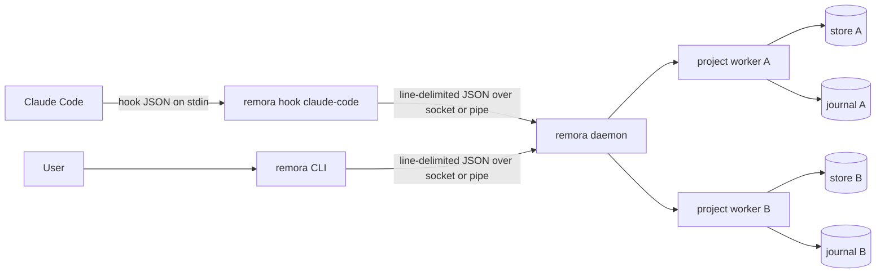
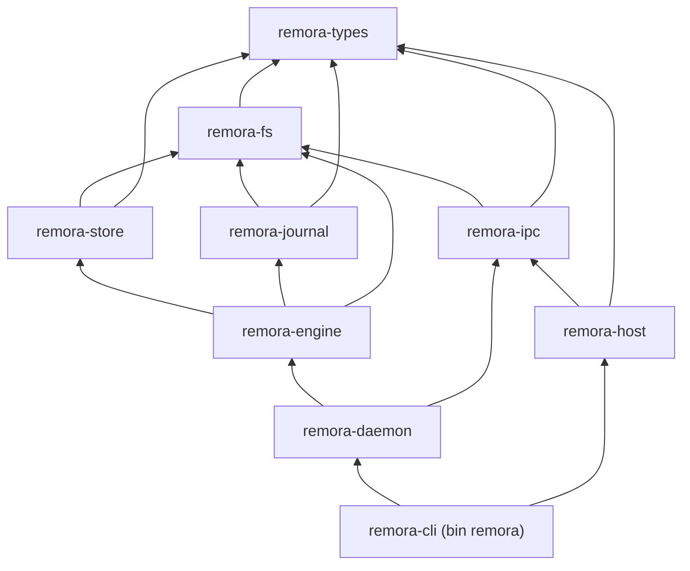
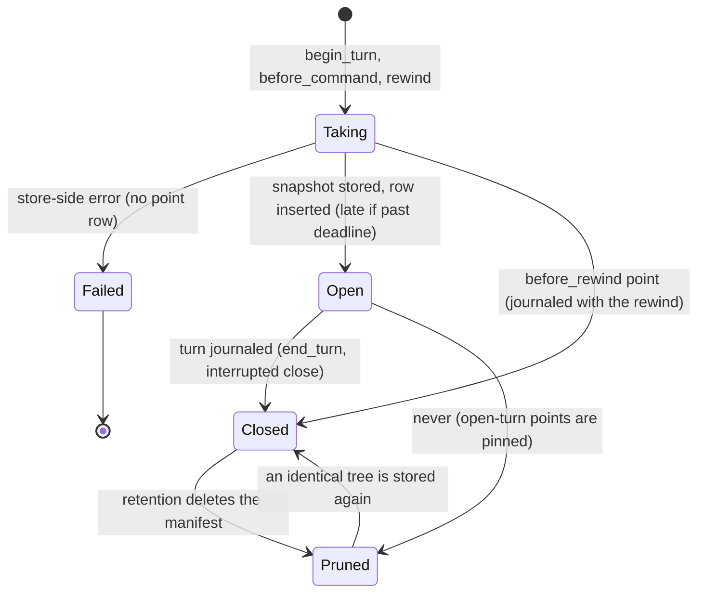
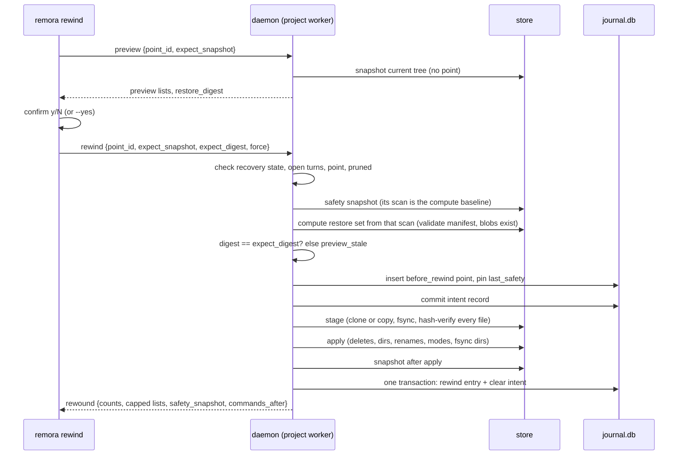
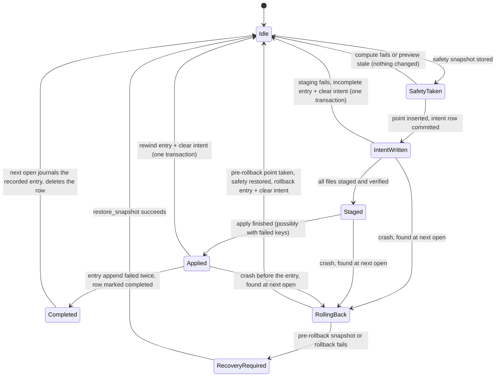
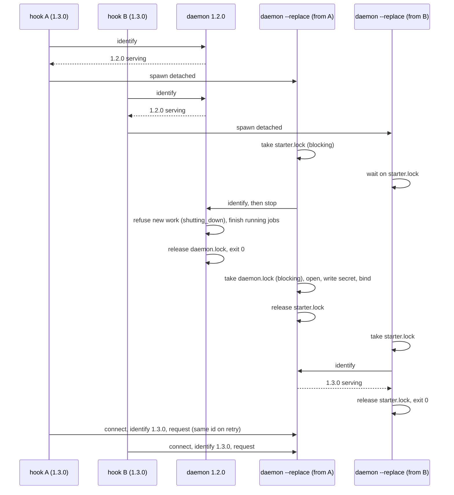
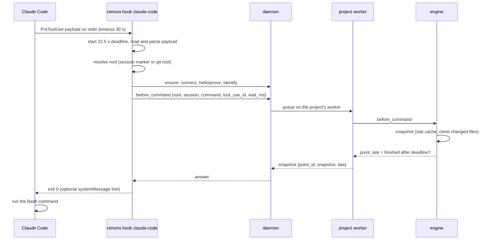

# Remora Technical Specification

**Version:** 1 (draft)
**Status:** Working draft. Normative for v1.

---

## 1. Overview and scope

Remora records what an AI coding agent does to a project's files and lets the developer rewind the project to any recorded point. It captures at the filesystem level, so changes made by shell commands (`rm`, `mv`, `sed -i`, build tools) are restored as well as changes made by the agent's own edit tools. It keeps a signed, hash-chained journal of every turn. It runs locally, makes no network calls and sends no telemetry.

### 1.1 Scope of v1

v1 consists of:

1. A Claude Code adapter driven by Claude Code hooks (§12).
2. A per-user daemon, started on demand by hooks and the CLI and optionally at login by the OS service manager (§11).
3. A content-addressed snapshot store with copy-on-write clones where the filesystem supports them and plain copies elsewhere (§7).
4. A signed, hash-chained journal in SQLite (§8).
5. The `remora` CLI: `init`, `uninit`, `status`, `log`, `rewind`, `forget`, `prune`, `verify`, `service`, plus the hidden `hook` and `daemon` subcommands (§13).
6. Linux, macOS and Windows, with service installation on each (§11.7).
7. Retention by age and size (§9.9).
8. A release pipeline producing archives, checksums, attestations, a crates.io package, a Homebrew formula and a winget manifest (§19).

Everything else is listed in §22 (D-01). The architecture leaves room for further host adapters (§3.4).

### 1.2 Goals

1. A developer installs Remora, runs `remora init`, and recovers a file that a shell command deleted, without reading documentation beyond the README quickstart.
2. A hook never blocks or breaks the agent. Failures turn into visible gaps in protection, never into a blocked tool call.
3. Every rewind can itself be undone, and a crash during a rewind leaves the project wholly in one state or the other.
4. Hooks add less than 50 ms at p99 on an unchanged 1,000-file project, checkpoints included (§16).
5. Other local users can neither read the recorded copies nor talk to the daemon.

### 1.3 Non-goals

- Undoing effects outside the project's files (pushes, network calls, database writes). These are listed after a rewind as "not undone", never faked.
- Whole-disk capture. The scope is one project root per session.
- Protection against a malicious process running as the same user. It is best-effort (§15.2).
- A GUI or TUI.

### 1.4 Conventions

- The key words MUST, MUST NOT, SHOULD, SHOULD NOT and MAY are used as described in RFC 2119 and RFC 8174.
- Sizes use KiB, MiB and GiB (1024-based) unless stated otherwise. Retention sizes use GB = 10^9 bytes (§14).
- Times on the wire and in records are milliseconds since the Unix epoch, signed 64-bit (`*_ms`).
- `<data>` is the data directory (§6.1). `<id>` is a project id (§6.3).
- **[verify]** marks a statement about third-party behaviour (Claude Code, an OS, a library) that a test or a manual check must confirm before code relies on it.
- `D-nn` refers to an entry of the decisions register (§20). Sections cite D-ids instead of repeating rationale.
- A rule is testable: each MUST in this document names a value, a path, a state or an observable behaviour that a test can check.

---

## 2. Terminology

| Term | Meaning |
|---|---|
| **Host** | The program whose actions Remora records. v1 has one host: Claude Code. |
| **Adapter** | Code that turns a host's events into daemon requests (§12). |
| **Project** | A directory tree Remora records, identified by its canonical root (§6.3). |
| **Root** | The canonical absolute path of a project's top directory. |
| **Session** | A host session, identified by the host's session id. One session records into one project. |
| **Turn** | The span from a user prompt to the host's stop event in one session. |
| **Implicit turn** | A turn opened by a command event when no turn was open. |
| **Command** | One shell command run by the host inside a turn. |
| **Snapshot** | An immutable record of a project tree: a manifest plus the blobs it references (§7). |
| **Manifest** | The list of a snapshot's entries with their metadata and content hashes (§7.3). |
| **Blob** | A file's content stored under its SHA-256 hash (§7.2). |
| **Store** | The manifests, blobs and stat cache of one project. |
| **Blob home** | The directory holding a project's blobs, chosen per volume (§7.7). |
| **Point** | A restore point: a snapshot with a kind, a time, a session and a label (§9.3). |
| **Checkpoint** | A point taken before a command. |
| **Safety snapshot** | The snapshot of the current tree that a rewind takes before changing anything. |
| **Rewind** | Restoring a project to a point (§9.6). |
| **Intent record** | The durable record of a rewind in progress (§9.7). |
| **Late point** | A point whose snapshot finished after the caller stopped waiting for it (§10.9). |
| **Unprotected path** | A path whose content a snapshot could not store (unreadable, too large, unsupported name). |
| **Journal** | The per-project signed hash chain of turn and rewind entries (§8). |
| **Head checkpoint** | The signed record of the journal's newest entry, kept outside the database (§8.6). |
| **Machine key** | The ed25519 key that signs every journal on this machine (§8.5). |
| **Daemon** | The long-running `remora daemon` process that owns all projects (§11). |
| **Client** | Any process that talks to the daemon: a hook or a CLI command. |
| **Budget** | The time a hook allows itself for one event, derived from the host timeout (§12.2). |
| **Pin** | An explicit reference that keeps a snapshot from being pruned (§9.9). |

---

## 3. Architecture

### 3.1 Process model

One binary, `remora`, plays three roles (D-03):

- **Hook:** `remora hook claude-code`, started by the host for each hook event. Short-lived. It reads one JSON payload on stdin, sends at most one request to the daemon, prints at most one JSON line, and exits 0.
- **CLI:** `remora <command>`, started by the user.
- **Daemon:** `remora daemon`, one per user and data directory. It owns every project, the journal and the store. Clients never touch project data directly.



### 3.2 Crates

The workspace has these crates. An arrow means "depends on". Lower crates MUST NOT depend on higher ones (D-02).

| Crate | Responsibility | May depend on (workspace crates) |
|---|---|---|
| `remora-types` | Wire messages, ids, typed error kinds, on-disk record types, version constants, the canonical journal encoding. No I/O. | none |
| `remora-fs` | The single filesystem and OS safety module: atomic writes, owner-only creation, fsync points, symlink-safe open and walk, canonicalization, volume identity, ACLs, file locks, detached process spawn, clones, randomness, root resolution, and SQLite connection setup behind the `sqlite` feature. Contains `sys`, the only module where `unsafe` is allowed (§3.5). | `remora-types` |
| `remora-store` | Blobs, manifests, stat cache, snapshot and restore, clone with copy fallback, blob homes. | `remora-types`, `remora-fs` |
| `remora-journal` | SQLite journal, signing, head checkpoint, verify. | `remora-types`, `remora-fs` |
| `remora-engine` | Projects, sessions, turns, points, timeline, preview, rewind, recovery, retention, forget. | `remora-store`, `remora-journal`, `remora-fs`, `remora-types` |
| `remora-ipc` | Transport (socket and pipe), framing, handshake, client, dedup keys. | `remora-types`, `remora-fs` |
| `remora-daemon` | Server, per-project workers, janitor, lifecycle, upgrade and replace, config loading, logging backend. | `remora-engine`, `remora-ipc`, `remora-store`, `remora-journal`, `remora-fs`, `remora-types` |
| `remora-host` | Claude Code adapter: payload parsing, event to request mapping, the per-event budget table. | `remora-types`, `remora-ipc` |
| `remora-cli` (bin `remora`) | CLI, hook runner, `init`, service installers. Links `remora-daemon` as a library; `remora daemon` runs it. | all of the above |
| `remora-testkit` | Test fixtures and harnesses. `publish = false`. Dev-dependency only. | any |
| `xtask` | Repository checks (layering, golden generation, CLI reference). `publish = false`. | none at build time; reads `cargo metadata` and runs generators that are examples of workspace crates (rule 5) |



Rules:

1. `remora-ipc` MUST NOT depend on `remora-engine`, `remora-store` or `remora-journal`. Only `remora-store` and `remora-journal` may enable the `sqlite` feature of `remora-fs` (D-80); every other edge to `remora-fs`, including the one from `remora-ipc`, MUST NOT name it. Wire types live in `remora-types`; the engine converts its own types to wire types at the daemon boundary.
2. `remora-host` MUST NOT depend on `remora-daemon` or `remora-engine`. A hook client therefore does not link the engine's logic. (The binary still links everything, because it is one executable; §16.3 covers what this costs.)
3. Only `remora-cli` installs a global logger. Library crates use the `log` facade.
4. `xtask layers` (D-71) reads `cargo metadata --format-version 1` and fails if any normal or build dependency edge between workspace crates is not in the table above, or if an edge enables a feature the rules forbid (it reads each edge's `features` from the metadata and allows `remora-fs/sqlite` only on the edges of rule 1). Dev-dependency edges to `remora-testkit` are allowed. CI runs it (§18).
5. Generators that need workspace types are examples of the crate that owns those types: `remora-types/examples/wire_golden.rs` writes the wire goldens (§17.4) and `remora-cli/examples/cli_docs.rs` renders the CLI reference from the `clap` definitions (§13.9). `xtask golden` and `xtask cli-docs` run them with `cargo run --locked --example` and write or compare the output, so `xtask` keeps no workspace dependency (D-87).

### 3.3 Concurrency model

- Threads, no async runtime (D-04).
- The daemon has one accept thread, one thread per connection, one worker thread per open project, and one janitor thread.
- A project worker executes that project's requests strictly in arrival order. Different projects run in parallel.
- A panic inside a request is caught at the worker boundary. The request is answered with `internal`, the worker drops its open project state, and the next request reopens it. A panic in one project MUST NOT affect requests for another project.
- A worker exits after 30 minutes without requests and releases its project lock and database handles.
- Only the daemon reads the wall clock for recorded times (D-05). Per project, a recorded time is `max(now_ms, last_ms + 1)`, where `last_ms` is the largest time recorded in that project, so recorded times are strictly increasing per project. When a project opens, `last_ms = max(points.at_ms, commands.at_ms, commands.ended_at_ms, open_turns.last_event_ms, ended_at_ms of the last entry)`. The engine receives time as an injected `Clock` (the trait `remora_types::time::Clock`, with `now_ms` and a monotonic reading, §4); the daemon passes its system clock (`remora_daemon::clock::SystemClock`) and tests pass the manual clock of `remora-testkit`. The engine applies `max(now_ms, last_ms + 1)` when it assigns a request's recorded time, which happens when the request reaches the project worker (§9.2 rule 10).

### 3.4 Host adapters

An adapter maps host events to the host-neutral requests of §10 (`begin_turn`, `before_command`, `after_command`, `end_turn`, `end_session`). Every request carries an `agent` string naming the adapter (`claude-code` in v1). The engine and the wire protocol contain nothing host-specific. Adding a host means adding a module to `remora-host`, a `remora hook <host>` subcommand and a host section like §12.

### 3.5 Unsafe code policy

- Every crate sets `unsafe_code = "forbid"` except `remora-fs` (D-06).
- In `remora-fs`, only the module `remora_fs::sys` and its submodules may contain `unsafe`. The rest of `remora-fs` sets `#![deny(unsafe_code)]` at module level and calls `sys` through safe functions.
- `sys` is built on `rustix` (Unix) and `windows-sys` (Windows). `libc` MAY be used for the macOS calls `rustix` does not wrap, and only for these: `fclonefileat` (§7.2), `acl_init`, `acl_set_fd_np` and `acl_free` (removing a blob's extended ACL, §7.9), `getentropy` (the random source) and `fpathconf` (case sensitivity, §5.6). Adding a call means adding it to this list (OQ-25).
- Every `unsafe` block MUST carry a `// SAFETY:` comment stating the invariant it relies on, and every `sys` function MUST have its own unit tests on each OS where it compiles.
- No code in the workspace starts a shell or an OS utility to read or change OS state (no `whoami`, `icacls`, `reg`, `id`, `powershell`, `cmd`). The only external programs Remora runs are `systemctl` (Linux) and `launchctl` (macOS) for service management, each call bounded by a 10 s timeout and its exit status checked (D-07).

---

## 4. Capability ownership

A capability has exactly one owner. Other code MUST call the owner and MUST NOT reimplement the capability (D-08). The roadmap column names the ROADMAP.md deliverable that builds each capability.

| Capability | Owner (crate::module) | Roadmap |
|---|---|---|
| Atomic write (temp, fsync, rename, fsync directory) | `remora_fs::atomic` | R0.7 |
| Owner-only file and directory creation, and the scoped umask for binding a socket (§5.1 rule 5) | `remora_fs::private` (Unix mode, Windows security descriptor via `sys`) | R0.6 |
| Fsync policy and the list of durability points | `remora_fs::durable` | R0.7 |
| Symlink-safe open, walk, unlink, rename, recursive delete (§9.10 rule 4, §15.3 item 8), and setting a file's times (§5.5 rule 7) | `remora_fs::nofollow` (on `sys::at`) | R0.8a, R0.8b (Windows) |
| Path canonicalization and case-folding comparison | `remora_fs::path` | R0.9a, R0.9b (case folding) |
| Quoting and unquoting command lines (POSIX shell, systemd `ExecStart`, Windows `CommandLineToArgvW` rules) | `remora_types::cmdline` (pure functions, called by `remora_fs::process` and `remora_cli::install`) | R1.4 |
| Volume identity and same-volume test | `remora_fs::volume` | R1.1 |
| ACL setup and verification (Windows), mode checks (Unix) | `remora_fs::acl` | R3.2 |
| Detached process spawn | `remora_fs::sys::spawn` (safe wrapper `remora_fs::process`) | R1.4 |
| File locks (instance, starter, project, data-dir) | `remora_fs::lock` | R1.2 |
| Clock trait | `remora_types::time::Clock` | R0.11 |
| System clock | `remora_daemon::clock::SystemClock` | R1.19 |
| Manual clock for tests | `remora-testkit` (`ManualClock`) | R0.10 |
| Environment value (variables and home directory, §14.4) | `remora_types::env::Env` (the value, R0.11); `remora_fs::env::capture` (reads it from the running process, R1.1) | R0.11, R1.1 |
| Project id derivation | `remora_types::ids::ProjectId::derive` | R0.11 |
| Config loading and reload | `remora_daemon::config` | R5.1 |
| Blob hashing (SHA-256) | `remora_store::hash` | R1.5 |
| Manifest codec and validation | `remora_store::manifest` | R1.6 |
| Copy-on-write clone with copy fallback | `remora_store::put` (clone primitive in `remora_fs::sys::clone`) | R1.5 (`put` and copy fallback), R3.1a, R3.1b (macOS), R3.1c (Windows) (clone primitive) |
| Journal canonical encoding | `remora_types::journal::encode` | R0.12 |
| Signing keys (create, load, zeroize) | `remora_journal::key` | R1.11 |
| Request ids and dedup window | `remora_ipc::request_id`, `remora_daemon::dedup` | R1.18 (`request_id`), R4.2 (`dedup`) |
| Replay of a retried `rewind` or `restore_snapshot` from its journal entry (§10.7) | `remora_engine::rewind` | R1.14 |
| Pin rows (§9.9) | `remora_engine::pins` | R3.6a |
| Injected services of the client roles (spawner, lock factory) passed to `hook::run` and `remora_cli::run` (§17.1 rule 1) | `remora_cli::Deps` (the `LockFactory` trait itself is in `remora_daemon::lifecycle`, R4.4) | R1.24 |
| Paging cursors | `remora_engine::cursor` (opaque to everyone else) | R3.5 |
| Error kinds | `remora_types::error::ErrorKind` | R0.11 |
| Version comparison (`semver` crate) | `remora_types::version` | R4.3 |
| Install-path discovery (stable executable path) | `remora_cli::install::exe` | R4.6 |
| Hook settings editing (`settings.json`) | `remora_cli::install::settings` | R1.25 |
| Service install per OS | `remora_cli::install::service` | R4.7a, R4.7b (macOS), R4.7c (Windows) |
| Ensure a current daemon (start or replace) | `remora_daemon::ensure` | R1.22 |
| Logging backend and rotation | `remora_daemon::logfile` | R1.20 |
| Text truncation at a UTF-8 boundary | `remora_types::text::cut` | R0.11 |
| `.remora-ignore` parsing | `remora_types::ignore` (parses bytes; the file is read through `remora_fs`) | R5.2 |
| Root resolution (git-root walk, refused roots) | `remora_fs::root` | R1.1 |
| SQLite open and hardening (pragmas, owner-only pre-create, foreign-file refusal) | `remora_fs::sqlite`, behind the cargo feature `sqlite` that only `remora-store` and `remora-journal` enable (D-80) | R1.3 |
| Endpoint derivation and socket-directory check | `remora_ipc::endpoint` | R1.15 |
| Daemon secret and handshake | `remora_ipc::auth` | R1.17 |
| OS random source (nonces, request ids, `turn_uid`, temporary and staging names) | `remora_fs::sys::random` | R0.5 |
| Host event table | `remora_host::claude_code::EVENTS` | R1.23 |
| Blob-home choice and checks | `remora_store::home` | R3.3a, R3.3b (Windows), R3.3c (adoption) |
| Test fixtures (trees, data dirs, in-process daemon, fake host payloads) | `remora-testkit` (D-55) | R0.10, R1.28 (in-process daemon, fake payloads) |
| Benchmarks | `remora-store/benches`, `remora-engine/benches`, `remora-cli/benches/process.rs` (fixtures from `remora-testkit`) | R6.3 |

---

## 5. Filesystem safety

`remora-fs` implements every rule in this section. Other crates MUST perform file operations on project trees, the data directory and blob homes only through it.

### 5.1 Owner-only creation

1. Every directory Remora creates MUST be owner-only from the moment it exists, except the Windows restore staging directory (§7.6). On Unix it is created with `mkdirat(dirfd, name, 0o700)`. On Windows it is created with `CreateDirectoryW` and a security descriptor whose owner is the current user's SID and whose DACL is protected and grants full control to the user SID and `SYSTEM` only, inheritable to files and subdirectories.
2. Every file Remora creates MUST be created with `O_CREAT | O_EXCL | O_NOFOLLOW | O_CLOEXEC` and mode `0o600` on Unix. On Windows it inherits the DACL of its owner-only parent. The one exception is a clone on macOS (§7.2): `fclonefileat` creates its destination itself, with the source's mode, so the clone is made inside an owner-only directory (the `tmp/` directory of a blob home, or the restore staging directory) and its mode is set to `0o600` on its descriptor before anything reads or writes it.
3. Remora MUST NOT create a file or directory and restrict it afterwards, except as rule 2 states. A `chmod` after creation is allowed only to restore a mode recorded in a manifest (§7.6).
4. A restored project file gets its recorded mode on the open descriptor before the rename that makes it visible (§7.6).
5. A Unix socket file gets its mode from the process umask at `bind`. The daemon binds through `remora_fs::private::with_umask(0o177, ...)`, which changes the umask under a process-wide mutex that every creation in `remora_fs::private` also takes, so no directory or file is created while the umask is changed (§10.2).

### 5.2 Checking existing state

1. When the daemon opens `<data>`, it MUST check that `<data>` is a real directory (not a symlink or junction) owned by the current user. On Unix, if the mode allows any group or other access, it is tightened to `0o700` through the open descriptor. On Windows, if the DACL grants anyone other than the user and `SYSTEM`, it is replaced by the protected DACL of §5.1. A directory owned by another user is refused with `unsafe_data_dir`.
2. Files directly inside `<data>` and `<data>/projects/<id>` are checked the same way at open: foreign owner refuses, loose mode is tightened.
3. The check is a pure function `check_private(meta: &PrivateMeta, me: &UserId) -> PrivateCheck` over metadata, so each branch (including a foreign owner, which needs root to produce on a real disk) is unit-tested.

### 5.3 Temporary files

1. A temporary file name is `.<purpose>.<16 lowercase hex random>.tmp`, created exclusively (§5.1). If the name exists, a new random name is drawn, at most 8 times, then the operation fails.
2. A temporary file is removed when the operation that created it fails.
3. Leftover temporary files in a store are removed only when older than 1 hour by mtime (§7.2). A store stamps each temporary file's mtime with the current time after cloning, because a clone keeps its source's mtime on APFS.

### 5.4 Atomic write

`write_atomic(dir, name, bytes, mode, purpose, point)`:

1. Create a temporary file in `dir` (§5.3).
2. Write `bytes`, set `mode` on the descriptor (Unix), `fsync` the file.
3. `renameat` the temporary file over `name`.
4. `fsync` `dir`.

On Windows, step 2 flushes through a writable handle (`FlushFileBuffers`), step 3 is the handle rename of §5.9 rule 2 (`FileRenameInformationEx` with POSIX semantics, falling back to `FileRenameInformation`), and step 4 is skipped: NTFS and ReFS journal the rename metadata.

`create_exclusive_atomic(dir, name, bytes, purpose, point)` is the no-replace variant used for the machine key: steps 1 and 2, then `renameat2(RENAME_NOREPLACE)` on Linux, `renameatx_np(RENAME_EXCL)` on macOS, and on Windows the handle rename of §5.9 rule 2 without `FILE_RENAME_REPLACE_IF_EXISTS` (falling back to `FileRenameInformation` with `ReplaceIfExists` false). If the filesystem does not support the no-replace rename, it falls back to `linkat` plus `unlinkat` of the temporary file. If neither works, it fails with `unsupported_filesystem`. If the target exists, the caller receives `AlreadyExists` and reads the existing file.

`purpose` is the `<purpose>` of the temporary file name (§5.3) and `point` the caller's durability point (§5.8), so every flush they make names its point.

### 5.5 Symlink-safe access

1. A project tree is walked through directory descriptors, starting from a descriptor of the root. Each subdirectory is opened with `openat(parent, name, O_DIRECTORY | O_NOFOLLOW)` (Unix) or relative to the parent handle with `FILE_FLAG_OPEN_REPARSE_POINT` and a check that the result is not a reparse point (Windows).
2. A symlink is recorded as a symlink and never followed. On Windows, symbolic links and junctions are both recorded as symlinks, except a mount-point reparse point whose target is a volume GUID path (`\??\Volume{...}\`): that is another volume mounted on a folder and is recorded as `opaque {other_filesystem}` (rule 4). Other reparse points are recorded as `opaque`.
3. A regular file is opened for reading with `O_NOFOLLOW | O_NONBLOCK`, then `fstat` MUST show a regular file with the same device and inode as the walk saw. Otherwise the entry is treated as changed during the snapshot and recorded as unprotected for this snapshot.
4. The walk MUST NOT cross into another filesystem. A directory whose device differs from the root's is recorded as `opaque` and neither entered nor touched by restore (D-59). A btrfs subvolume has its own `st_dev`, so a subvolume inside a project is `opaque` too; `status` lists such directories.
5. Restore writes, renames, deletes and mode changes MUST go through the descriptor of the parent directory, opened by the same no-follow walk from the root. Before each write the restore re-opens the parent chain and refuses to continue below any component that is not a real directory (§7.6).
6. Same-user races (an agent swapping a directory for a symlink between two system calls) are reduced by these rules but not excluded. §15.4 lists the residual.
7. Setting a file's times (the touch of a hook marker, §12.6 rule 6) goes through the parent's descriptor without following a symlink: `utimensat` with `AT_SYMLINK_NOFOLLOW` on Unix; on Windows `SetFileTime` on a handle opened relative to the parent with `FILE_FLAG_OPEN_REPARSE_POINT`.

### 5.6 Canonicalization

1. One function, `remora_fs::path::canonical(path)`, produces every path that is compared, hashed or recorded (D-10).
2. Unix: open the path with `O_DIRECTORY` (or `O_PATH` for files on Linux), then read the path back from the descriptor (`/proc/self/fd/<n>` on Linux, `fcntl(F_GETPATH)` on macOS). On macOS this yields `/private/var/...` for `/var/...` and the on-disk case of every component.
3. Windows: open the path and call `GetFinalPathNameByHandleW` with `FILE_NAME_NORMALIZED`. Strip the `\\?\` prefix for drive paths, keep `\\?\UNC\` as `\\server\share`, upper-case the drive letter. `subst` drives resolve to their target.
4. A path that does not exist is canonicalized by canonicalizing its deepest existing ancestor and appending the remaining components unchanged.
5. Canonical paths MUST be valid UTF-8 to be used as a root, a data directory or a blob home. A non-UTF-8 root is not recorded (§12.6).
6. Case-folding comparison (`path::eq_on(rule, a, b)`, where `rule` is the `CaseRule` that `path::case_rule(dir)` reads from the directory holding the names) compares component by component when the rule is case-insensitive: on macOS after NFD normalization plus simple Unicode case folding (case-insensitive APFS is also normalization-insensitive); on Windows with `CompareStringOrdinal(a, b, TRUE)` (NTFS's own upcase table); elsewhere with simple Unicode case folding. Case sensitivity is read per directory: `fpathconf(_PC_CASE_SENSITIVE)` on macOS, `FILE_CASE_SENSITIVE_INFO` per directory and `FILE_CASE_SENSITIVE_SEARCH` per volume on Windows, case-sensitive on Linux unless the directory has the casefold attribute (`FS_CASEFOLD_FL`).

### 5.7 Volume identity

- Unix: `st_dev` of the opened directory.
- Windows: the 64-bit volume serial number from `GetFileInformationByHandleEx(FileIdInfo)`, plus the volume mount path from `GetVolumePathNameW`. Two paths are on the same volume when the serial numbers are equal. Drive letters are not compared (folder mounts and `subst` would be misclassified).

### 5.8 Durability points

Remora MUST `fsync` at exactly these points (D-22). On macOS every flush is `F_FULLFSYNC`, because `fsync` there can leave the data in the drive's cache. On Windows, file flushes apply and directory flushes are skipped (§5.4).

| # | After | Flush |
|---|---|---|
| F1 | Writing a blob temporary file | the file |
| F2 | Renaming a blob into `blobs/<aa>/` | `blobs/<aa>/`, and `blobs/` if `<aa>` was created |
| F3 | Writing a manifest temporary file, then renaming it | the file, then `manifests/<aa>/`, and `manifests/` if created |
| F4 | Any `write_atomic` of a state file (`project.json`, `install.json`, `janitor.json`, `layout.json`, `journal.head`, `daemon.secret`, `daemon.failed`, `owner.json`, `.remora-store/.gitignore`, `settings.json` and `settings.json.remora-backup`, the systemd unit, the launchd plist) | the file, then its directory |
| F5 | Creating `machine.key` | the file, then `<data>` |
| F12 | Appending to `machine.keys.log` (`O_APPEND`) | the file, and `<data>` when the log was created |
| F6 | Creating any directory (`projects/<id>`, store fan-out directories, blob homes, `.remora-store`, restore directories) | the parent directory |
| F7 | Staging a restored file | the staged file |
| F8 | Applying a restore: each delete, directory create and rename | every directory whose entries changed, deepest first, then the root's parent if the root was recreated |
| (none) | Moving a corrupt blob to `quarantine/` | no flush: if the move is lost, the blob is detected as corrupt again |
| F9 | Removing the restore staging directory | the root directory |
| F10 | Every SQLite commit | SQLite with `synchronous = FULL` (§8.2) |
| F11 | Rotating a log file | none (logs are not durable state) |

Order constraints:

1. Every blob a manifest references MUST be durable (F1, F2) before the manifest's rename (F3).
2. A manifest MUST be durable before any database row references it (F10).
3. A rewind's intent record (F10) MUST be committed before the first change to the project tree.
4. Every change of a restore (F8) MUST be durable before the transaction that journals the rewind and clears the intent record.

### 5.9 Windows handle rules

These rules apply to every Windows open, rename and delete in a project tree, a store or `<data>` (D-77):

1. Every open uses `FILE_SHARE_READ | FILE_SHARE_WRITE | FILE_SHARE_DELETE` and `FILE_FLAG_OPEN_REPARSE_POINT`, plus `FILE_FLAG_BACKUP_SEMANTICS` for directories, so a snapshot never makes the agent's concurrent writes, deletes or renames fail. The identity check of §5.5 rule 3 compares the volume serial and 128-bit file id of `FILE_ID_INFO`.
2. Renames use `NtSetInformationFile(FileRenameInformationEx)` on a handle to the source, with `RootDirectory` set to the target's parent and `FILE_RENAME_REPLACE_IF_EXISTS | FILE_RENAME_POSIX_SEMANTICS | FILE_RENAME_IGNORE_READONLY_ATTRIBUTE` (the Win32 `SetFileInformationByHandle` refuses a `RootDirectory`). On `STATUS_INVALID_PARAMETER` or `STATUS_NOT_SUPPORTED` (a filesystem without POSIX renames) it falls back to the classic `FileRenameInformation` on the same handles, after clearing the target's read-only attribute, so the rename stays relative to the parent handle. A sharing violation fails that key with `in_use`.
3. Deletes use `SetFileInformationByHandle(FileDispositionInfoEx)` with `FILE_DISPOSITION_FLAG_DELETE | FILE_DISPOSITION_FLAG_POSIX_SEMANTICS | FILE_DISPOSITION_FLAG_IGNORE_READONLY_ATTRIBUTE`, so read-only blobs can be replaced, pruned and forgotten.

---

## 6. Data directory and on-disk layout

### 6.1 Location

| OS | Default `<data>` |
|---|---|
| Linux | `$XDG_DATA_HOME/remora`, else `~/.local/share/remora` |
| macOS | `~/Library/Application Support/remora` |
| Windows | `%LOCALAPPDATA%\remora` |

`--data-dir <DIR>` or the environment variable `REMORA_DATA_DIR` overrides it, for every command including `init`, `service` and `daemon`. A non-default data directory is written into the hook command and the service definition (§13.4), so all three roles agree.

`<data>` MUST be on a local filesystem: on Linux, `statfs` `f_type` MUST NOT be NFS, SMB2 or CIFS; on macOS the mount MUST have `MNT_LOCAL`; on Windows `GetDriveTypeW` MUST NOT be `DRIVE_REMOTE`. Otherwise the daemon refuses to start with `unsafe_data_dir {path, reason: "network"}`. Moving the data directory, or reaching it through a different canonical path, changes the `<home>` name and the `owner.json` check of every blob home on another volume (§7.7): those projects become `blob_store_unavailable {path, reason: "foreign_owner"}`, and `status` names the data directory recorded in `owner.json` with the hint `remora forget`, which removes the project's records and leaves that blob home for the user to delete (§9.10 rule 7, OQ-43). `<data>` is canonicalized once at daemon start; all later paths derive from the canonical form.

### 6.2 Layout

```
<data>/                               0700, owner-only
  layout.json                         {"layout": 1}
  config.toml                         optional, user-edited (§14)
  machine.key                         32-byte ed25519 seed, 0600 (§8.5)
  machine.keys.log                    every public key this data directory created, append-only (§8.8)
  install.json                        recorded install (§11.6)
  daemon.lock                         instance lock (§11.2)
  starter.lock                        starter lock (§11.3)
  daemon.secret                       64 hex chars, rewritten at each daemon start (§10.4)
  daemon.sock                         Unix socket, when its path fits (§10.2)
  daemon.failed                       last start failure, deleted by a serving daemon (§11.11)
  projects.lock                       data-dir lock (§9.12)
  install.lock                        serializes edits of settings.json and service definitions (§12.5)
  janitor.json                        {"layout":1,"last_prune_ms":i64}
  logs/daemon.log, logs/daemon.log.1  daemon log, rotated at 10 MiB
  logs/hook.log, logs/hook.log.1      hook log, rotated at 10 MiB
  hook/sessions/<session-id>          session root marker (§12.6)
  hook/warnings/<session-id>.<reason> once-per-session warning marker (§12.8)
  projects/<id>/                      0700
    project.json                      {"layout":1,"root":"<canonical root>","blob_home":"<abs path>"|null,"blob_home_reason":"<code>"}  (§7.7)
    journal.db                        SQLite: journal, points, open turns, intent, pins (§8)
    journal.head                      signed head checkpoint (§8.6)
    cache.db                          SQLite: stat cache (§7.4), disposable
    lock                              project lock
    manifests/<aa>/<62 hex>.json      manifests (§7.3)
    blobs/<aa>/<62 hex>               blobs, when the blob home is the data directory
    blobs/tmp/                        in-flight blob temporaries
    blobs/quarantine/                 corrupt blobs moved aside (§7.10)
```

A blob home on another volume (§7.7) has the same `blobs/` layout below its home directory, next to an `owner.json`, and its store directory holds a `.gitignore`.

Rules:

1. `layout.json` names the layout version. A daemon that finds a higher layout version than it supports MUST refuse to start with `format_too_new` and change nothing.
2. `<data>` MUST NOT be inside, equal to, or an ancestor of any recorded root. The engine checks this at every project open with canonical paths and the case-folding comparison of §5.6. A violating root is refused with `root_overlaps_data_dir` (D-09).
3. A store (blob home) MUST NOT be inside its project's root (§7.7).
4. No file in `<data>` is written outside `write_atomic`, `create_exclusive_atomic` (the machine key and the `hook/` markers), the blob sequence of §7.2 (exclusive temporary file in `blobs/tmp/`, then rename into place), renames of corrupt blobs into `blobs/quarantine/` (§7.10), renames of log files at rotation (§11.9), `O_APPEND` writes (`machine.keys.log` and the log files), SQLite, the lock files and the socket.

### 6.3 Project identity

1. The project id is the first 16 lowercase hex characters of `SHA-256(canonical root as UTF-8 bytes)` (D-10).
2. `project.json` records the root. If `project.json` exists and records a different root, the open fails with `project_mismatch` and nothing is written.
3. The recorded root is the project's identity for its whole life. If the root directory disappears, the project still exists: snapshots of a missing root record an empty tree with `root_missing: true`, and a rewind recreates the root (§7.6).
4. A root that exists but is not a directory is refused with `root_not_directory`.
5. `project.json` is written once when the project is created (under `projects.lock`) and rewritten only to record a blob home change, which v1 never makes.

### 6.4 Format compatibility

| Format | Version carrier | Older reader meets newer | Newer reader meets older |
|---|---|---|---|
| Data layout | `layout.json` | refuse (`format_too_new`), no writes | read; migrate forward only if a migration exists |
| Journal schema | `meta.schema_version` and `PRAGMA user_version` | refuse | migrate forward in one transaction (§8.3) |
| Journal entry encoding | `entry_format` byte in each entry | verify reports `unknown_entry_format` at that entry | verify each entry with its own format |
| Manifest | `format` field | refuse that manifest (`format_too_new`) | read |
| Stat cache | `cache.db` `meta.schema_version` | delete and rebuild | delete and rebuild |
| `project.json`, `install.json`, `janitor.json` | `layout` field (default 1) | refuse | read; unknown fields are an error |
| Wire | `v` field (§10.3) | `version_mismatch` with supported list | serve every version of the same major release |

Every format has a golden fixture of each released version in `testdata/`, and a test opens each fixture with the current code.

A downgrade (an older binary on data written by a newer one) refuses to open what it cannot read and leaves it untouched. The hook warns once per session with reason `daemon_too_old` or `format_too_new`.

---

## 7. Snapshot store

### 7.1 Model

A snapshot is a manifest plus the blobs it references. Blobs are content-addressed, so identical content is stored once per blob home, and identical trees produce byte-identical manifests with the same id (D-11).

`remora-store` exposes the store through a trait so the conformance suite (§17.2) runs the same tests on every filesystem:

```rust
pub trait Snapshotter {
    fn snapshot(&self, root: &RootDir, opts: &SnapshotOptions) -> Result<Snapshot, StoreError>;
    fn manifest(&self, id: &SnapshotId) -> Result<Manifest, StoreError>;
    fn compute_restore(&self, root: &RootDir, current: &Snapshot, target: &SnapshotId,
        opts: &SnapshotOptions) -> Result<RestoreSet, StoreError>;
    fn stage(&self, set: &RestoreSet) -> Result<Staged, StoreError>;
    fn apply(&self, staged: Staged) -> Result<RestoreReport, StoreError>;
}
```

`Snapshot` carries the snapshot id, counters (`entries`, `hashed_files`, `stored_files`, `cloned_files`, `bytes_read`, `stored_bytes` for the bytes of newly written blobs, and `manifest_bytes_written`, 0 when the manifest id already existed), the unprotected paths (capped at 1,000, with a total count), and its scan: per key, the node and the size, mtime and file id the walk saw. `compute_restore` takes the current tree from `current`, the scan of the snapshot the caller has just taken (§7.6), and apply rule 5 of §7.6 compares against the same scan. When a point's snapshot completes, its unprotected paths replace the rows of the `unprotected` table in `cache.db` (§7.4), and the `unprotected_meta` row of `cache.db` records the total and the snapshot id. After `cache.db` is rebuilt, `status` reports the unprotected list as `unknown` until the next point is taken. "The last snapshot" in `status` means the snapshot of the newest point.

### 7.2 Blobs

1. A blob's id is the lowercase hex SHA-256 of its content. It is stored at `<blob home>/<first 2 hex>/<remaining 62 hex>`.
2. Blobs are written only through this sequence (D-11):
   1. Create `<blob home>/tmp/.blob.<random>.tmp` exclusively (§5.3). On macOS this step and the clone of step 2 are one call: `fclonefileat` creates the temporary itself (an existing name fails with `EEXIST`, and a new name is drawn as in §5.3), then the clone's mode is set to `0o600` on its descriptor (§5.1 rule 2).
   2. Clone the source file into it through the source's open descriptor (§7.5, D-52). If cloning fails for any reason, copy the bytes from the same descriptor into a fresh temporary file (a failed clone on Windows can leave its target pending deletion, so the copy never reuses the failed name).
   3. Stamp the temporary file's mtime with the current time. On macOS, remove its extended attributes and its extended ACL, best-effort (§7.9).
   4. `fsync` it through a writable handle (F1).
   5. Hash the temporary file, not the source. The stored bytes therefore always match their id, even if the source changes during the copy.
   6. If `<aa>/<rest>` exists with the same size, delete the temporary file. Otherwise rename it into place and flush (F2).
3. Blob files are `0o400` on Unix after the rename (set on the descriptor before it). Windows blobs carry the read-only attribute.
4. Files larger than `max_file_bytes` (default 100 MiB, §14) are hashed from the source but not stored. Their manifest node has `stored: false`. They are unprotected: a rewind neither restores nor deletes them, and previews list them under `unrestorable`.
5. Leftover entries in `<blob home>/tmp/` older than 1 hour are deleted when the store opens. Younger ones belong to a concurrent snapshot and are kept.

### 7.3 Manifests

A manifest is a UTF-8 JSON document. Its id is the lowercase hex SHA-256 of its exact bytes. It is stored at `manifests/<aa>/<62 hex>.json` in `<data>/projects/<id>/`.

Encoding (fixed, so identical trees give identical ids):

```json
{"format":1,"root_missing":false,"options":{"exclude_names":[".venv","node_modules","target"],"exclude_paths":[],"max_file_bytes":104857600},"nodes":[
 ["link","symlink",{"target":"src/main.rs","dir":false}],
 ["mnt","opaque",{"why":"other_filesystem"}],
 ["src","dir",{"mode":493}],
 ["src/main.rs","file",{"hash":"9f86d0...","size":1204,"mode":420,"stored":true}]
]}
```

Rules:

1. Object keys appear in the order shown. `nodes` is sorted by the key's bytes. `exclude_names` and `exclude_paths` are sorted by their bytes, without duplicates, so the order of a configuration list never changes an id. The stored form contains no whitespace outside strings; the example above is wrapped for reading. Strings are written as the compact writer of `serde_json` writes them: `"` and `\` as `\"` and `\\`, U+0008, U+0009, U+000A, U+000C and U+000D as `\b`, `\t`, `\n`, `\f` and `\r`, any other character below U+0020 as `\u00xx` with lowercase hex digits, and every other character, including `/` and non-ASCII, as its UTF-8 bytes. Integers are decimal, without sign or leading zeros.
2. A key is a relative path with `/` separators. Each component is non-empty, is not `.` or `..`, contains no `/`, no NUL, and on Windows no `\`, `:` or a reserved device name (`CON`, `PRN`, `AUX`, `NUL`, `COM1` to `COM9`, `LPT1` to `LPT9`, with or without an extension).
3. Every proper ancestor of a key MUST be a `dir` node in the same manifest.
4. `hash` is 64 lowercase hex characters. `mode` is an integer in `0..=0o1777`. `size` is a non-negative integer.
5. Node types: `dir {mode}`, `file {hash, size, mode, stored}`, `symlink {target, dir}` (target is UTF-8, stored as read; `dir` is true for a Windows directory symlink or junction and false for every other link, on Unix always false; restore uses it on Windows to create a file or directory symlink, §7.9), `opaque {why}` where `why` is one of `other_filesystem`, `special` (FIFO, socket, device), `reparse_point`, `unreadable`, `path_too_long`, `changed_during_snapshot`.
6. `options` records the exclusions and the size limit the snapshot was taken with (§7.8).
7. On load, a manifest MUST be validated: its id equals the SHA-256 of the bytes read, it parses with exactly this schema (unknown fields are an error), and rules 2 to 4 hold. A manifest failing validation is reported as `store_damaged` and is never used for a restore.
8. On a case-insensitive volume, a manifest with two keys equal under the volume's comparison (§5.6 rule 6, which on macOS includes Unicode normalization) MUST NOT be restored (it cannot come from a scan of that volume).
9. Manifests are written with `write_atomic` (F3). If a manifest with the same id exists, its bytes are compared and rewritten on mismatch.

### 7.4 Change detection

A snapshot must not re-read unchanged files (D-14). The stat cache in `cache.db` maps a path to the hash of the content seen with given metadata:

```sql
PRAGMA application_id = 1380799043;   -- 0x524D5243, "RMRC"

CREATE TABLE meta (key TEXT PRIMARY KEY, value TEXT NOT NULL) WITHOUT ROWID;
  -- keys: schema_version ('1' in v1, §6.4)

CREATE TABLE stat (
  path      BLOB PRIMARY KEY,   -- manifest key bytes
  size      INTEGER NOT NULL,
  mtime_ns  INTEGER NOT NULL,
  ctime_ns  INTEGER NOT NULL,   -- Unix st_ctime; Windows ChangeTime
  file_id   BLOB    NOT NULL,   -- Unix st_dev+st_ino; Windows 64-bit volume serial + 128-bit file id
  hash      TEXT    NOT NULL,
  stored    INTEGER NOT NULL
) WITHOUT ROWID;

CREATE TABLE unprotected (
  key       BLOB PRIMARY KEY,   -- path bytes; non-UTF-8 names included
  why       TEXT NOT NULL       -- an opaque reason of §7.3, or name_not_utf8
) WITHOUT ROWID;              -- at most 1,000 rows: the newest point's snapshot

CREATE TABLE unprotected_meta (
  id        INTEGER PRIMARY KEY CHECK (id = 1),
  total     INTEGER NOT NULL,   -- unprotected paths before the cap
  snapshot  TEXT NOT NULL       -- the snapshot the rows belong to
);
```

Rules:

1. A file is a cache hit only if `size`, `mtime_ns`, `ctime_ns` and `file_id` all equal the walk's values, and, when `stored = 1`, the blob file exists in the blob home (one `fstatat` on the blob path).
2. **Racy window:** a file whose `mtime_ns` is within 2 seconds before the snapshot's start, or later, MUST be re-read and MUST NOT be written to the cache.
3. A cache row whose hash is malformed is ignored and replaced.
4. Oversized files are cached by metadata like other files (`stored = 0`), so an unchanged large file is not re-hashed.
5. Removing a blob (prune, quarantine, forget) deletes the cache rows that reference it in the same critical section.
6. `cache.db` is disposable. If it is missing, damaged, foreign (another `application_id`) or of another schema version (`meta.schema_version`), it is deleted and rebuilt empty. Its loss costs one full re-hash, never correctness.
7. The cache is per project and written only by that project's worker.
8. On Windows, the walk reads size, times and file ids from the directory enumeration (`GetFileInformationByHandleEx` with `FileIdExtdDirectoryInfo` on the directory handle), so a cache hit costs no per-file open. On Unix, a cache hit costs one `fstatat` per entry.

The cost of a snapshot is therefore one metadata record per entry plus reading, hashing and storing the changed files only (§16.2).

### 7.5 Taking a snapshot

1. Open the root with the no-follow rules of §5.5. If the root does not exist, produce a manifest with `root_missing: true` and no nodes.
2. Load the effective options (§7.8) and read `.remora-ignore` patterns.
3. Walk the tree in key order. For each entry, decide its node type and, for files, look it up in the stat cache.
4. For each cache miss: open the file (no-follow, `O_NONBLOCK`), confirm identity with `fstat`, and store it (§7.2), or hash it only when oversized.
5. Classify failures by side (D-11):
   - **Source side** (the file cannot be opened or read: permission denied, locked by another process on Windows, `EIO`, vanished, changed type): the entry becomes `opaque {unreadable}` or `opaque {changed_during_snapshot}` and is added to the unprotected list. The snapshot continues.
   - **Store side** (a blob or temporary file cannot be created, written, flushed or renamed; disk full): the snapshot fails with `snapshot_failed {cause: "store_write"}` and no manifest is written.
6. Write the manifest (F3), then update the stat cache in one SQLite transaction.
7. Cosmetic steps (clearing macOS extended attributes, removing old temporary files) log and continue on failure. They MUST NOT fail a snapshot.
8. An entry whose name is not valid UTF-8 (Unix) or not valid UTF-16 (Windows) is not recorded: it and everything below it are left out of the manifest and listed as unprotected, displayed with each invalid byte escaped as `\xNN` (D-56). Restore never deletes or changes such an entry and never deletes a directory that contains one.

### 7.6 Restore

Restore never trusts the store (D-13). It runs in three phases: compute, stage, apply. Nothing in the project tree changes before apply.

**Compute.** `compute_restore(root, current, target)`:

1. Load and validate the target manifest (§7.3). Failure: `store_damaged`.
2. Take the current tree from `current`, the scan of the snapshot the caller has just taken: the safety snapshot for a rewind (§9.6 step 4), the preview snapshot for a preview (§9.5). One walk serves both; there is no second scan. Compute, per key:
   - `restore`: present in the target, absent now;
   - `revert`: present in both with a different type, content or mode;
   - `delete`: absent in the target, present now;
   - `unrestorable`: `stored: false` in the target, or an `opaque` node;
   - `skip`: under an excluded name or path in either the target's recorded options or the current options (the union), or under `.remora-store*` or `.remora-restore-*`;
   - `skip` with reason `untouchable`: a current entry that is `opaque`, has `stored: false`, or is not recorded (non-UTF-8 name). `delete` never contains such an entry, and a directory is in `delete` only if everything inside it is in `delete`; otherwise the directory is skipped. Entries in `skip` never make a rewind incomplete.
3. Every key in `restore` or `revert` whose target node is a file needs its blob. The restore set lists the blobs and checks that each exists. A missing blob fails the compute phase with `store_damaged {missing}` before anything else happens.

**Stage.** `stage(set)` (D-54):

1. Create `<root>/.remora-restore-<16 hex>/` owner-only (F6). If the root does not exist, create it first (mode `0o700` until apply ends). On Windows the staging directory and staged files are created with the default security of their parent instead, and after each rename into place, and for each directory apply creates, `SetSecurityInfo` with `UNPROTECTED_DACL_SECURITY_INFORMATION` and an empty explicit ACL makes the entry inherit from its new parent (D-83). A restored file therefore has the same DACL as a file newly created in its directory.
2. For each needed file: clone or copy the blob into the staging directory, `fsync` it (F7), hash the staged copy and compare with the blob id. A mismatch moves the blob to `<blob home>/quarantine/` (so the next snapshot of the same content rewrites it) and fails the stage with `store_damaged {corrupt}`. Set the target mode on the descriptor.
3. If staging fails, remove the staging directory and return the error. The project tree is unchanged except for the staging directory, which is removed.

**Apply.** `apply(staged)`, in this order:

1. Deletions, deepest key first. A directory that contains a skipped (excluded) entry is not deleted; it is reported in `skipped`.
2. Type changes: remove the current entry, then treat the key as `restore`.
3. Directory creations, shallowest first, each created `0o700`.
4. Files: `renameat` from the staging directory into place. If the parent directory is read-only, its owner write bit is added for the duration and its recorded mode is set again in step 6.
5. Symlinks: `symlinkat` to a temporary name in the parent, then `renameat` over the target.
6. Directory modes, deepest first, from the target manifest.
7. Flush every directory whose entries changed (F8), remove the staging directory and flush the root (F9).

Rules for every apply step:

1. A write happens only through the descriptor of a parent directory reached by the no-follow walk (§5.5). If any component of the parent chain is a symlink, a junction, or not a directory, that key fails with `unsafe_parent` and is reported. Nothing is written through it.
2. On a case-insensitive volume, the existence checks and the ancestor rule use the case-folding comparison.
3. Restore never sets the set-user-id or set-group-id bits. A recorded mode is applied as `mode & 0o1777`.
4. Restored files get the current time as mtime (§7.9).
5. Before deleting or replacing a key, apply compares its current size, mtime and file id with the compute scan, which is the safety snapshot's scan. A difference (a write after the safety snapshot, for example by an agent running during a `--force` rewind) fails that key with `changed_during_rewind`; the newer content is left in place.
6. Each key that fails is recorded in `failed` with an error code (§10.12) and the restore continues with the next key. The caller decides what a partial apply means (§9.6).
7. A manifest whose own keys break rule 2 or 8 of §7.3 is refused as a whole at compute (`store_damaged`). The per-key codes cover what only the current tree shows: `case_collision` for a key to create that equals, under the volume's comparison, a current entry that restore leaves in place (excluded, `opaque`, unstored or not recorded); `reserved_name` for a create the OS refuses because it treats the name as a device name (for example a name with trailing dots or spaces that §7.3 rule 2 does not list). On Windows apply also checks each key against the list of §7.3 rule 2 right before its create.

`RestoreReport` carries counts (`restored`, `reverted`, `deleted`, `cloned`, `skipped`, `failed`, `unrestorable`) and the lists of `skipped`, `failed` and `unrestorable` keys. On the wire these lists are capped (§10.8).

### 7.7 Blob homes

Clones work only within one volume, so a project on another volume than `<data>` keeps its blobs on its own volume (D-12). Manifests and the stat cache always stay in `<data>/projects/<id>/`.

| Case | Blob home |
|---|---|
| Root on the same volume as `<data>` | `<data>/projects/<id>/blobs` |
| Root on another volume, Unix, an anchor exists | `<anchor>/.remora-store/<home>/blobs` |
| Root on another volume, Windows, local volume whose mount path is a strict ancestor of the root | `<mount path>\.remora-store-<user SID>\<home>\blobs` |
| Any other case (no anchor, UNC path, network or unsupported volume, mount path equals the root, any check fails) | `<data>/projects/<id>/blobs` (plain copies), with a reason code |

`<home>` is `<id>-<first 16 hex of SHA-256(canonical data dir)>`, so two data directories that record the same root never share a blob home (D-74). The home directory holds `owner.json` = `{"layout":1,"data_dir":"<canonical data dir>","project_id":"<id>"}`, written with `write_atomic` (F4) when the home is created. At every open the daemon compares it with the opening data directory and project; a mismatch is `blob_store_unavailable {reason: "foreign_owner"}`.

The blob home is chosen once, when the project is created under `projects.lock`, and recorded in `project.json` with `blob_home_reason` (`same_volume`, `anchor`, `volume_root`, `no_safe_anchor`, `network_volume`, `root_is_volume_root`, `check_failed`). `blob_home_reason` is never null. `blob_home` is null exactly when the store is the data directory store (`<data>/projects/<id>/blobs`, reasons `same_volume`, `no_safe_anchor`, `network_volume`, `root_is_volume_root`, `check_failed`), so moving the data directory does not invalidate those projects; for `anchor` and `volume_root` it is the absolute path of the home's `blobs` directory. Any other combination makes `project.json` invalid (`corrupt_state`). Later opens use the recorded home. If the recorded blob home is missing or fails its checks, every snapshot and restore for the project fails with `blob_store_unavailable {path, reason}`, where `reason` is `missing`, `foreign_owner` (its `owner.json` names another data directory or project) or `check_failed`. Remora MUST NOT switch to another blob home silently.

#### 7.7.1 Unix anchor

Given the canonical root `R`, the data directory `D` and the effective user id `U`:

1. If `st_dev(R) == st_dev(D)`, use the data directory store.
2. A directory is **safe** when its owner is `U` or root (uid 0) and it is not writable by group or others, or it is writable by them but has the sticky bit set.
3. The anchor is the highest strict ancestor `A` of `R` such that `st_dev(A) == st_dev(R)`, `A` is owned by `U`, `A` is not writable by group or others, and every ancestor of `A` up to `/` is safe.
4. If no such `A` exists, use the data directory store with reason `no_safe_anchor`. `status` names the folder that ruled the choice out (writable by others, or owned by another user), so a volume on a system with umask `002` is explained.
5. `<A>/.remora-store` is created owner-only (`0o700`), contains a `.gitignore` with the single line `*`, and holds one `<home>` directory per project and data directory.
6. At every project open, the daemon re-checks `A`'s ancestors (rule 3), and that `.remora-store`, `<home>` and `blobs` are real directories owned by `U` with no group or other access. Failure: `blob_store_unavailable`.
7. Rules 2 to 5 apply only to a root on a local filesystem. After rule 1, a root on a network filesystem (the tests of §6.1 applied to the root's volume) uses the data directory store with reason `network_volume`.

#### 7.7.2 Windows volume root

1. If the volume serial of the root equals that of `<data>`, use the data directory store.
2. `M` is the volume mount path of the root (`GetVolumePathNameW`). If the root is a UNC path or on a network volume (`GetDriveTypeW` is `DRIVE_REMOTE`), use the data directory store with reason `network_volume`; if `M` equals the root, with reason `root_is_volume_root`.
3. `M\.remora-store-<SID>` is created with the security descriptor of §5.1 in the same call (`CreateDirectoryW` with `SECURITY_ATTRIBUTES`), so there is no window in which it exists with another DACL. `<SID>` is the string SID of the current process token's user (`GetTokenInformation(TokenUser)`). An elevated process uses the same user SID and sets it explicitly as owner.
4. At every open, `.remora-store-<SID>`, `<home>` and `blobs` MUST each be a real directory (no reparse point), owned by the user SID, with a protected DACL whose entries grant access to the user SID and `S-1-5-18` (SYSTEM) only. Comparison is by SID. Failure: `blob_store_unavailable`.

#### 7.7.3 Adoption and crash windows

| Window | What a crash leaves | Behaviour at the next open |
|---|---|---|
| W1 | `.remora-store` (or `.remora-store-<SID>`) created, `.gitignore` missing | Adopt if the checks of §7.7.1 rule 6 or §7.7.2 rule 4 pass; write `.gitignore` |
| W2 | `<home>/blobs` created, `project.json` not yet written | The project is created again under `projects.lock`; the same path is computed; the existing directories are adopted if they pass the checks and `owner.json` names this data directory |
| W3 | `project.json` written, no blob stored yet | Normal open |
| W4 | A blob temporary file in `tmp/` | Removed when older than 1 hour (§7.2) |
| W5 | A folder at the store path that Remora did not create (another user, or wrong DACL or mode) | Refused, reason `check_failed`; the project uses the data directory store only if it is being created now; a recorded home fails with `blob_store_unavailable` |
| W6 | Recorded home vanished (volume unmounted, folder deleted) | `blob_store_unavailable`; never recreated silently while the project has manifests referencing it. `remora status` shows the path. Recreating it requires `remora forget` |
| W7 | Two first opens of projects on the same volume | Serialized by `projects.lock`; the second finds the store created by the first and adopts it |
| W8 | `<home>` exists without `owner.json` | Refused (`check_failed`) unless the project is being created now under `projects.lock`, in which case `owner.json` is written |

Adoption is safe because only the owning user (or an administrator, outside the threat model) can create a directory owned by the user's uid or SID with an owner-only ACL.

### 7.8 Exclusions

1. Built-in excluded directory names, at any depth: `node_modules`, `target`, `.venv`. Built-in excluded name patterns, at any depth, never configurable: `.remora-store`, `.remora-store-*`, `.remora-restore-*`.
2. `config.toml` `[snapshot] exclude_names` adds directory names (§14).
3. `.remora-ignore` at the root (§12.6) may add patterns (D-67): a line `<name>/` excludes every directory with that exact name at any depth; a line `/<relative path>` excludes that path; a line `*` (or an empty file) opts the whole repository out; lines starting with `#` and blank lines are ignored. Any other line makes the file invalid; an invalid `.remora-ignore` opts the repository out and the hook warns once per session.
4. `.git` is snapshotted like any other directory (D-23). Rewinding restores the repository's refs, index and objects together with the working tree, so the two stay consistent.
5. An excluded entry is never read, stored, restored, deleted or changed by restore. A manifest records the options it was taken with; restore skips the union of recorded and current exclusions (§7.6).

### 7.9 Metadata policy

What a snapshot captures and a restore sets back (D-57):

| Metadata | Linux | macOS | Windows |
|---|---|---|---|
| File content | captured, restored | captured, restored | captured, restored |
| Permission bits | `mode & 0o1777` | `mode & 0o1777` | read-only attribute only, as mode `0o444` or `0o644`; directories `0o755` |
| Set-user-id, set-group-id | not captured | not captured | n/a |
| Symlink target | captured (UTF-8 only) | captured (UTF-8 only) | captured; junctions recorded as symlinks, restored as file or directory symlinks by the recorded target type [verify privilege] |
| Owner and group | not captured | not captured | not captured |
| Timestamps | not restored (restore sets now) | not restored | not restored |
| Extended attributes | not captured | not captured; cleared from blobs best-effort | not captured (alternate data streams are not captured) |
| ACLs | not captured | not captured; extended ACL removed from blobs best-effort | not captured; restored files inherit the parent DACL |

Because blobs carry no extended attributes or ACLs, a restored file never inherits those of an unrelated source. A failed best-effort removal is logged once per daemon lifetime and never fails a snapshot.

### 7.10 Damage detection

1. Snapshot: an existing blob with the expected size is reused; one with a different size is replaced.
2. Restore: every staged copy is hashed (§7.6). A corrupt blob is moved to `quarantine/` and its stat cache rows deleted, so the next snapshot of that content stores it again.
3. `remora verify --store` reads every manifest and every blob of the project, validates manifests, re-hashes blobs, quarantines corrupt ones, recomputes `store_stats` from a walk of the blob home and the manifests, and reports counts and the first 100 damaged items. It holds the project worker for its duration and never changes the journal.

### 7.11 Limits

| Item | Limit |
|---|---|
| File stored in the store | `max_file_bytes`, default 100 MiB, configurable 1 MiB to 64 GiB |
| Manifest key | 4,096 bytes; a longer path becomes `opaque {path_too_long}` and is unprotected |
| Symlink target | 4,096 bytes |
| Unprotected paths kept per snapshot | first 1,000 in key order plus a total count |
| Directory depth walked | 256; deeper entries are unprotected (`path_too_long`) |


---

## 8. Journal

### 8.1 Contents

Each project has one SQLite database, `journal.db` (D-15). It holds the signed hash chain and the unsigned operational tables the engine needs. The signed chain is the record; the operational tables are an index and a work area that `verify` cross-checks against the chain (D-51).

```sql
PRAGMA application_id = 1380799041;   -- 0x524D5241, "RMRA"

CREATE TABLE meta (key TEXT PRIMARY KEY, value TEXT NOT NULL) WITHOUT ROWID;
  -- keys: project_id, root, created_by (remora version),
  --       verifying_keys (JSON list of {"from_seq": n, "key": "<64 hex>"}, §8.5),
  --       head_conflict, head_recreated_at_ms (§8.6)
CREATE TABLE schema_version (
  version       INTEGER PRIMARY KEY,
  applied_at_ms INTEGER NOT NULL,
  applied_by    TEXT NOT NULL                -- remora version that applied it
);

-- Signed chain.
CREATE TABLE entries (
  seq          INTEGER PRIMARY KEY,           -- 1, 2, 3, ... without gaps
  entry_format INTEGER NOT NULL,              -- 1 in v1
  body         BLOB NOT NULL,                 -- canonical encoding, §8.4
  hash         BLOB NOT NULL,                 -- 32 bytes
  signature    BLOB NOT NULL,                 -- 64 bytes
  request_id   TEXT UNIQUE                    -- unsigned copy of a rewind's request id (§10.7); verify cross-checks it
);

-- Operational tables (unsigned).
CREATE TABLE open_turns (
  session_id       TEXT PRIMARY KEY,
  turn_uid         TEXT NOT NULL UNIQUE,      -- 32 hex, random
  agent            TEXT NOT NULL,
  prompt           TEXT,
  started_at_ms    INTEGER NOT NULL,
  start_point_id   INTEGER,                   -- NULL only while the start snapshot failed
  implicit         INTEGER NOT NULL,          -- 0 or 1
  late_start       INTEGER NOT NULL,
  transcript_path  TEXT,
  begin_request_id TEXT NOT NULL,
  last_event_ms    INTEGER NOT NULL
);
CREATE TABLE commands (
  command_id    INTEGER PRIMARY KEY,
  turn_uid      TEXT NOT NULL,
  session_id    TEXT NOT NULL,
  at_ms         INTEGER NOT NULL,
  ended_at_ms   INTEGER,
  command       TEXT NOT NULL,                -- cut to 16 KiB
  agent_type    TEXT,
  tool_use_id   TEXT,
  exit_code     INTEGER,
  point_id      INTEGER,
  late          INTEGER NOT NULL,
  entry_seq     INTEGER                       -- NULL while the turn is open
);
CREATE INDEX commands_at ON commands (at_ms);
CREATE UNIQUE INDEX commands_tool ON commands (session_id, tool_use_id) WHERE tool_use_id IS NOT NULL;
CREATE TABLE points (
  point_id      INTEGER PRIMARY KEY,          -- per project, never reused
  kind          TEXT NOT NULL,                -- turn_start | before_command | before_rewind
  session_id    TEXT NOT NULL,
  turn_uid      TEXT,
  at_ms         INTEGER NOT NULL UNIQUE,
  snapshot_id   TEXT NOT NULL,
  label         TEXT NOT NULL,                -- cut to 512 bytes
  late          INTEGER NOT NULL,
  rolled_back   INTEGER NOT NULL,             -- safety point of a rewind that was rolled back
  damaged       INTEGER NOT NULL,             -- snapshot absent from its entry (§8.8); rewind refused
  entry_seq     INTEGER,                      -- journal entry that closed it
  pruned_at_ms  INTEGER
);
CREATE INDEX points_snapshot ON points (snapshot_id);
CREATE TABLE pins (
  snapshot_id   TEXT NOT NULL,
  reason        TEXT NOT NULL,                -- newest | open_turn | last_safety | intent | preview
  expires_at_ms INTEGER,                      -- NULL = until removed
  PRIMARY KEY (snapshot_id, reason)
) WITHOUT ROWID;
CREATE TABLE rewind_intent (
  id              INTEGER PRIMARY KEY CHECK (id = 1),
  request_id      TEXT NOT NULL,
  origin          TEXT NOT NULL,              -- rewind | restore_snapshot
  safety_snapshot TEXT NOT NULL,
  safety_point_id INTEGER NOT NULL,
  target_snapshot TEXT NOT NULL,
  target_point_id INTEGER,
  staging_name    TEXT NOT NULL,              -- .remora-restore-<16 hex>
  started_at_ms   INTEGER NOT NULL,
  completed_at_ms INTEGER,                    -- apply finished but the entry could not be appended (§9.6)
  completion      BLOB                        -- encoded entry fields to journal at the next open
);
CREATE TABLE recovery (
  id              INTEGER PRIMARY KEY CHECK (id = 1),
  safety_snapshot TEXT NOT NULL,
  failed_at_ms    INTEGER NOT NULL,
  error           TEXT NOT NULL
);
CREATE TABLE store_stats (
  id INTEGER PRIMARY KEY CHECK (id = 1),
  blob_count        INTEGER NOT NULL,
  blob_bytes        INTEGER NOT NULL,
  manifest_bytes    INTEGER NOT NULL           -- counted in the size cap (§9.9)
);
```

Schema version 1 contains all the tables and columns above, including `late`, `late_start`, `implicit`, `tool_use_id`, `damaged` and the rewind intent fields, and entry format 1 (§8.4.2) carries `interrupted`, `incomplete` and the rewind targets in the signed body, so no migration is needed before the first format change (D-18).

### 8.2 SQLite settings

Every connection MUST set these before any statement that reads or writes the database's tables (D-19). One exception keeps a foreign file untouched: on an existing file, the read-write open sets `journal_mode` only after the read-only check of §8.3 rule 2 has passed, because switching a rollback-journal file to WAL rewrites its header.

| Setting | Value | Why |
|---|---|---|
| `PRAGMA trusted_schema` | `OFF` | no functions run from schema objects |
| `SQLITE_DBCONFIG_DEFENSIVE` | on | blocks schema corruption through `PRAGMA writable_schema` |
| `PRAGMA foreign_keys` | `ON` | |
| `PRAGMA journal_mode` | `WAL` | readers do not block the writer |
| `PRAGMA synchronous` | `FULL` | a commit is durable when it returns (F10) |
| `PRAGMA cell_size_check` | `ON` | detects some page corruption early |
| `PRAGMA busy_timeout` | `5000` | |
| Extension loading | disabled (not compiled in) | |

`journal.db`, its `-wal` and `-shm` files are created owner-only: the database file is pre-created with `create_private_file` before SQLite opens it, and SQLite creates the side files with the database file's mode on Unix. A read-only open (§8.3 rule 3) may create a missing `-wal` or `-shm` file when the directory is writable [verify]; it gets the same mode, and nothing is written to the database file.

SQLite is bundled (`rusqlite` with `bundled`), so every platform runs the same SQLite version.

### 8.3 Opening, versioning and migration

1. **Open for writing** (daemon only): create the file if missing, then in one `BEGIN IMMEDIATE` transaction: if the database has no tables, create the schema, set `application_id`, insert `schema_version (1, ...)`, set `PRAGMA user_version = 1`, fill `meta` (including `verifying_keys` with the machine public key from `seq` 1, §8.5 rule 5; the caller passes the key). Creation and version stamping are one transaction, so a crash or two concurrent first opens leave either nothing or a complete version 1 database. A test opens the same new file from 8 threads at once.
2. **Refuse foreign files:** before an existing, non-empty file is opened for writing, a read-only connection checks that its `application_id` is `0x524D5241` and that it has the `entries` table. Otherwise the open fails with `foreign_database` and the file is never modified.
3. **Open read-only** (`verify`, diagnostics, the check of rule 2): `mode=ro` URI, fails with `not_found` if the file does not exist, never creates the database file or writes to it (side files: §8.2).
4. **Versions:** the current schema version is `MAX(version)` of `schema_version`, and MUST equal `PRAGMA user_version`. A mismatch is `corrupt_state`. A version higher than the binary supports is refused with `format_too_new` and nothing is written.
5. **Migrations** are forward-only. Migration `n` to `n+1` runs in one `BEGIN IMMEDIATE` transaction that changes the schema, inserts the `schema_version` row and sets `user_version`. A failed migration rolls back completely and the open fails with the cause. Read-only opens accept every version from 1 to the current one. v1 ships with no migrations; the mechanism and its test (a synthetic migration in the test suite applied to a version 1 fixture) exist from v1.
6. Signed entries are never rewritten by a migration. New entry fields require a new `entry_format` (§8.4.4).

### 8.4 Canonical entry encoding

An entry's hash covers a canonical byte encoding defined here, not a serializer's output (D-16). The encoding includes `seq` and the previous hash.

#### 8.4.1 Primitives

| Type | Encoding |
|---|---|
| `u8` | 1 byte |
| `bool` | `u8` 0 or 1; any other value is invalid |
| `u32`, `u64` | big-endian, 4 or 8 bytes |
| `i32`, `i64` | two's complement big-endian, 4 or 8 bytes |
| `h32` | 32 raw bytes (a SHA-256 value) |
| `str` | `u32` byte length, then that many bytes of valid UTF-8; length at most 1,048,576 |
| `opt<T>` | `u8` 0 (absent), or `u8` 1 followed by `T` |
| `list<T>` | `u32` item count, then the items in order |

A decoder MUST reject any input that does not round-trip: invalid `bool` or `opt` tags, invalid UTF-8, lengths past the end, trailing bytes. Re-encoding a decoded entry MUST give the original bytes.

#### 8.4.2 Entry, format 1

Fields in this exact order:

| # | Field | Type | Meaning |
|---|---|---|---|
| 1 | `entry_format` | `u8` | 1 |
| 2 | `seq` | `u64` | equals the row's `seq` |
| 3 | `prev_hash` | `h32` | hash of entry `seq - 1`; 32 zero bytes for `seq = 1` |
| 4 | `kind` | `u8` | 1 = turn, 2 = rewind |
| 5 | `session_id` | `str` | host session id; `remora-rewind` for rewinds started by the CLI and for rollback entries |
| 6 | `agent` | `str` | adapter name (`claude-code`) or `remora` |
| 7 | `turn_uid` | `str` | 32 hex; for rewinds, the request id; for rollback entries (origin 3), a fresh random value, so a retried rewind after a rollback runs again |
| 8 | `started_at_ms` | `i64` | |
| 9 | `ended_at_ms` | `i64` | at least `started_at_ms` |
| 10 | `start_snapshot` | `opt<h32>` | turn: start snapshot; rewind: safety snapshot |
| 11 | `end_snapshot` | `opt<h32>` | turn: snapshot at close; rewind: snapshot after apply |
| 12 | `prompt` | `opt<str>` | cut to 4 KiB |
| 13 | `implicit` | `bool` | turn opened by a command event |
| 14 | `interrupted` | `bool` | turn closed without a stop event, or rewind rolled back |
| 15 | `late_start` | `bool` | start snapshot finished after the caller's deadline |
| 16 | `incomplete` | `bool` | rewind that did not finish cleanly, or turn closed from a damaged open-turn row (§9.11) |
| 17 | `rewind_origin` | `u8` | 0 none, 1 rewind to a point, 2 raw snapshot restore, 3 rollback at recovery |
| 18 | `rewind_target` | `opt<h32>` | snapshot restored (or attempted) |
| 19 | `rewind_target_point` | `opt<u64>` | point id, when the target was a point |
| 20 | `commands` | `list<Command>` | in `at_ms` order, at most 10,000 |
| 21 | `commands_total` | `u64` | number of commands before the cap |
| 22 | `changes` | `list<Change>` | at most 100,000, in path byte order |
| 23 | `changes_total` | `u64` | number of changes before the cap |

A decoder MUST reject a body larger than 64 MiB.

`Command`:

| # | Field | Type |
|---|---|---|
| 1 | `command` | `str` (cut to 16 KiB) |
| 2 | `tool_use_id` | `opt<str>` |
| 3 | `agent_type` | `opt<str>` |
| 4 | `at_ms` | `i64` |
| 5 | `ended_at_ms` | `opt<i64>` |
| 6 | `exit_code` | `opt<i32>` |
| 7 | `checkpoint` | `opt<h32>` |
| 8 | `late` | `bool` |

`Change`: `path` (`str`, manifest key), `kind` (`u8`: 1 added, 2 removed, 3 modified, 4 type changed, 5 mode changed).

#### 8.4.3 Hash and signature

```
hash      = SHA-256( "remora/journal/v1/entry" || 0x00 || body )
signature = Ed25519-sign( machine key, "remora/journal/v1/sig" || 0x00 || hash )
```

Verification uses `verify_strict`. The domain strings make an entry hash unusable as any other Remora signature input.

#### 8.4.4 Evolution

1. A new field requires a new `entry_format` value. Format `n+1` MAY add fields only after the last field of format `n`, so a format `n+1` decoder can share code with format `n`.
2. A verifier MUST verify each entry with the rules of its own `entry_format`. An unknown format is reported as `broken {seq, unknown_entry_format}`; it is not skipped.
3. `testdata/journal/v1/` holds golden vectors: for each vector, the logical entry as JSON, the body as hex, the hash, the signature under a fixed test key, and the test key's public key. A test re-encodes, re-hashes and re-signs each vector and compares bytes. A change that alters any vector byte fails CI.

### 8.5 Machine key

1. One ed25519 key per machine and data directory, at `<data>/machine.key`: exactly 32 raw bytes (the seed), owner-only (D-15).
2. Creation: generate the seed from the OS random source, write it with `create_exclusive_atomic` (§5.4). If the call reports `AlreadyExists`, another process won the race: read and use the existing key. A crash after the key is created and before its public key is appended to `machine.keys.log` is covered by rule 7, which appends it at the next open.
3. Loading: the file MUST be exactly 32 bytes. Any other length is `invalid_key`, and Remora MUST NOT overwrite the file.
4. The seed is held in a type that zeroizes on drop and implements neither `Debug` nor `Display`.
5. `meta.verifying_keys` records, per journal, each public key used and the first `seq` it signed: `[{"from_seq": 1, "key": "<64 hex>"}]`. The bootstrap transaction (§8.3 rule 1) writes the first item with the machine public key. When a project opens and the machine key's public key differs from the last entry of the list, the daemon appends `{"from_seq": <next seq>, "key": ...}` (D-82).
6. All journals of the data directory share the key. If `machine.key` is lost, a new key is created; existing entries still verify with the key recorded for their `seq`, and `verify` reports the change as `key_changed {seq}`.
7. `<data>/machine.keys.log` holds every public key this data directory has used, one line of 64 lowercase hex characters each (D-85). At every `Engine::open`, if the machine public key is not in the log, it is appended before anything is signed. A missing log is recreated holding only the current key, and `status` reports the recreation once. Appends open the owner-only file with `O_APPEND | O_NOFOLLOW` (created with `create_private_file` if missing), write one line, and `fsync` (F12). Lines that are not 64 lowercase hex characters are ignored and reported by `status`.

### 8.6 Head checkpoint

The hash chain alone cannot show that the newest entries were deleted. The head checkpoint can (D-17).

`<data>/projects/<id>/journal.head`, written with `write_atomic` after every committed append:

```json
{"format":1,"seq":42,"hash":"<64 hex>","signature":"<128 hex>"}
```

`signature = Ed25519-sign(machine key, "remora/journal/v1/head" || 0x00 || u64be(seq) || hash)`.

At project open (write mode):

| Database tail vs head | Action |
|---|---|
| equal | none |
| database ahead, and entries `head.seq + 1 ..` chain from `head.hash` | crash between commit and head write: rewrite the head |
| database behind (`head.seq > max(seq)`) | the journal was truncated: record the old head in `meta.head_conflict`, rewrite the head from the database tail, keep recording; `verify` reports `truncated` from then on and `status` shows it |
| head hash differs from the entry at `head.seq` | as above, with reason `head_mismatch` |
| head signature invalid | as above, with reason `bad_head_signature` |
| head missing, database has entries | write a new head, set `meta.head_recreated_at_ms`; `verify` reports it |

Recording continues in every case. The conflict stays visible in `verify` and `status` (D-68).

### 8.7 Appending

`append` runs in one `BEGIN IMMEDIATE` transaction:

1. Read the last `(seq, hash)`.
2. Encode the body with `seq + 1` and `prev_hash = hash`, hash it, sign it.
3. Insert the entry (with `request_id` for a rewind or raw restore), and in the same transaction update the operational tables the entry closes: set `entry_seq` on its commands and points, delete its `open_turns` row, delete the `rewind_intent` row when the entry is a rewind.
4. Commit (F10), then write the head (F4).

Because the entry and the open-turn deletion commit together, closing a turn twice is impossible: a second `end_turn` for the same session finds no open turn and is a no-op.

### 8.8 Verify

`verify` opens the journal read-only and walks every row from `seq = 1`:

1. Read each column with type checks. A column of the wrong type is reported, never returned as an error.
2. `seq` MUST be contiguous from 1.
3. Decode `body` (§8.4.1). Its `seq` MUST equal the row's.
4. `prev_hash` MUST equal the previous entry's hash.
5. The stored hash MUST equal the recomputed hash.
6. The signature MUST verify with `verify_strict` under the key that `meta.verifying_keys` records for that `seq` (D-82). The private machine key is not needed; its public key is derived from `machine.key`. Because `meta` is unsigned, verify also records a `foreign_keys` finding `{seq, key}` for each entry whose recorded key is neither the current machine public key nor listed in `<data>/machine.keys.log` (§8.5 rule 7, D-85). A foreign key is a warning, not a broken link: the walk continues, so a later real break is still reported.
7. After the last row, compare with the head checkpoint (§8.6).
8. Cross-check the operational tables: every point with an `entry_seq` names a snapshot present in that entry (start snapshot, a command checkpoint, or the safety snapshot). A mismatch is reported as `index_mismatch`, together with a mismatch between `entries.request_id` and the `turn_uid` in the body. Nothing is rebuilt: point ids, labels, pins and prune state exist only in the operational tables. When `verify` runs through the daemon, the worker afterwards sets `damaged = 1` on each mismatching point; a rewind to it is refused with `unknown_point`.

Result:

```
intact { entries, head: "matches" | "recreated", verifying_keys, key_changed: [seq, ...], foreign_keys: [{seq, key}, ...] }
broken { seq, reason }   reason ∈ unparseable | seq_gap | chain_broken | hash_mismatch | bad_signature
                                   | unknown_entry_format | truncated | head_mismatch | bad_head_signature
                                   | index_mismatch
```

`verify` reports and never repairs (D-15). It reports the first broken link only.

### 8.9 Limits of tamper evidence

The journal detects accidental damage and partial tampering: an edited entry, a deleted middle entry, a truncated tail with the head intact, a database copied from another machine or data directory (its earlier keys are reported as `key_changed` and, when absent from `machine.keys.log`, as `foreign_keys`; the warning stays for the life of the journal, OQ-44). It does not resist a process running as the same user, which can read `machine.key` and rewrite the database and the head together. A process that rewrites entries, re-signs them with a fresh key and replaces `meta.verifying_keys` is reported in `foreign_keys` unless it also appends that key to `machine.keys.log`, which a same-user process can do: the log is a tamper signal against accidents and careless edits, not a defence against the same user. `remora verify --json` prints the verifying keys, so a user who records it elsewhere can later check that a journal was signed by that key. External anchoring is future work (§22).

---

## 9. Engine

`remora-engine` holds the project state machine. It reads time only through the `Clock` the daemon injects (§3.3), and has no transport and no host knowledge.

### 9.1 Projects

1. `Engine::open(data_dir)` checks `<data>` (§5.2), loads or creates the machine key (§8.5) and reads `layout.json`.
2. `Engine::project(root)` canonicalizes the root (§5.6), refuses roots that overlap `<data>` (`root_overlaps_data_dir`), computes the id (§6.3), and:
   - if `projects/<id>/project.json` exists: checks the recorded root (`project_mismatch` on a difference) and opens;
   - otherwise: takes `projects.lock`, re-checks, chooses the blob home (§7.7), creates `projects/<id>/` and its contents, writes `project.json` last, releases the lock.
3. Opening a project takes the project lock (§9.12), opens `journal.db` for writing (§8.3), reconciles the head (§8.6), runs recovery if an intent record exists (§9.7), removes blob temporaries older than 1 hour, removes `.remora-restore-*` directories in the root that no intent row names, that are owned by the user and older than 1 hour, and sweeps stale open turns (§9.2 rule 7).
4. The outcome of a failed open is cached for the daemon's lifetime with a retry delay of 10 seconds doubling to 10 minutes, so a broken project does not retry on every hook call. A successful `restore_snapshot` or `forget` resets the delay. A failed rollback is not an open failure: the project opens in recovery required (§9.7) and the rollback is never retried automatically.
5. Background work (janitor) opens only projects that are recorded in `projects/` and whose `project.json` reads; it never creates a project directory, never recreates a deleted root, and closes every project it opened when done (D-36).

### 9.2 Sessions and turns

A session records into one project. Each session has at most one open turn.

1. **`begin_turn {session, agent, prompt, transcript_path, wait_ms}`:**
   - If the session has an open turn whose `begin_request_id` equals this request's id, return its start point (retry).
   - If it has another open turn, close that turn first as `interrupted` (rule 5). A host that sends no stop event on a user interrupt (§12.4) produces this case.
   - Take a snapshot, create a `turn_start` point labelled with the prompt (cut to 512 bytes, or `(no prompt)`), insert the `open_turns` row. If the snapshot finished after the deadline (§10.9), set `late_start` and the point's `late`.
2. **`before_command {session, agent, command, tool_use_id, agent_type, wait_ms}`:**
   - If a command with this `(session, tool_use_id)` exists, return its point (retry).
   - If the session has no open turn, open an implicit turn (`implicit = 1`, no prompt) whose start point is this command's checkpoint.
   - Take a snapshot, create a `before_command` point labelled with the command (prefixed `[<agent_type>] ` when set, cut to 512 bytes), insert the `commands` row. A late snapshot sets `late` on the command and the point, and `late_start` on an implicit turn it opened.
3. **`after_command {session, command, tool_use_id, exit_code}`:**
   - With `tool_use_id`: the command with that id gets `ended_at_ms` and `exit_code`. A command already ended is left unchanged (retry). An unknown id is recorded as a new command without a checkpoint when the session has an open turn; otherwise the event is logged and dropped.
   - Without `tool_use_id`: the most recent command of the session with the same text and no `ended_at_ms` is paired. This fallback exists for hosts that do not send ids; with parallel identical commands it may pair the wrong one, which only affects the recorded exit codes.
4. **`end_turn {session}`:** take an end snapshot, compute `changes = diff(start snapshot, end snapshot)`, and append a `turn` entry with the turn's commands (§8.7). No open turn: a no-op answered `turn_ended {seq: null}`.
5. **Closing as interrupted** (by `begin_turn`, `end_session` or the janitor): as `end_turn`, with `interrupted = true`.
6. **`end_session {session, reason}`:** closes the session's open turn as interrupted; no-op if none.
7. **Stale turns:** an open turn whose `last_event_ms` is more than 6 hours old is closed as interrupted by the janitor (§11.8). A turn waiting on a long permission prompt stays open for up to 6 hours (D-36).
8. Any request of a session updates `last_event_ms` of its open turn.
9. A session id MUST be 1 to 128 characters from `[A-Za-z0-9_-]`. Others are refused with `invalid_request {field: "session"}`.
10. A request gets one recorded time when it arrives at the worker. The point and the command row a request creates share that `at_ms`, so a late point keeps its place in the timeline.
11. `after_command`, `end_turn`, `end_session` and `prune` for a root that is not recorded answer `unknown_project` and never create a project.

If the start snapshot of a turn fails, the turn is still opened with `start_point_id = NULL` and the error is returned. Its commands still take checkpoints. A turn closed without a start snapshot records `start_snapshot` absent and no `changes`.

### 9.3 Points

A point is a row of `points` (§8.1). Kinds:

| Kind | Created by | Snapshot | Label |
|---|---|---|---|
| `turn_start` | `begin_turn` | the tree before the turn | the prompt |
| `before_command` | `before_command` | the tree before the command | the command |
| `before_rewind` | rewind and raw restore | the safety snapshot | `before rewind to #<point id>` or `before restore of <first 12 hex>`; `rewind interrupted, rolled back` after a rollback |

1. Point ids are assigned by SQLite (`INTEGER PRIMARY KEY` without reuse: the table is never emptied, rows are never deleted while the project exists).
2. `at_ms` is unique per project (§3.3), so ordering by `at_ms` is total. The timeline is per event and time-ordered, across all sessions (D-20).
3. Listing reads only the `points` table through its primary key and the `at_ms` index, newest first, one page at a time (§10.8). It never decodes journal entries.
4. A point is identified on the wire by `point_id`. Requests that act on a point also carry the snapshot id the client saw (`expect_snapshot`); a mismatch, or a point with `damaged = 1` (§8.8), is `unknown_point`.
5. `#N` in the CLI is a position in the current listing (newest is `#1`); the CLI always resolves it to a `point_id` before acting and prints the point it resolved.



### 9.4 Commands after a point

Preview and rewind return the commands recorded at or after the point: every `commands` row, in any session, with `at_ms` greater than or equal to the point's `at_ms`, oldest first. The bound includes the command whose checkpoint the point is, because its external effects are exactly what a rewind to "before command" cannot undo. These are the actions a rewind does not undo (pushes, network calls, database writes). The list is capped at 100 commands, each cut to 512 bytes, plus `commands_total`.

### 9.5 Preview

`preview {point_id, expect_snapshot}`:

1. Take a snapshot of the current tree (no point, no journal entry). Pin it with reason `preview` for 1 hour.
2. Compute the restore set from the current snapshot to the point (§7.6, compute phase only).
3. Return the lists `restore`, `delete`, `revert`, `unrestorable`, `skipped` (each capped, §10.8), `commands_after`, the point (with `late`), `current_snapshot` (pinned) and `restore_digest`.

`restore_digest` is `SHA-256("remora/restore-digest/v1" || 0x00 || tuples)`, where `tuples` is the list of `(list name, key, target)` tuples of `restore`, `revert` and `delete`, sorted by the bytes of list name and then of key, encoded with the primitives of §8.4.1 as `list<T>` (a `u32` count, then each tuple as three `str`). `target` describes the target node: `file:<hash>:<mode>`, `dir:<mode>`, `symlink:<f or d>:<target>` (`d` when the node's `dir` is true), and `absent` for `delete`; `<mode>` is the recorded mode in octal digits without prefix or leading zeros (`644`, `1777`). A mode-only revert and a changed link target therefore change the digest. It identifies what the rewind will change, not the whole tree.

A preview never changes the project tree, the journal or the points. The rewind that follows carries `expect_digest = restore_digest`. The daemon recomputes the restore set from the safety snapshot and refuses the rewind with `preview_stale` only if the digest differs, so what the user confirmed is what happens, while changes outside the restore set (an editor refreshing `.git/index`, a log file) do not refuse it; the safety snapshot captures them (D-65).

`preview_snapshot {snapshot}` does the same for a raw snapshot id (the escape hatch of §9.8).

### 9.6 Rewind

`rewind {point_id, expect_snapshot, expect_digest, force}`:



Steps and their failure rules:

| Step | On failure |
|---|---|
| 1. Project in recovery (§9.7) | `recovery_required {safety_snapshot}` |
| 2. Open turns and `force = false` | `turn_in_progress {sessions, sessions_total}` with up to 20 open-session items (§9.13), each with `transcript_mtime_ms`, the transcript file's modification time, when `transcript_path` is known and the file can be read |
| 3. Point lookup (`point_id`, `expect_snapshot`) | `unknown_point`; a pruned point: `pruned {pruned_at_ms}` |
| 4. Safety snapshot | `snapshot_failed`; nothing changed |
| 5. Compute the restore set from the safety snapshot's scan (validate manifest, every needed blob exists) | `store_damaged`; nothing changed |
| 6. `expect_digest` given and different from the recomputed digest | `preview_stale {restore_digest}`; nothing changed |
| 7. Insert the `before_rewind` point, pin `last_safety` | error returned with `safety_snapshot`; nothing changed |
| 8. Commit the intent record (§9.7) | error; nothing changed |
| 9. Stage | staging removed; journal an `incomplete` rewind entry with `end_snapshot` equal to the safety snapshot (the tree is unchanged) and no changes, and clear the intent, in one transaction; `rewind_incomplete {safety_snapshot, tree_changed: false}` |
| 10. Apply | keys that fail are collected; the apply continues |
| 11. Snapshot after apply | the entry records no `end_snapshot` and no `changes`; `incomplete = true` |
| 12. Journal the entry and clear the intent | retried once; if the append fails twice, a separate transaction sets `rewind_intent.completed_at_ms` and stores the entry's fields in `completion` (rule 2) |

Rules:

1. The safety snapshot is taken before anything changes, and every rewind that wrote an intent record is journaled, complete or not (D-21).
2. When the rewind call returns, its intent row is either deleted together with the appended entry or marked completed (step 12). A completed row is journaled from its recorded fields and deleted at the next open; it is never rolled back. If marking it also fails, the error is logged and the next open rolls back after taking a pre-rollback snapshot (§9.7), so the finished restore stays reachable as a point.
3. Success requires an empty `failed` list. A rewind with failed keys returns `rewind_incomplete {safety_snapshot, tree_changed: true, failed (capped), failed_total}` and is journaled with `incomplete = true`. A partial success is not a success (§13.6).
4. The rewind entry has `kind = rewind`, `start_snapshot = safety`, `end_snapshot = after apply`, `rewind_target`, `rewind_target_point`, `changes = diff(safety, after apply)`, and `turn_uid = request id` (also stored in `entries.request_id`) so a retried request can find it (§10.7). Before step 1, a rewind or raw restore looks up `entries.request_id`; a match is answered from the entry as §10.7 describes, and nothing runs again.
5. A rewind runs on the project worker and is never cut short by a client disconnect or a daemon stop request (§11.5).

### 9.7 Intent record and recovery

The intent record is the `rewind_intent` row (§8.1). It is written in its own committed transaction after the safety snapshot and before the first change to the tree.



**Recovery at open.** If `rewind_intent` has a row when a project opens:

1. If the row has `completed_at_ms`: append the entry stored in `completion` and delete the row in one transaction. Nothing is rolled back.
2. Otherwise take a snapshot of the current tree and insert it as a `before_rewind` point labelled `before rollback of an interrupted rewind`, pinned with reason `intent` (D-75). Recovery can run hours after the crash, at the first request after a reboot, and the agent or the user may have changed the tree since; this point keeps those changes reachable. If this snapshot fails, do not roll back: write the `recovery` row and enter recovery required.
3. If the staging directory named in the row exists inside the root, matches `.remora-restore-<16 hex>`, and is owned by the user, remove it.
4. Restore the safety snapshot with compute, stage and apply (§7.6). No new safety snapshot is taken; the pre-rollback point of step 2 serves as one.
5. In one transaction: append a rewind entry with `rewind_origin = 3`, `session_id = remora-rewind`, a fresh random `turn_uid`, `interrupted = true`, `start_snapshot = safety`, `rewind_target = the interrupted target`; set `rolled_back = 1` and the label `rewind interrupted, rolled back` on the safety point; delete the intent row.
6. Queue a `rewind_rolled_back` notice: the next snapshot answer to each session of this project carries it once (§12.8).

**Failed rollback.** If step 2, 4 or 5 fails, the intent row stays, a `recovery` row is written, and the project is in **recovery required**:

- Recording continues: `begin_turn`, `before_command`, `after_command`, `end_turn` and `end_session` are served, and their `snapshot` answers carry the `recovery_required` notice (§10.11), which the hook shows once per session (D-72). Snapshots do not change the tree, and points taken now are the user's protection while the project is in this state.
- Also allowed: `status`, `list_points`, `list_unprotected`, `verify`, `preview_snapshot`, `restore_snapshot`, `forget`.
- Refused with `recovery_required {safety_snapshot}`: `rewind`, `preview` and `prune`.
- A failed rollback is never retried automatically. Only `restore_snapshot` leaves recovery required.
- `restore_snapshot` in recovery (to any snapshot, usually the safety snapshot or the pre-rollback point) replaces §9.6 step 8 with one transaction that appends the interrupted rewind's entry (`incomplete = true`, `interrupted = true`, origin and target from the old intent row), deletes the old intent and `recovery` rows, and inserts its own intent row (D-86). From then on it is an ordinary raw restore: a crash is recovered from the new intent row like any rewind, and on success its own entry is appended and its intent deleted. If it ends with any result other than success after the handover (staging or apply failed, `rewind_incomplete`), the engine inserts a new `recovery` row naming its own safety snapshot in the same transaction that journals it, so `status` never shows `ok` over a half-restored tree.

The crash tests of §17.6 leave a project in each state of this diagram and reopen it.

### 9.8 Raw snapshot restore

`restore_snapshot {snapshot, expect_digest, force}` restores any snapshot by id. It is the manual way out when a rewind is incomplete or a rollback failed (D-21).

1. It follows §9.6 with these differences: no point lookup (the snapshot id is validated: 64 lowercase hex, manifest present and valid), `rewind_origin = 2`, and it is allowed in the recovery-required state.
2. Its CLI path (`remora rewind --snapshot <id>`) skips every pre-check except connecting to the daemon, and shows a preview from `preview_snapshot` before confirming (§13.6).
3. The open-turn check applies unless `force`.

### 9.9 Retention

Defaults: points older than 30 days are pruned, and the oldest points are pruned while the project's store (blobs plus manifests) exceeds 10 GB (10^9 bytes) (D-50). Both values come from `config.toml` (§14).

**Pins.** A snapshot referenced by a pin is never pruned. Pins are explicit rows, not inferred from file times:

| Reason | Snapshot | Lifetime |
|---|---|---|
| `newest` | the newest point's snapshot | until a newer point exists |
| `open_turn` | start points and checkpoints of open turns | until the turn closes |
| `last_safety` | the safety snapshot of the most recent rewind or raw restore | until the next rewind |
| `intent` | safety and target of a live intent or recovery row, and the pre-rollback point of §9.7 | until the row is deleted |
| `preview` | a preview's current snapshot | 1 hour |

A pin row is keyed by snapshot and reason, so holders that share a snapshot share the row. When a holder changes (a point is inserted, a turn closes, an intent or `recovery` row is written or deleted), the rows of the reasons it holds are recomputed from all their holders in the same transaction: `newest` from the newest point, `open_turn` from the points of open turns, `intent` from the live intent and `recovery` rows and the pre-rollback point. A row is never deleted by snapshot id alone. `last_safety` is replaced at each rewind and raw restore, and `preview` rows expire (D-90).

A manifest with no point and no pin (an unused preview, a snapshot whose operation failed) is deleted once it is older than 1 hour by its file mtime.

**Algorithm** (`prune {dry_run}`, run by the janitor daily and by `remora prune`):

1. Read every live manifest once and build a reference count per blob. If any manifest cannot be read or validated, log it, keep going for the age phase, and skip the sweep (step 5).
2. **Age phase:** every point with `at_ms < now - days * 86,400,000` whose snapshot is not pinned is marked for pruning.
3. **Size phase:** walking the remaining unpinned points oldest first, mark each and subtract the bytes of blobs whose reference count reaches zero and of manifests no unmarked point or pin references, until the projected size (blobs plus manifests) is at most the cap.
4. Delete each manifest that no unmarked point and no pin references. In one transaction set `pruned_at_ms` on the marked points whose manifest was deleted; a marked point whose manifest survives (a newer point shares it) stays restorable and unmarked.
5. **Sweep** (only if every manifest was read): delete blobs with a reference count of zero whose mtime is older than 1 hour, delete their stat cache rows, and recompute `store_stats` from the walk of the blob home and the manifest directory.
6. Between sweeps, `store_stats` keeps a running count and size of blobs and manifests, updated on every write and delete, so the size phase does not re-scan the blob home. A crash between a blob rename and the counter update can leave the counter low until the next sweep or `verify --store` recomputes it.

**Pruned points** stay in `points` and in the journal. `log` shows them as `(pruned)`. A rewind to one is refused with `pruned {pruned_at_ms}`. If a later snapshot produces a manifest with the same id, the points with that snapshot id are restorable again (`pruned_at_ms` cleared).

The journal is never pruned (D-15).

### 9.10 Forget

`forget {force}` removes everything Remora holds for a project.

1. Refused with `turn_in_progress` while a turn is open, unless `force`.
2. The worker closes the project and releases its lock.
3. Under `projects.lock`: delete the project's `<home>` directory in its blob home first (when the blob home is on another volume), then `<data>/projects/<id>/`. A failure part-way leaves a state that a second `forget` completes.
4. Before deleting, the `<home>` path MUST be absolute, the parent of the recorded `blobs` directory, its last component MUST equal `<id>-<data dir hash>` (§7.7), its `owner.json` MUST name this data directory and project, and its parent MUST be `<anchor>/.remora-store` or `<mount>\.remora-store-<SID>` as recorded in `project.json`. Deletion uses the no-follow walk and never follows a symlink out of the directory.
5. A project whose root no longer exists is forgotten by its path; nothing is recreated.
6. `forget` of a root with no project answers `forgotten {already: true}`, so a retried request succeeds.
7. If the blob home's `owner.json` names another data directory (the data directory moved, or is reached through another canonical path, §6.1), rule 4 forbids deleting it: `forget` deletes `<data>/projects/<id>/` only, leaves the blob home in place, and returns its path in `forgotten.blob_home` so the user can delete it (OQ-43).

### 9.11 Failure isolation

1. A damaged item affects only itself. A damaged open-turn row, an unreadable manifest, a point whose manifest is missing: each is logged, reported in `status`, and the project stays usable for everything else.
2. A damaged open-turn row (fails validation: bad snapshot id, bad session id, times out of order) is closed as an `incomplete` turn entry with no changes, and the row is deleted.
3. A missing manifest for a point makes that point unrestorable (`store_damaged` on rewind); listing still works.
4. Sweeps (stale turns, temporaries, prune) log per-item errors and continue.

### 9.12 Locking

Lock hierarchy, always taken in this order:

| Lock | File | Held by | While |
|---|---|---|---|
| Starter | `<data>/starter.lock` | a starting daemon; `init`, `uninit` and `service` commands while they stop a daemon and write a definition | §11.3 |
| Instance | `<data>/daemon.lock` | the serving daemon | its whole life |
| Data-dir | `<data>/projects.lock` | a worker | creating a project, choosing a blob home, `forget` |
| Project | `<data>/projects/<id>/lock` | the project's worker | while the project is open |
| Install | `<data>/install.lock` | `init`, `uninit`, `service` | while editing `settings.json` or a service definition |

1. File locks are OS advisory locks (`flock` on Unix, `LockFileEx` on Windows) through `remora_fs::lock`.
2. The project lock, `projects.lock` and `install.lock` are acquired with a 10 second deadline; on expiry the operation fails with `busy`. With a single daemon per data directory the project lock only times out when a second daemon instance shares the data directory by mistake.
3. Inside a long-lived process (the daemon, and the CLI for `install.lock`), a lock with a deadline is acquired with `try_lock`, retried with a delay of 5 ms doubling to 100 ms until the deadline (D-78). This is acquisition, not a liveness probe. The blocking acquisition on a helper thread (§11.3) is used only by short-lived processes that exit when the limit passes: `daemon`, `init`, `uninit` and `service`.
4. No code tests whether a lock is free by taking it and releasing it (D-32). Liveness comes from `identify` (§10.5).
5. A process that acquires `daemon.lock` to observe a stop MUST release it immediately. A process MUST NOT hold `starter.lock` or `daemon.lock` while calling `ensure` or waiting for a daemon it started, because the daemon it starts blocks on the same locks. A process that needs `install.lock` and `starter.lock` either takes them in the order of the table above or releases `install.lock` before taking `starter.lock` (`uninit` does the latter, §13.4). `init`, `uninit` and `service install` hold `starter.lock` only while stopping the daemon and writing the definition, and release it before `systemctl restart`, `launchctl bootstrap` or `ensure`.
6. Readers do not take locks: all reads happen inside the daemon, on the worker or through SQLite's WAL readers.

### 9.13 Status

`status` returns, for the project:

| Field | Content |
|---|---|
| `root`, `project_id` | |
| `state` | `ok`, `recovery_required`, `blob_store_unavailable`, `open_failed` |
| `open_sessions` | up to 20 open-session items `{session, agent, started_at_ms, last_event_ms, last_command, implicit, transcript_mtime_ms?}`; `last_command` cut to 512 bytes; `transcript_mtime_ms` only when `transcript_path` is known and the file can be read. `turn_in_progress` uses the same items (§9.6) |
| `open_sessions_total` | |
| `points_total`, `points_pruned` | |
| `journal` | `entries`, head state (`matches`, `recreated`, `conflict`), `head_conflict` (null, or the reason and old head recorded in `meta.head_conflict`), `head_recreated_at_ms` (null or the time, §8.6) |
| `keys_log` | `{recreated, invalid_lines}` for `machine.keys.log` (§8.5 rule 7); `recreated` stays true until the daemon restarts |
| `last_snapshot` | time, `copy_on_write` or `plain_copy`, counters; kept in the project worker's memory, so null after a daemon restart until the next point |
| `unprotected_total` and `unprotected` | first 20 paths of the last snapshot, cut to 512 bytes each; the full list is paged by `list_unprotected` |
| `other_filesystems` | the entries of `unprotected` recorded as `opaque {other_filesystem}` (§5.5 rule 4) |
| `blob_home`, `blob_home_reason`, `plain_copies_because` | |
| `anchor_refused_by` | null, or for `no_safe_anchor` the folder that ruled out a Unix anchor (§7.7.1 rule 4), found by running the anchor search again at project open; null when that search now finds an anchor, in which case the recorded store is kept (§7.7: never switched silently) |
| `foreign_owner_data_dir` | null, or for `blob_store_unavailable {reason: "foreign_owner"}` the data directory recorded in the blob home's `owner.json`, with the hint `remora forget` (§6.1) |
| `damaged` | `{open_turns_closed, manifests_unreadable, points_without_manifest}` found since the project opened (§9.11) |
| `store_bytes`, `retention` | effective values |
| `config_problem` | null or the parse error with line and column |
| `recovery` | null or `{safety_snapshot, failed_at_ms, error}` |

The CLI adds daemon, install, hooks and service lines (§13.5).

---

## 10. Wire protocol

### 10.1 Overview

Clients and the daemon exchange line-delimited JSON over a local stream: a Unix socket on Linux and macOS, a named pipe on Windows (D-24, D-25). The protocol has two layers:

- **Layer 0** (`"v":0`): the handshake and the control verbs `identify` and `stop`. Layer 0 is frozen: its messages, fields and semantics never change in any future version, so any client can authenticate to, identify and stop any daemon (D-26).
- **Layer 1 and later** (`"v":1`, ...): every other request, versioned per message.

One connection carries one request at a time: the client sends a request and reads its response before sending the next.

### 10.2 Endpoints

The endpoint is derived only from the canonical data directory, never from environment variables that differ between a login service and a shell (`XDG_RUNTIME_DIR`, `TMPDIR`).

| OS | Endpoint | Protection |
|---|---|---|
| Linux, macOS | `<data>/daemon.sock` if the path is at most 100 bytes | socket created inside the owner-only `<data>`; the socket file is `0o600` (the daemon binds with umask `0o177`, set through the scoped helper of §5.1 rule 5) |
| Linux, macOS, long path (D-61) | `/tmp/remora-<uid>/<first 16 hex of SHA-256(canonical data dir)>.sock` | `/tmp/remora-<uid>` created `0o700` by the daemon; daemon and client both refuse it unless it is a real directory owned by `<uid>` with no group or other access (`unsafe_socket_dir`) |
| Windows | `\\.\pipe\remora-<first 16 hex of SHA-256(canonical data dir)>` | created with `FILE_FLAG_FIRST_PIPE_INSTANCE` and a protected DACL granting the user SID and SYSTEM only; a name already taken makes the daemon fail with `endpoint_in_use` |

`<uid>` is the owner of `<data>` read from its metadata, so client and daemon agree even when started from different environments. Linux abstract-namespace sockets MUST NOT be used: any local user can connect to them.

The daemon removes a stale socket file before binding. This is safe because it holds the instance lock (§11.2).

On Windows, `remora-ipc` implements the pipe transport directly on `remora_fs::sys` (overlapped I/O, so every read, write and connect has a deadline and is cancelled with `CancelIoEx` when it passes) (D-53).

### 10.3 Framing

1. A message is one JSON object encoded in UTF-8, followed by `\n`. The object MUST NOT contain a raw newline.
2. A message is at most 1 MiB (1,048,576 bytes) excluding the newline, in both directions. A reader MUST NOT buffer more than 1 MiB + 1 byte for one message.
3. A message that is too large, not UTF-8, or not a JSON object is **malformed**: the daemon answers with a layer 0 error of kind `invalid_request` if it can, then closes the connection.
4. A well-formed message with a semantic error (unknown type, missing field, bad value) is answered with an error and the connection stays open.
5. The daemon parses in this order: the JSON object; `v`; for `v = 0`, the layer 0 rules; for other values, `v` against the supported versions (unsupported: a layer 0 error of kind `version_mismatch` with `supported`, connection kept open so the client can still `identify` and `stop`); then `id`; then `req`. Authentication is checked before `v`: before `authenticated`, any message with `v >= 1` is answered `unauthenticated`, whatever its `v`. This order guarantees that a newer request type a daemon does not know is answered `version_mismatch` when its version is unsupported, and `invalid_request {field: "req.type"}` when the version is supported.
6. Unknown fields in a request are an error (`invalid_request {field}`) in layer 1. In layer 0, unknown fields are ignored.
7. The layer 0 error message is `{"v":0,"op":"error","kind":"<kind>","message":"<text>","id":<the request's id if it could be read, else null>,"supported":[...]}` (`supported` only for `version_mismatch`). Its shape is frozen with the rest of layer 0, so every client version can read a refusal from every daemon version.

### 10.4 Handshake (layer 0)

The handshake authenticates both sides with a shared secret that never crosses the connection (D-25).

**Secret.** `<data>/daemon.secret` holds 64 lowercase hex characters (32 random bytes), owner-only. The daemon writes a fresh secret with `write_atomic` at every start, after taking the instance lock and before listening. Clients only read it. A missing or unreadable secret means `daemon_not_running` for the client.

```
C → D  {"v":0,"op":"hello","nonce":"<64 hex>","client_version":"<semver>"}
D → C  {"v":0,"op":"hello","nonce":"<64 hex>","proof":"<64 hex>"}
         proof = hex(HMAC-SHA256(secret, "remora-server\n" || client nonce as 64 ASCII hex chars))
C      verifies the proof in constant time; on mismatch it sends nothing more
C → D  {"v":0,"op":"prove","proof":"<64 hex>"}
         proof = hex(HMAC-SHA256(secret, "remora-client\n" || server nonce as 64 ASCII hex chars))
D → C  {"v":0,"op":"authenticated"}
```

Rules:

1. Nonces are 32 bytes from the OS random source, sent as 64 lowercase hex characters. A nonce that is not exactly that is refused (`invalid_request`, close).
2. The daemon proves first. A client that receives a wrong proof re-reads `daemon.secret` once; if the secret changed (a daemon restarted between the read and the connect), it reconnects once. Otherwise it reports `impostor {endpoint}` and sends nothing else.
3. The daemon answers any message other than `hello` and `prove` before a successful `prove` with a layer 0 error of kind `unauthenticated` (§10.3 rule 7) and closes the connection. A wrong client proof gets the same answer. Each refusal is logged with the endpoint and the reason.
4. Proof comparison is constant-time on both sides. The secret type implements neither `Debug` nor a non-constant-time equality.
5. Any process that can connect gets a server proof for a nonce of its choice. The two proofs use different prefixes, so a server proof is never a valid client proof. Connecting already requires the user's own account (§10.2).
6. The handshake must finish within 5 seconds of the connect (daemon side) or the connection is closed.

### 10.5 Control verbs (layer 0)

After `authenticated`, these layer 0 messages are valid on any connection, at any later time, by any client version:

```
C → D  {"v":0,"op":"identify"}
D → C  {"v":0,"op":"identity","daemon_version":"<semver>","protocols":[1],"pid":<u32>,"state":"starting"|"serving"|"stopping"}

C → D  {"v":0,"op":"stop"}
D → C  {"v":0,"op":"stopping"}
```

1. `identify` answers immediately, without queueing behind project work.
2. `stop` puts the daemon into the stopping state (§11.5) whether or not the `stopping` answer can be written.
3. A daemon reports `protocols`, the list of layer 1+ versions it serves. A client chooses the highest version it shares, or replaces the daemon (§11.4).

### 10.6 Requests (layer 1)

```
C → D  {"v":1,"id":"<32 hex>","req":{"type":"<snake_case>", ...}}
D → C  {"v":1,"id":"<32 hex>","ok":{"type":"<snake_case>", ...}}
D → C  {"v":1,"id":"<32 hex>","err":{"kind":"<snake_case>","message":"<text>", ...detail}}
```

Every project request carries `root`, an absolute path. The daemon canonicalizes it (§5.6). Paths in answers are manifest keys (relative, `/`-separated) or absolute canonical paths.

### 10.7 Request ids and deduplication

1. The client generates `id`: 16 random bytes as 32 lowercase hex characters, one per logical request (D-28). A retry of the same logical request MUST reuse the id.
2. The daemon keeps a dedup window (D-63) of the 4,096 most recent mutating request ids, each for at most 15 minutes, with their encoded answers (at most 32 MiB of answers in total; the oldest entries are evicted first).
3. A request whose id is in the window and completed gets the stored answer without running again. A request whose id is in progress waits for that run and gets its answer. A request whose id is in the window with a different `req.type` or `root` gets `invalid_request {field: "id"}`.
4. Read requests (`list_points`, `preview`, `preview_snapshot`, `status`, `list_unprotected`, `verify`, `daemon_info`) are not stored; a retry runs them again. `verify` counts as a read request: the `damaged` marks it sets and the blobs a store scrub quarantines are the same on every run.
5. The window lives in memory and is lost when the daemon stops. Requests that a retry may reach on a new daemon are idempotent through persisted state (§9):

| Request | Idempotent across daemon restarts because |
|---|---|
| `begin_turn` | the open turn stores `begin_request_id` |
| `before_command` with `tool_use_id` | `(session, tool_use_id)` is unique in `commands` |
| `before_command` without `tool_use_id` | not idempotent across restarts; a retry may record a second checkpoint (harmless: an extra point) |
| `after_command` with `tool_use_id` | an ended command is not changed again |
| `end_turn`, `end_session` | no open turn means no-op |
| `rewind`, `restore_snapshot` | the journal entry stores the request id as `turn_uid`, and `entries.request_id` indexes it; a retry finds it before running and is answered from the entry with `replayed: true` (rule 6) |
| `forget` | `forgotten {already: true}` |
| `prune` | applying retention twice gives the same result |

6. A replayed answer is built from the entry alone. An entry without `incomplete` answers `rewound` with `restored` = changes of kind added, `deleted` = removed, `reverted` = modified, type changed and mode changed (counted from the stored `changes` list, which holds at most 100,000 items), the `safety_snapshot` from `start_snapshot`, and empty `skipped`, `failed` and `unrestorable` lists with totals 0. An entry with `incomplete` answers `rewind_incomplete {safety_snapshot, tree_changed, failed: [], failed_total: 0, replayed: true}`, with `tree_changed` false only when `end_snapshot` equals `start_snapshot` (a stage failure, §9.6 step 9).

### 10.8 Paging and caps

Every list in an answer is either paged by an opaque cursor or capped with a total (D-29).

**Paged lists:**

| Request | Default limit | Max limit | Order |
|---|---|---|---|
| `list_points` | 50 | 100 | newest first |
| `list_unprotected` | 100 | 1,000 | key order |

`cursor` is an opaque string of at most 256 bytes produced by the daemon (`next_cursor`, `null` on the last page). It encodes the position after the last item (for points: `at_ms` and `point_id`), so points added during paging never shift a page (D-64). For `list_unprotected`, whose keys can be 4,096 bytes, it encodes the snapshot id of `unprotected_meta` and the index of the last row returned in key order; those rows change only as a whole when a newer point completes (§7.1), and a cursor whose snapshot no longer matches is `invalid_request {field: "cursor"}`, after which the client lists again from the start. A cursor the daemon cannot decode is `invalid_request {field: "cursor"}`. Offsets are not used.

**Capped fields:**

| Field | Cap | Total field |
|---|---|---|
| Any point label | 512 bytes | |
| `prompt` in requests | 4 KiB (the daemon cuts again) | |
| `command` in requests | 16 KiB | |
| `commands_after` | 100 commands, each 512 bytes | `commands_total` |
| Preview lists (`restore`, `delete`, `revert`, `unrestorable`, `skipped`) | 200 paths each, each 512 bytes | `<list>_total` |
| `rewound` and `rewind_incomplete` lists (`skipped`, `failed`, `unrestorable`) | 100 each, each 512 bytes | `<list>_total` |
| `status.unprotected` | 20 paths | `unprotected_total` |
| `status.open_sessions`, `turn_in_progress.sessions` | 20 | `*_total` |
| `verified.store.damaged` | 100 | `damaged_total` |

Cutting happens at a UTF-8 character boundary (`remora_types::text::cut`). Caps are measured on the encoded JSON, after escaping: a path of control characters encodes to six bytes per input byte. Each capped list also stops adding items once its encoded size reaches 128 KiB, and counts the rest in its total (D-81). With at most seven capped lists per answer, every answer type stays below 1 MiB.

For a read request, an answer that still exceeds 1 MiB is replaced by `too_large`. For a mutating request the daemon MUST shrink its lists until the answer fits; a completed mutation is never answered `too_large`. The daemon never closes a connection silently. A test builds the largest possible instance of every response type, with paths of control characters, and checks that it encodes within 1 MiB.

### 10.9 Deadlines and late points

1. Every snapshotting request (`begin_turn`, `before_command`) carries `wait_ms`: how long the caller will wait for the answer, measured from when it writes the request (D-30, D-58). The hook computes it from its remaining budget minus 250 ms for reading the answer.
2. The daemon sets `deadline = arrival time + wait_ms` on its monotonic clock. Time spent queued behind other work on the same project counts.
3. If the snapshot completes after the deadline, the point is `late` (and the turn `late_start` for a start point). The daemon still completes the work: a late point is still useful, and the label tells the user it may include the command's effects.
4. A request whose client disconnected is still completed.

### 10.10 Timeouts

Every connection step has a deadline (D-31):

| Step | Side | Limit |
|---|---|---|
| Connect | client | caller's deadline (hook: from the budget; CLI: 5 s per attempt; the CLI's whole `ensure` has a 10 s deadline) |
| Handshake | daemon | 5 s from accept |
| Waiting for the next request | daemon | 30 s idle, then close |
| Reading the rest of a started message | daemon | 5 s |
| Writing an answer | daemon | 10 s, then close (the result stays in the dedup window) |
| Reading an answer | client | caller's deadline (hook: budget; CLI: 120 s; `rewind`, `restore_snapshot` and `verify` with `store: true`: none, the CLI shows a waiting message after 2 s) |

On Unix, read and write timeouts use the socket's `SO_RCVTIMEO` and `SO_SNDTIMEO`, and connect uses a non-blocking connect with `poll`. On Windows, every operation is overlapped and cancelled at its deadline. A client that stops reading costs the daemon one connection thread for at most 10 seconds.

### 10.11 Message catalog

| Request (`req.type`) | Answer (`ok.type`) | Mutating | Idempotent on retry | Paged | Allowed in recovery |
|---|---|---|---|---|---|
| layer 0 `hello`, `prove` | `hello`, `authenticated` | no | n/a | no | yes |
| layer 0 `identify` | `identity` | no | n/a | no | yes |
| layer 0 `stop` | `stopping` | yes | yes (by nature) | no | yes |
| `begin_turn {root, session, agent, prompt?, transcript_path?, wait_ms}` | `snapshot {point_id, snapshot, late, notice?}` | yes | yes (§10.7) | no | yes |
| `before_command {root, session, agent, command, tool_use_id?, agent_type?, wait_ms}` | `snapshot` | yes | yes (§10.7) | no | yes |
| `after_command {root, session, agent, command, tool_use_id?, exit_code?}` | `recorded` | yes | yes (§10.7) | no | yes |
| `end_turn {root, session, agent}` | `turn_ended {seq}` | yes | yes (§10.7) | no | yes |
| `end_session {root, session, agent, reason?}` | `turn_ended {seq}` | yes | yes (§10.7) | no | yes |
| `list_points {root, cursor?, limit?}` | `points {points, next_cursor, total}` | no | yes (read-only) | yes | yes |
| `preview {root, point_id, expect_snapshot}` | `preview` | no (pins a snapshot) | yes (read-only) | no, capped | no |
| `preview_snapshot {root, snapshot}` | `preview` | no (pins a snapshot) | yes (read-only) | no, capped | yes |
| `rewind {root, point_id, expect_snapshot, expect_digest?, force}` | `rewound` | yes | yes (§10.7) | no, capped | no |
| `restore_snapshot {root, snapshot, expect_digest?, force}` | `rewound` | yes | yes (§10.7) | no, capped | yes |
| `status {root}` | `status` | no | yes (read-only) | no, capped | yes |
| `list_unprotected {root, cursor?, limit?}` | `unprotected {paths, next_cursor, total}` | no | yes (read-only) | yes | yes |
| `verify {root, store}` | `verified {journal, store?}` | no (a read request; its daemon-side marking of `points.damaged` and a store scrub's quarantine are idempotent) | yes (read-only; a retry runs it again) | no, capped | yes |
| `prune {root, dry_run}` | `pruned {report}` | yes | yes (§10.7) | no | no |
| `forget {root, force}` | `forgotten {already, blob_home?}` (`blob_home`: a blob home left in place, §9.10 rule 7) | yes | yes (§10.7) | no | yes |
| `daemon_info {}` | `daemon {version, protocols, started_at_ms, projects_open, config_problem, log_path, log_write_failures}` (shown by `status`, §13.5) | no | yes (read-only) | no | n/a |

Read requests (`list_points`, `preview`, `preview_snapshot`, `status`, `list_unprotected`, `verify`) MUST NOT create a project: for an unrecorded root they answer `unknown_project`, except `status` and `list_points`, which answer with `recorded: false` and an empty list.

`after_command`, `end_turn`, `end_session` and `prune` for an unrecorded root answer `unknown_project`; only `begin_turn` and `before_command` create a project.

`snapshot` answers (to `begin_turn` and `before_command`) may carry `notice`; no other answer does. `notice` values: `rewind_rolled_back`, `recovery_required`, `config_problem`. When several apply, the answer carries the first of them in that order. `rewind_rolled_back` is carried until each session of the project has received it once (§9.7 step 6); `recovery_required` and `config_problem` are carried on every `snapshot` answer while the condition holds. The hook turns a notice into a once-per-session message (§12.8).

### 10.12 Error kinds

`ErrorKind` is an exhaustive enum in `remora-types` (D-27). The daemon maps engine errors to kinds in one `match` without a wildcard arm. Clients branch on `kind` and its detail fields only; they MUST NOT inspect `message`.

| Kind | Detail fields | Meaning | CLI exit | Hook reaction |
|---|---|---|---|---|
| `invalid_request` | `field?` | malformed or semantically invalid request | 1 | log |
| `version_mismatch` | `supported` | the `v` is not served | 4 after a failed replacement | ensure daemon, retry once |
| `unauthenticated` | | handshake missing or failed | 4 | warn `impostor` |
| `shutting_down` | | daemon is stopping; request not run | retried | ensure daemon, retry with same id |
| `busy` | `what` | project lock not acquired in 10 s | 1 | warn `snapshot_failed` |
| `too_large` | | answer exceeds 1 MiB after caps | 1 | log |
| `unknown_project` | | root never recorded | 1 | n/a |
| `unknown_point` | | point id unknown or snapshot differs | 1 | n/a |
| `unknown_snapshot` | | no valid manifest with that id | 1 | n/a |
| `pruned` | `pruned_at_ms` | the point's snapshot was pruned | 3 | n/a |
| `turn_in_progress` | `sessions` (open-session items of §9.13), `sessions_total` | open turns and no `force` | 3 | n/a |
| `preview_stale` | `restore_digest` | what the rewind would change differs from the preview | 3 | n/a |
| `recovery_required` | `safety_snapshot` | a rollback failed; `rewind`, `preview` and `prune` refused (§9.7) | 3 | n/a (recording continues; the notice warns) |
| `root_overlaps_data_dir` | | root contains or is inside `<data>` | 3 | warn `not_recorded` |
| `root_not_directory` | | root exists and is not a directory | 3 | warn `not_recorded` |
| `project_mismatch` | `recorded_root` | `project.json` names another root | 1 | warn `not_recorded` |
| `snapshot_failed` | `cause` | store-side failure | 1 | warn `snapshot_failed` |
| `blob_store_unavailable` | `path`, `reason` (`missing`, `foreign_owner`, `check_failed`) | recorded blob home missing, owned by another data directory, or unsafe (§7.7) | 1 | warn `store_unavailable` |
| `store_damaged` | `missing_total`, `corrupt_total`, `first` (up to 20 keys) | manifest invalid or blobs missing or corrupt | 1 | n/a |
| `rewind_incomplete` | `safety_snapshot`, `tree_changed`, `failed`, `failed_total` | rewind did not finish cleanly | 1 | n/a |
| `format_too_new` | `what`, `found`, `supported` | data written by a newer version | 1 | warn `format_too_new` |
| `foreign_database` | `path` | not a Remora journal | 1 | warn `snapshot_failed` |
| `unsafe_data_dir` | `path`, `reason` (`foreign_owner`, `not_directory`, `network`) | `<data>` owned by another user, not a real directory, or on a network filesystem (§5.2, §6.1) | 4 | warn `not_recorded` |
| `corrupt_state` | `path` | a state file fails validation | 1 | warn `snapshot_failed` |
| `unsupported_filesystem` | `path` | no atomic no-replace rename (§5.4) | 1 | warn `snapshot_failed` |
| `invalid_key` | `path` | `machine.key` is not exactly 32 bytes | 1 | warn `daemon_start_failed` |
| `not_found` | `path` | a file opened read-only does not exist (§8.3) | 1 | n/a |
| `endpoint_in_use` | `endpoint` | the pipe or socket name is held by another process | 1 | warn `daemon_start_failed` |
| `internal` | | a bug or an unexpected OS error (logged with details) | 1 | warn `snapshot_failed` |

In the hook column, `n/a` means the hook never sends a request that can produce the kind; if one arrives anyway, the hook logs it and prints nothing. A CLI command that gets `shutting_down` runs `ensure` and resends with the same id until its 10 s `ensure` deadline (§10.10) passes, then exits 4 as `daemon_not_running`. A `version_mismatch` answer to a request is handled like the `ensure` result: `ensure`, then one resend; a second `version_mismatch` exits 4.

Client-side conditions never travel on the wire:

| Condition | Detail fields | CLI exit | Hook reaction |
|---|---|---|---|
| `daemon_not_running` | | 4 | warn `daemon_unreachable` |
| `daemon_start_failed` | `kind` | 4 (§11.11) | warn `daemon_start_failed` |
| `daemon_too_old` | | 4 | warn `daemon_too_old` |
| `impostor` | `endpoint` | 4 | warn `impostor` |
| `unsafe_socket_dir` | `path` | 4 | warn `unsafe_socket_dir` |
| `timeout` | | 1 | warn `daemon_unreachable`, or `slow_snapshot` when the request was written (§12.8) |
| `disconnected` | | `ensure` and one resend with the same id; a second `disconnected` exits 1 | `ensure` and one resend with the same id if time remains, then warn `daemon_unreachable` |
| `no_user_session` | | 1 (`service install` on Linux) | n/a |
| `usage` | `field?` | 2: invalid arguments, no root (§13.1) | n/a |
| `confirmation_required` | | 2: `rewind` or `forget` without a terminal and without `--yes` (§13.6, §13.8) | n/a |

Per-key failure codes, used in the `failed` lists of `rewound` and `rewind_incomplete`:

| Code | Meaning |
|---|---|
| `unsafe_parent` | a component of the parent chain is a symlink, junction or not a directory (§7.6) |
| `in_use` | Windows sharing violation on rename or delete (§5.9) |
| `changed_during_rewind` | the entry changed after the compute scan (§7.6) |
| `permission_denied` | the OS refused the operation |
| `reserved_name` | the OS refused a create because it treats the name as a device name, or the key matches the list of §7.3 rule 2 (§7.6 apply rule 7) |
| `case_collision` | a key to create equals, under the volume's case folding, a current entry that restore leaves in place (§7.6 apply rule 7) |
| `io_error` | any other OS error, with its OS code in the detail |

### 10.13 Examples

These examples are part of the golden wire suite (§17.4). Hex values are shortened here with `...`; the golden files hold full values.

```
→ {"v":0,"op":"hello","nonce":"1f0c...","client_version":"1.2.0"}
← {"v":0,"op":"hello","nonce":"8a71...","proof":"c4e2..."}
→ {"v":0,"op":"prove","proof":"77ab..."}
← {"v":0,"op":"authenticated"}
→ {"v":0,"op":"identify"}
← {"v":0,"op":"identity","daemon_version":"1.1.3","protocols":[1],"pid":40213,"state":"serving"}
→ {"v":1,"id":"5d0f...","req":{"type":"before_command","root":"/home/me/app","session":"4f1c2a","agent":"claude-code","command":"rm -rf build","tool_use_id":"toolu_01","wait_ms":22000}}
← {"v":1,"id":"5d0f...","ok":{"type":"snapshot","point_id":118,"snapshot":"9ad3...","late":false}}
→ {"v":1,"id":"6e21...","req":{"type":"rewind","root":"/home/me/app","point_id":118,"expect_snapshot":"9ad3...","expect_digest":"02be...","force":false}}
← {"v":1,"id":"6e21...","err":{"kind":"turn_in_progress","message":"a turn is open in session 4f1c2a","sessions":[{"session":"4f1c2a","agent":"claude-code","started_at_ms":1791810000000,"last_event_ms":1791810042000,"last_command":"rm -rf build","implicit":false}],"sessions_total":1}}
→ {"v":2,"id":"7a90...","req":{"type":"status","root":"/home/me/app"}}
← {"v":0,"op":"error","kind":"version_mismatch","message":"protocol 2 is not served","id":"7a90...","supported":[1]}
```

---

## 11. Daemon

### 11.1 Start sequence

`remora daemon [--replace]` starts all-or-nothing:

1. Install signal handlers first: `SIGTERM` and `SIGINT` (Unix) request a stop (§11.5); `SIGHUP` is ignored. On Windows the daemon has no console, so it receives no console control events; it stops on the `stop` verb, and at the end of the user's session through a hidden top-level window on its own thread, whose `WM_QUERYENDSESSION` and `WM_ENDSESSION` handlers request a stop (D-88) [verify]. Windows may end the process before running requests finish; recovery (§9.7) covers a rewind cut that way.
2. Take the starter lock (§11.3).
3. Identify any running daemon and decide (§11.3).
4. Take the instance lock (§11.2).
5. Open the engine (§9.1), write a fresh `daemon.secret` (§10.4), remove a stale socket file, bind the endpoint (§10.2), start the accept, janitor and logging machinery. State becomes `serving`.
6. Release the starter lock.

If any step from 4 on fails, everything started so far is stopped, the locks are released, the error is logged and the process exits 1. A daemon never reports success with a thread that failed to start.

The daemon runs with its working directory set to `<data>`, stdin, stdout and stderr connected to the null device, and its own process group (Unix) or no console (Windows).

### 11.2 Instance lock

1. The serving daemon holds an exclusive lock on `<data>/daemon.lock` for its whole life. Only a process holding it may bind the endpoint, write `daemon.secret` or open projects.
2. A daemon is **stopped** when its instance lock is released. A replacing process observes this by acquiring the lock with a blocking call, never by polling a try-lock (D-32).
3. The lock file content is not used; liveness and identity come from `identify` (§10.5).

### 11.3 Starter lock and replacement

`<data>/starter.lock` serializes everything that starts or stops a daemon. It is taken with a blocking call, so parallel hooks that each spawn a starter queue on it.

`remora daemon --replace` (what hooks, the CLI and the services run):

1. Acquire `starter.lock`, blocking, with a 60 second limit (on expiry: exit 1).
2. Connect and `identify` with a 2 second limit.
   - A daemon answers `serving` or `starting` with a version greater than or equal to ours: release the starter lock, exit 0 ("already running").
   - A daemon answers with an older version: send `stop`.
   - A daemon answers `stopping`, or nothing answers: continue.
3. Acquire `daemon.lock`, blocking, with a 30 second limit. On expiry, identify again: if a daemon of version greater than or equal to ours now serves, exit 0. If an older daemon still answers but has not released the lock, log it and exit 1 (clients report `daemon_too_old`). If nothing answers, a daemon holds the lock but cannot be reached (for example its socket file was deleted): log it, record the start failure `daemon_unreachable_lock_held` (§11.11) and exit 1.
4. Continue with §11.1 step 5.

`remora daemon` without `--replace` behaves the same except that in step 2 any answering daemon, of any version, makes it exit 0. It is meant for running in a terminal.

A blocking lock acquisition with a limit runs on a helper thread; when the limit passes, the process exits, which releases whatever the helper acquired. Only `daemon`, `init`, `uninit` and `service` use this pattern (§9.12 rule 3).

`--detach` (used by the Windows Run entry, §11.7) makes the process re-launch the same command line without `--detach` through `spawn_detached` (§11.10) and exit 0 at once.

### 11.4 Version rule and ensure

A hook or CLI command needs a daemon whose version is greater than or equal to its own (D-33). Versions are compared by SemVer precedence with the `semver` crate (`Version::cmp_precedence`; the derived `Ord` also compares build metadata and is not used): build metadata is ignored and a prerelease orders before its release, so a `1.3.0-rc.1` daemon is replaced by a `1.3.0` client. A daemon newer than the client is never replaced.

`remora_daemon::ensure(data_dir, deadline)` is the single routine every client role uses (`init`, `service install`, the hook, and the CLI commands listed in §13.2). The CLI's deadline is 10 seconds.

1. Connect, handshake, `identify`. If the daemon serves, its version is at least ours, and it serves a protocol we speak, return the connection.
   - If the daemon's version is greater than ours and it serves none of our protocols, return `version_mismatch` without spawning.
   - Only after the connect attempt failed or the daemon did not qualify: if `<data>/daemon.failed` is younger than 60 seconds and names our version, return `daemon_start_failed {kind}` without spawning (§11.11).
2. Otherwise spawn the client's own executable as `<exe> [--data-dir <D>] daemon --replace`, detached (§11.10).
3. Retry connecting with a delay of 20 ms doubling to 200 ms until the deadline, identifying each time, until step 1's condition holds. Stop as soon as `daemon.failed` has an `at_ms` later than the spawn, and return `daemon_start_failed {kind}`.
4. On deadline: `daemon_not_running` if nothing answered, `daemon_too_old` if an older daemon still answers.

A daemon that is newer than the client but no longer serves the client's protocol (a major version change) is reported as `version_mismatch`; the client tells the user to run the newer `remora`.



Open turns survive a replacement: they are in `journal.db`, not in daemon memory.

### 11.5 Stopping

On `stop`, `SIGTERM` or `SIGINT`:

1. State becomes `stopping`. `identify` reports it. The accept loop keeps accepting, so layer 0 still works.
2. New layer 1 requests, and queued requests that have not started, are answered `shutting_down` and not run. A client retries them on the next daemon with the same id.
3. Requests already running finish, including rewinds and snapshots, and their answers are written (with the 10 s write limit). There is no drain time limit: only `SIGKILL` or a power loss can cut a running rewind, and recovery (§9.7) handles that.
4. Workers close their projects and release their locks. The accept loop stops, the socket file is removed, the instance lock is released, the process exits 0.

### 11.6 Install record and stable path

`remora init` and `remora service install` record the executable that hooks and services run (D-34). The record MUST NOT name a version-specific path (such as a Homebrew Cellar directory), because an upgrade removes it.

`remora_cli::install::exe::stable()`:

1. For each entry of `PATH`, in order, take `<entry>/remora` (`remora.exe` on Windows). If it exists and its canonical path equals the canonical path of the running executable, return it unresolved (for example `/opt/homebrew/bin/remora`, `~/.cargo/bin/remora`, `%LOCALAPPDATA%\Microsoft\WinGet\Links\remora.exe`).
2. If no entry matches, return the canonical path of the running executable and note `not_on_path`; `init` prints the note.
3. Errors other than not-found while reading `PATH` entries are reported, not treated as absence.

`<data>/install.json`:

```json
{"layout":1,"exe":"/opt/homebrew/bin/remora","version":"1.2.0","data_dir":null,"service":true,"installed_at_ms":1791810000000}
```

`remora status` compares the record with reality and reports `stale_install` when: the recorded `exe` is missing; it resolves to a different file than the `remora` found on `PATH`; the hook commands in `settings.json` or the service definition name another executable than the record. Every message names the fix (`remora init`). `init` is idempotent and rewrites all three. A hook `timeout` in `settings.json` that differs from the event table (§12.2) is reported as the finding `hook_timeout_mismatch`.

### 11.7 Service installation

Every installer step checks its result, waits for asynchronous managers to finish, and reports failures with the command and its output. Service commands run with a 10 second timeout each (D-07). Every install path ends with `ensure` (§11.4), so an older running daemon is always replaced. `starter.lock` is released before `systemctl restart`, `launchctl bootstrap` and `ensure` (§9.12 rule 5).

| OS | Definition | Install steps | Restart on crash |
|---|---|---|---|
| Linux | `$XDG_CONFIG_HOME/systemd/user/remora.service` when `XDG_CONFIG_HOME` is set and absolute, else `~/.config/systemd/user/remora.service`: `Type=simple`, `ExecStart="<exe>" daemon --replace`, `Restart=on-failure`, `RestartSec=2`, `WantedBy=default.target` | `systemctl --user show-environment` (fails: `no_user_session`, with a hint that hooks still start the daemon), write the unit, `daemon-reload`, `enable`, `restart` | yes, by systemd |
| macOS | `~/Library/LaunchAgents/dev.wolfware.remora.plist`: `ProgramArguments = [<exe>, daemon, --replace]`, `RunAtLoad`, `KeepAlive = {SuccessfulExit = false}`, `ProcessType = Background` | `launchctl bootout gui/<uid>/dev.wolfware.remora` (not loaded is fine), wait until `launchctl print` reports it absent (10 s limit), write the plist, `launchctl bootstrap gui/<uid> <plist>` | yes, by launchd |
| Windows | `HKCU\Software\Microsoft\Windows\CurrentVersion\Run`, value `Remora` = `"<exe>" daemon --replace --detach` | write the value with `RegSetValueExW`, stop any running daemon (as `uninit` does, §13.4), release the locks, `ensure` | no: the next hook or CLI command starts it (§11.4) |

1. A non-default data directory adds `--data-dir "<D>"` to each definition.
2. `<uid>` comes from `getuid()` (`rustix`), not from a command.
3. Uninstall removes the definition and stops the daemon. Linux: `systemctl --user disable remora.service`, remove the unit, `daemon-reload`. macOS: `launchctl bootout gui/<uid>/dev.wolfware.remora` (not loaded is fine), wait until `launchctl print` reports it absent (10 s limit), remove the plist. Windows: `RegDeleteKeyValueW`. Then, on every OS, any running daemon is stopped as `uninit` stops it (§13.4 rule 3), which also covers a daemon running outside the service manager. A missing definition is success; on Windows, `RegDeleteKeyValueW` returning not-found is success, and any other error is reported.
4. `service status` reports, per OS: definition present, its recorded command, whether it matches `install.json`, and the manager's state (`systemctl --user is-active`, `launchctl print`). A definition that exists but cannot be read is reported with its error, never as "not installed" (only not-found means absent).
5. Windows uses a per-user Run entry because a per-user Windows service needs administrator rights to install (D-35). `remora.exe` is a console program (it is the CLI), so a process started from the Run entry gets a console window; `--detach` re-launches the daemon without one and exits, leaving at most a brief console flash at logon [verify]. The Task Scheduler alternative is in §21.
6. After a hook or the CLI replaces a daemon, the daemon started by systemd or launchd has exited 0 and the new one runs outside the service manager, without crash restart until the next login or `service install`. `service status` reports this as `running outside the service manager`.

### 11.8 Janitor

The janitor thread wakes every 60 seconds:

1. For each open project: close open turns whose `last_event_ms` is more than 6 hours old, as interrupted (§9.2).
2. On Unix, compare `fstat` of the listening socket with `lstat` of its path. If the path is missing or names another inode (cleanup tools remove old files in `/tmp`), re-bind it, which is safe because the daemon holds the instance lock, log the event, and delete a `daemon.failed` of kind `daemon_unreachable_lock_held` (§11.11).
3. Check `config.toml` for changes (§14.3).
4. If at least 24 hours passed since `janitor.json.last_prune_ms`: write the new time first (so a crash during pruning does not loop), then for each project directory listed once under `projects/` whose `project.json` reads: open it if not open, close stale turns, prune (§9.9), and close it again if the janitor opened it.
5. Delete `hook/sessions/*` and `hook/warnings/*` files whose mtime is older than 7 days. Hooks touch a session's marker on every event, so a marker expires 7 days after the session's last event.
6. Delete expired `preview` pins.
7. Rotate `hook.log` (§11.9).

The janitor never creates a project or a directory (§9.1 rule 5).

### 11.9 Logging

1. `logs/daemon.log` and `logs/hook.log`, owner-only, one line per record: RFC 3339 UTC time, level, target, message.
2. A log file is renamed to `<name>.1` (replacing the previous one) when it exceeds 10 MiB. `daemon.log` is rotated by the daemon when it writes. Hooks only append to `hook.log` (`O_APPEND`) and never rotate it; the janitor rotates it, so concurrent hook processes never race on a rotation. If rotation fails, writing continues in the current file and rotation is retried after another 1 MiB.
3. A write failure increments a counter reported by `daemon_info` and shown by `status`; it never stops the daemon.
4. Logs never contain file contents or the secret. Prompts and commands appear cut to 200 bytes.
5. Only the binary installs the logger. The default level is `info`; `REMORA_LOG=debug|info|warn|error` overrides it.

### 11.10 Detached spawn

`remora_fs::process::spawn_detached(exe, args, cwd)` starts a process that outlives its parent and holds none of the parent's handles (D-07):

- **Unix:** `fork` and `exec` through `std::process::Command` with stdin, stdout and stderr on the null device, `setsid()` in the child before exec (through `sys`), and every descriptor above 2 marked close-on-exec in the child (`close_range(3, ~0, CLOSE_RANGE_CLOEXEC)` on Linux 5.11 and later, otherwise `fcntl(F_SETFD, FD_CLOEXEC)` in a loop up to `RLIMIT_NOFILE` capped at 65,536), so they are closed at `exec` while the pipe `std::process::Command` uses to report an `exec` failure keeps working. The parent does not wait for the child. When the short-lived parent (a hook or a CLI command) exits, the child is reparented to `init` (or the nearest subreaper), which reaps it.
- **Windows:** `CreateProcessW` with `bInheritHandles = FALSE`, `DETACHED_PROCESS | CREATE_NEW_PROCESS_GROUP | CREATE_BREAKAWAY_FROM_JOB` (`CREATE_NO_WINDOW` is ignored together with `DETACHED_PROCESS`, so it is not passed), standard handles unset. If `CREATE_BREAKAWAY_FROM_JOB` is refused (`ERROR_ACCESS_DENIED`), retry without it; if the host's job object then has `JOB_OBJECT_LIMIT_KILL_ON_JOB_CLOSE`, the daemon ends with the host [verify], and the next hook starts it again. The command line is built with the Windows quoting rules of `remora_types::cmdline` (no shell, no PowerShell).
- Arguments are passed as `OsStr` without lossy conversion.

A hook's stdout is a pipe the host reads until end-of-file. Because the spawned daemon holds no copy of it, the host does not wait for the daemon.

### 11.11 Start failures

A daemon that cannot start must not cost every hook its full budget (D-76).

1. Only start failures that persist across restarts write `<data>/daemon.failed` (D-84), with `write_atomic`: `{"layout":1,"at_ms":<i64>,"version":"<semver>","kind":"<kind>","message":"<text>"}`. `kind` is one of `format_too_new`, `invalid_key`, `unsafe_data_dir`, `endpoint_in_use`, `daemon_unreachable_lock_held`, or `internal` raised while opening the engine. A lock wait that expires (§11.3 steps 1 and 3) while a daemon answers `identify` exits 1 without writing it; clients then report `daemon_too_old` or keep waiting for the serving daemon.
2. A daemon that reaches `serving` deletes `daemon.failed`.
3. `ensure` reads it as §11.4 describes: it stops waiting as soon as a failure newer than its spawn appears, and for 60 seconds after a failure of the same version it neither spawns nor waits.
4. For a failure recorded in `daemon.failed`, the hook warns once per session with reason `daemon_start_failed`, and the CLI exits 4 and prints the kind and message. An older daemon that does not release its lock is reported as `daemon_too_old` instead.
5. A test forces a start failure and checks that 200 consecutive `PreToolUse` hook calls after the first each return in under 100 ms.

---

## 12. Claude Code integration

### 12.1 Host facts

The design relies on these Claude Code behaviours. The opt-in drift test (§17.9) checks the ones marked [verify] against the real host.

| # | Fact |
|---|---|
| H1 | Hooks run synchronously: the host waits for a `PreToolUse` hook before running the tool, and for `UserPromptSubmit` before sending the prompt. |
| H2 | Only exit code 2 blocks. A hook that fails with another code, or times out, does not block the action. Exit 2 blocks the tool call (`PreToolUse`), erases the prompt (`UserPromptSubmit`) or prevents the stop (`Stop`). |
| H3 | The host kills a hook that runs longer than the `timeout` (seconds) written in its settings entry. |
| H4 | Pressing Esc to interrupt the agent does not fire `Stop`. The next prompt fires `UserPromptSubmit` in the same session. |
| H5 | Cancelling a running tool fires no `PostToolUseFailure`, so a cancelled command has no end event. |
| H6 | `PostToolUseFailure` carries the exit code only inside the `error` string (`Exit code N`), and `is_interrupt: true` for an interrupt. |
| H7 | The output of `SessionEnd` and `StopFailure` hooks is discarded; a `systemMessage` there is never shown. |
| H8 | Tool calls made by agents that the main agent starts carry the main `session_id` plus `agent_id` and `agent_type`. |
| H9 | Every payload has `session_id`, `transcript_path`, `cwd` and `hook_event_name`. `PreToolUse`, `PostToolUse` and `PostToolUseFailure` carry `tool_name`, `tool_input` and `tool_use_id`. `UserPromptSubmit` carries `prompt`. `SessionEnd` carries `reason`. |
| H10 | Settings live in `$CLAUDE_CONFIG_DIR/settings.json` when that variable is set, else `~/.claude/settings.json`, on every OS. |
| H11 | A JSON object with `systemMessage` printed on stdout is shown to the user for `UserPromptSubmit`, `PreToolUse`, `PostToolUse`, `PostToolUseFailure` and `Stop`. [verify] |
| H12 | For a Bash call with `run_in_background: true`, `PostToolUse` fires when the command has started, not when it ends; its later effects land after the checkpoint and are captured at the turn end. [verify] |
| H13 | Parallel tool calls run their hooks concurrently. [verify] |
| H14 | The hook command string is run by a shell (`sh` on Unix; on Windows, the shell Claude Code uses for hooks). [verify on Windows] |

### 12.2 Budgets

`remora_host::claude_code::EVENTS` is the single table of events (D-37). `init` writes each row's host timeout into `settings.json`, and the hook derives its budget from the same row:

```
budget_ms = host_timeout_ms * 3 / 4
margin_ms = host_timeout_ms - budget_ms
```

The formula is D-62.

| Event (matcher) | Host timeout | Budget | Margin | Request | Snapshots | Autostarts daemon | Exit 2 would block | Output shown (H7, H11) |
|---|---|---|---|---|---|---|---|---|
| `UserPromptSubmit` | 30 s | 22.5 s | 7.5 s | `begin_turn` | yes, before the turn | yes | yes | yes |
| `PreToolUse` (`Bash`) | 30 s | 22.5 s | 7.5 s | `before_command` | yes, before the command | yes | yes | yes |
| `PostToolUse` (`Bash`) | 10 s | 7.5 s | 2.5 s | `after_command` (exit 0) | no | yes | no | yes |
| `PostToolUseFailure` (`Bash`) | 10 s | 7.5 s | 2.5 s | `after_command` (parsed exit code, or none on interrupt) | no | yes | no | yes |
| `Stop` | 10 s | 7.5 s | 2.5 s | `end_turn` | yes, at the end (daemon side) | yes | yes | yes |
| `StopFailure` | 10 s | 7.5 s | 2.5 s | `end_turn` | yes, at the end (daemon side) | yes | no | no |
| `SessionEnd` | 5 s | 3.75 s | 1.25 s | `end_session` | yes, at the end (daemon side) | no | no | no |

Rules:

1. A unit test asserts, for every row, `budget_ms + MIN_MARGIN_MS < host_timeout_ms` with `MIN_MARGIN_MS = 1000`, and that the timeouts `init` writes equal the table's.
2. One deadline, started when the hook process enters `main`, bounds everything the hook does: reading stdin, resolving the root, `ensure` (including spawning a daemon), the request and reading its answer.
3. A snapshotting request waits for the full budget; a command that runs before its checkpoint exists is unprotected.
4. The daemon finishes `end_turn` and `end_session` even if the hook stops waiting (§10.9 rule 4), so their short budgets cost nothing but the answer.
5. `SessionEnd` never spawns a daemon: the session is over and the host discards the output. If no daemon runs, the open turn stays open until the next `begin_turn` of the session or the janitor closes it.

### 12.3 Hook runner



`remora hook claude-code`:

1. `main` checks whether `argv[1]` is `hook` before any argument parser runs. On the hook path, every error, including an unknown argument, and every panic (`catch_unwind` around the whole run) is logged to `hook.log` and ends with exit 0. The argument parser is never allowed to exit with its own code, because exit 2 blocks the host (H2) (D-38).
2. Read stdin up to 2 MiB. More input is discarded and the payload is treated as unparseable.
3. Parse the payload; unknown fields are ignored. An unknown event or a payload that does not parse: log, exit 0.
4. Resolve the root (§12.6). Not recorded: maybe warn, exit 0.
5. Build the request (§12.4) with a fresh request id.
6. `ensure` (§11.4), except for `SessionEnd`, which only connects.
7. Send; read the answer until the deadline. On `shutting_down`, `disconnected` or `version_mismatch`, run `ensure` again and resend with the same id if time remains.
8. Print at most one line, `{"systemMessage":"Remora: <text>"}`, when a warning or notice is due (§12.8).
9. Exit 0.

### 12.4 Event mapping

| Event | Request fields from the payload |
|---|---|
| `UserPromptSubmit` | `prompt` (cut to 4 KiB), `transcript_path`, `session_id` |
| `PreToolUse` with `tool_name == "Bash"` | `tool_input.command` (cut to 16 KiB), `tool_use_id`, `agent_type` |
| `PostToolUse` with `tool_name == "Bash"` | `tool_input.command` (cut to 16 KiB), `tool_use_id`, `exit_code = 0` |
| `PostToolUseFailure` with `tool_name == "Bash"` | `tool_input.command` (cut to 16 KiB), `tool_use_id`, `exit_code` parsed from `error` matching `^Exit code (-?\d+)`; none when `is_interrupt` is true or nothing matches |
| `Stop`, `StopFailure` | `session_id` |
| `SessionEnd` | `session_id`, `reason` |

Every other event, and tool events for tools other than `Bash`, are ignored (exit 0 with no request).

**Edit and Write tools.** v1 takes checkpoints before `Bash` commands only (D-40). Edits by `Edit`, `Write`, `MultiEdit` and `NotebookEdit` are captured by the turn's start point, the next checkpoint and the turn end, and the host has its own rewind for its edit tools. A checkpoint before every edit would add a tree walk to every edit, and an agent turn often makes dozens of edits.

### 12.5 Installed hooks

`remora init` merges these entries into `settings.json` (D-39):

```json
{"hooks": {
  "UserPromptSubmit":   [{"hooks": [{"type": "command", "command": "'/opt/homebrew/bin/remora' hook claude-code", "timeout": 30}]}],
  "PreToolUse":         [{"matcher": "Bash", "hooks": [{"type": "command", "command": "'/opt/homebrew/bin/remora' hook claude-code", "timeout": 30}]}],
  "PostToolUse":        [{"matcher": "Bash", "hooks": [{"type": "command", "command": "...", "timeout": 10}]}],
  "PostToolUseFailure": [{"matcher": "Bash", "hooks": [{"type": "command", "command": "...", "timeout": 10}]}],
  "Stop":               [{"hooks": [{"type": "command", "command": "...", "timeout": 10}]}],
  "StopFailure":        [{"hooks": [{"type": "command", "command": "...", "timeout": 10}]}],
  "SessionEnd":         [{"hooks": [{"type": "command", "command": "...", "timeout": 5}]}]
}}
```

1. The command is the stable executable path (§11.6) quoted for a POSIX shell by `remora_types::cmdline`, followed by `hook claude-code`, plus `--data-dir '<D>'` for a non-default data directory.
2. An entry is Remora's if and only if its command, unquoted by the same module, is at least three words, the first word's file name is `remora` or `remora.exe`, and the next two are `hook` and `claude-code`. Nothing else is touched.
3. Editing: take `<data>/install.lock`; read the file (following a symlink to its target); refuse invalid JSON with its line and column and leave the file untouched; on the first edit ever, copy the original to `settings.json.remora-backup` owner-only (never overwritten later); replace Remora's entries in place and append missing ones, so the user's hook order is preserved; preserve key order; write with `write_atomic` keeping the file's original mode.
4. `init` is idempotent: a second run produces byte-identical output.
5. `uninit` removes exactly Remora's entries, and removes an event key or matcher group only if Remora's removal left it empty.

### 12.6 Root resolution

Hooks are user-wide (D-39). The root of a session is decided at its first event and fixed for the session:

1. `cwd` from the payload MUST be absolute. Otherwise the event is not recorded (`not_recorded`).
2. If `<data>/hook/sessions/<session_id>` exists, its content decides: an absolute root, or `-` for "not recorded". The current `cwd` is ignored, so an agent that changes directory or deletes the repository keeps recording into the same project, and a session that started outside a repository does not start recording after a `cd`.
3. Otherwise canonicalize `cwd` (deepest existing ancestor, §5.6) and walk up to the nearest directory containing `.git` (a directory, or a file for worktrees and submodules). None: `-`.
4. A candidate root that is the filesystem root, the user's home directory, a volume root, or overlaps `<data>`, is not recorded (`-`), and the hook warns once with reason `not_recorded` (D-66).
5. A `.remora-ignore` that opts out (§7.8) gives `-` silently. An invalid one gives `-` and the warning `ignore_file_invalid`.
6. The marker is created with `create_exclusive_atomic`. If another hook of the same session created it first, its content is used. Every later event of the session sets the marker's mtime to now without following a link (§5.5 rule 7), so the janitor expires markers by last use (§11.8).
7. A non-UTF-8 root gives `-` and the warning `not_recorded`.

### 12.7 Payload limits

| Field | Limit | Over the limit |
|---|---|---|
| stdin | 2 MiB | payload unparseable |
| `prompt` | 4 KiB | cut at a character boundary |
| `tool_input.command` | 16 KiB | cut |
| `transcript_path` | 4 KiB | dropped |
| `tool_use_id`, `agent_type` | 256 bytes | dropped |
| `session_id` | 128 characters of `[A-Za-z0-9_-]` | event not recorded, logged |

### 12.8 Warnings and notices

1. The hook prints at most one `systemMessage` per session per reason (D-38). The marker `<data>/hook/warnings/<session>.<reason>` is created with exclusive creation; if it exists, nothing is printed.
2. A marker is created only on events whose output the host shows (the last column of §12.2, from H7 and H11). On `SessionEnd` and `StopFailure`, failures are logged and the marker is not consumed, so the warning still reaches the user later in the session if the problem persists.
3. Reasons and texts:

| Reason | Text after `Remora: ` |
|---|---|
| `daemon_unreachable` | `not recording this session: the daemon did not answer. Run 'remora status'.` (no connection, or no answer before the request was written) |
| `daemon_start_failed` | `not recording: the daemon cannot start (<kind>). Run 'remora status'.` |
| `slow_snapshot` | `a restore point is taking longer than <n> s; it will be marked late.` (the budget ended after the request was written) |
| `daemon_too_old` | `not recording this session: an older daemon could not be replaced. Run 'remora status'.` |
| `impostor` | `not recording this session: something other than your Remora daemon answers on <endpoint>.` |
| `unsafe_socket_dir` | `not recording this session: unsafe socket directory <path>.` |
| `not_recorded` | `not recording this session: <cause>.` |
| `ignore_file_invalid` | `not recording this repository: .remora-ignore line <n> is invalid.` |
| `snapshot_failed` | `a restore point could not be taken: <cause>. Run 'remora status'.` |
| `store_unavailable` | `not recording: blob store <path> is unavailable.` |
| `recovery_required` | `a rewind could not be completed or rolled back. Run 'remora status'.` |
| `format_too_new` | `not recording: data was written by a newer Remora. Upgrade remora.` |
| `late` | `a restore point finished after the command started; it may include the command's effects.` (only when an answer with `late: true` arrives within the budget; a point that becomes late after the hook stopped waiting is reported by `slow_snapshot` and shown as late in `log`) |
| `rewind_rolled_back` | `an interrupted rewind was rolled back.` |
| `config_problem` | `config.toml is invalid, defaults are in use. Run 'remora status'.` (`status` shows the error with its line and column) |

Notices (`rewind_rolled_back`, `recovery_required`, `config_problem`) arrive in the `notice` field of a `snapshot` answer (§10.11) and use the same markers.

---

## 13. CLI

### 13.1 Global options

| Option | Meaning |
|---|---|
| `--data-dir <DIR>` (env `REMORA_DATA_DIR`) | data directory for every command, including `init`, `service` and `daemon` |
| `--root <DIR>` | project root for project commands; default: the git root around the current directory (§13.2) |
| `--json` | machine-readable output on every command (§13.8) |
| `--version` | prints `remora <version>` |

Root selection: `--root` that is inside a git repository maps to the repository root; a `--root` outside any repository is used as given; without `--root`, a current directory outside any repository is a usage error (exit 2).

### 13.2 Commands

| Command | Flags | Does |
|---|---|---|
| `init` | `--no-service` | records the install (§11.6), installs the hooks (§12.5), installs the service unless `--no-service` (§11.7), runs `ensure`, then checks that the daemon answers and the hooks are present; prints one line per step |
| `uninit` | | removes Remora's hooks and the service, stops the daemon; keeps all recorded data (D-60) |
| `status` | `--root` | daemon, install, hooks, service and project state (§13.5); never starts a daemon |
| `log` | `--root`, `-n/--count <N>` (default 20), `--all` | numbered restore points, newest `#1`; `--all` pages through every point |
| `rewind <POINT>` | `--root`, `--snapshot <ID>`, `-y/--yes`, `--force` | preview, confirm, rewind (§13.6); `<POINT>` is `N`, the number `log` prints as `#N` (`#N` is accepted too, but `#` starts a comment in POSIX shells and PowerShell, so it must be quoted, as in `'#3'`); `--snapshot` restores a raw snapshot id instead |
| `forget` | `--root`, `-y/--yes`, `--force` | removes all recorded data of the project after confirmation (§9.10) |
| `prune` | `--root`, `--dry-run` | applies retention now (§9.9) and prints what was or would be removed |
| `verify` | `--root`, `--store` | verifies the journal (§8.8); `--store` also scrubs the store (§7.10) |
| `service install`, `service uninstall`, `service status` | | §11.7 |
| `hook claude-code` (hidden) | | the hook runner (§12.3) |
| `daemon` (hidden) | `--replace`, `--detach` | runs the daemon (§11.3) |

Every command except `status`, `service status`, `uninit`, `service uninstall`, `hook` and `daemon` runs `ensure` (§11.4) before its first request; `uninit` and `service uninstall` only stop a running daemon.

### 13.3 Exit codes

| Code | Meaning |
|---|---|
| 0 | success |
| 1 | error, including a partial rewind |
| 2 | usage: invalid arguments, no root, confirmation needed without a terminal |
| 3 | refused: a precondition the user can resolve (`turn_in_progress`, `preview_stale`, `pruned`, `recovery_required`, root refused) |
| 4 | no daemon: not running and not startable (`daemon_start_failed`), impostor, unsafe socket directory, a daemon too old to replace or too new to talk to |

`hook claude-code` always exits 0 (§12.3). `daemon` exits 0 when it served and stopped or found a daemon already running, 1 when it failed to start.

### 13.4 Init and uninit

1. `init` steps, each printed as `ok`, `failed: <reason>` or `skipped: <reason>`: stable path (§11.6), `install.json`, hooks, service (unless `--no-service`), `ensure`, self-check.
2. `init` is idempotent. It always replaces a running daemon older than itself (through `ensure`), with or without a service.
3. `uninit` first removes the hooks and the service definition under `install.lock`, so no hook that starts afterwards spawns a daemon, and releases `install.lock`. It then takes the starter lock, keeping the lock order of §9.12, and stops the daemon (`identify`, `stop`, then acquires the instance lock with a blocking call on a helper thread with a 30 second limit and releases it at once), releases both locks, and sets `install.json` `service` to false. It never deletes recorded data; the printed summary names the data directory and `remora forget`.
4. Hints depend on the install mode: a user who ran `init --no-service` is never told to run `service install`.

### 13.5 Status

`status` prints, in order:

1. `daemon`: version and state from `identify`, the log path and log write failures from `daemon_info`, or `not running` with the last start failure from `daemon.failed` (§11.11). A version older than the CLI prints the action `ensure` would take; a newer daemon is reported as newer, never as something to downgrade.
2. `install`: the recorded executable and `stale_install` findings, including `hook_timeout_mismatch` (§11.6).
3. `hooks`: present, missing, or the error reading `settings.json` (only not-found means absent).
4. `service`: as `service status`.
5. `config`: `ok` or the `config_problem`.
6. `project`: the fields of §9.13, if the current directory or `--root` resolves to a root.

With no daemon running, `status` prints section 1 as `not running` (with the last start failure from `daemon.failed`, if any), then sections 2 to 5, leaves out section 6, and exits 4. Output goes to stdout only.

### 13.6 Log and rewind

`log` prints one line per point:

```
#1   2 min ago   before command   4f1c2a   rm -rf build
#2   5 min ago   turn             4f1c2a   fix the failing test
#3   1 h ago     before rewind    remora   before rewind to #9   (pruned)
```

A late point shows `(late)` after its kind. A rolled-back safety point shows its label `rewind interrupted, rolled back`. Times are relative; `--json` carries exact milliseconds.

`rewind N` runs, in order:

1. **Resolve:** list points to find `#N` (the `point_id` and snapshot id). Unknown: exit 1.
2. **Refuse before asking:** `status` for open turns and recovery. Open turns without `--force`: print the open sessions (age, last event, last command) and `stop the agent first; if you interrupted it with Esc it has already stopped: pass --force`; exit 3. Recovery required: print the safety snapshot and the `remora rewind --snapshot <id>` command; exit 3.
3. **Preview:** `preview`; print the header (`Rewind to #N · <kind> '<label>' · <time>`), counts and up to 10 paths per list, the `unrestorable` count, a warning for a late point (`this point was taken after the command may have started; it may include its effects`), and `Not undone by this rewind:` with `commands_after`.
4. **Confirm:** `Proceed? [y/N]`. Without a terminal on stdin, `--yes` is required; missing: exit 2.
5. **Rewind** with `expect_snapshot` and `expect_digest` (the preview's `restore_digest`). `preview_stale`: print `what the rewind would change differs from the preview; run the command again`, exit 3.
6. **Report:** counts, the safety snapshot id, and `undo with: remora rewind --snapshot <safety>`. A `rewind_incomplete` answer prints the failed paths (up to 100 and the total), the same undo command, and exits 1 (D-41).

`rewind --snapshot <ID>` is the escape hatch (D-21): it connects (with `ensure`), skips steps 1 and 2 (the daemon still refuses with `turn_in_progress` while a turn is open, unless `--force`), previews with `preview_snapshot`, confirms, and calls `restore_snapshot`. It works while the project requires recovery.

### 13.7 Forget, prune, verify

- `forget` previews what it removes (data directory path, blob home, number of points and journal entries), confirms (`--yes` without a terminal), and refuses with exit 3 while a turn is open unless `--force`.
- `prune` prints points pruned, manifests and blobs deleted, bytes freed, bytes kept, and `sweep skipped: <n> unreadable manifests` when it applies. `--dry-run` changes nothing.
- `verify` prints `journal intact: <n> entries` or `journal broken at entry #<seq>: <reason>` (exit 1), the head state, key changes, and the verifying keys. `foreign_keys` findings are printed after an intact result, and the command then exits 1. With `--store`: manifests and blobs checked, damaged items (exit 1 if any).

### 13.8 JSON output

1. Every command accepts `--json`. The output is exactly one JSON object on stdout, followed by a newline.
2. Every object has `"schema": "remora.<command>/<n>"` (for example `remora.status/1`, `remora.log/1`, `remora.rewind/1`, `remora.error/1`).
3. A failure with `--json` prints `{"schema":"remora.error/1","kind":"<kind>","message":"<text>", ...detail}` on stdout, nothing on stderr, and uses the exit code of §13.3. Usage errors use the client-side kinds `usage` and `confirmation_required` (§10.12). `status --json` with no daemon is a report, not a failure: it prints `remora.status/1` with `daemon` set to `{"running": false, "failed": <the daemon.failed record or null>}` and no `project`, and exits 4.
4. A schema version changes only when a field is removed or changes meaning. Adding a field keeps the version. Every schema has a golden file in `testdata/cli/` and a test that runs the command against an in-process daemon and compares.
5. Times are `*_ms` integers. Paths are strings. Ids are lowercase hex strings.
6. `--json` never prompts: `rewind` and `forget` with `--json` require `--yes`.

### 13.9 Text output

1. Errors go to stderr as `remora: <message>`, plus one `hint:` line when an action fixes it.
2. Colour only when stdout is a terminal and `NO_COLOR` is unset.
3. No output claims a capability the command did not perform; the README and the CLI reference document only built behaviour.
4. The CLI reference (`docs/cli.md`) is generated from the `clap` definitions by the `remora-cli` example that `xtask cli-docs` runs (§3.2 rule 5), and CI fails if the committed file differs. Every command shown in the README quickstart runs in a test.

---

## 14. Configuration

### 14.1 File

`<data>/config.toml` is optional and written only by the user.

```toml
[retention]
days = 30            # integer, 1 to 3650: points younger than this are kept
max_store_gb = 10    # integer, 1 to 100000: per-project blob size cap, GB = 10^9 bytes

[snapshot]
exclude_names = []   # directory names excluded at any depth, in addition to the built-ins
max_file_mib = 100   # integer, 1 to 65536: larger files are hashed but not stored
```

### 14.2 Validation

1. Unknown tables or keys, wrong types and out-of-range values make the whole file invalid.
2. `exclude_names` entries MUST be non-empty, contain no `/`, `\` or NUL, and not be `.` or `..`.
3. An invalid file: every value takes its default, the daemon logs the error, `status` shows `config_problem` with the line and column, and the next hook answer carries the `config_problem` notice once per session (D-42).
4. A missing file means defaults and no problem.

### 14.3 When changes apply

The daemon checks `config.toml`'s size, mtime and file id at most once every 5 seconds: on each janitor tick and at the start of each `begin_turn`, `before_command`, `prune` and `status` request. A change is parsed and applies to every request that starts after it. No daemon restart is needed (D-69).

- Retention changes apply to the next prune.
- Snapshot option changes apply to the next snapshot. Each manifest records its options, and restore honours the union (§7.8), so changing exclusions never makes a rewind delete a newly excluded directory.

### 14.4 Environment variables

| Variable | Used by | Meaning |
|---|---|---|
| `REMORA_DATA_DIR` | all roles | data directory override |
| `REMORA_LOG` | daemon, hook | log level |
| `CLAUDE_CONFIG_DIR` | `init`, `uninit`, `status` | Claude Code settings directory |
| `NO_COLOR` | CLI | disable colour |
| `HOME` (Unix), `XDG_DATA_HOME` (Linux), `LOCALAPPDATA` (Windows) | all roles | default data directory (§6.1) and the home directory; on Windows the home directory is the profile directory of the process token (`GetUserProfileDirectoryW`), never `USERPROFILE` |
| `XDG_CONFIG_HOME` (Linux) | `service` | systemd user unit directory |
| `PATH` | `init`, `service install`, `status` | stable executable discovery (§11.6) |
| `REMORA_TEST_FS`, `REMORA_EXPECT_CLONES`, `REMORA_TEST_SERVICE`, `REMORA_TEST_CLAUDE` | tests only | §17 |

No other environment variable changes Remora's behaviour. In particular, the endpoint never depends on `XDG_RUNTIME_DIR` or `TMPDIR` (§10.2).

Code reads these values only through an `Env` value (`remora_types::env::Env`), which the binary captures once from the running process (`remora_fs::env::capture`, which also reads the Windows home directory) and tests build from temporary paths (§17.1 rule 2, D-89).

---

## 15. Security

### 15.1 Assets

| Asset | Why it matters |
|---|---|
| Blobs and manifests | copies of every recorded file, including secrets such as `.env` files and keys |
| Journal | prompts and commands (which can contain secrets), and the integrity of the history |
| `machine.key` | signs every journal |
| `daemon.secret` | admits clients to the daemon |
| The daemon endpoint | a client can rewind or forget any project |
| `settings.json` | runs commands in every agent session |

### 15.2 Adversaries

The threat model (D-43):

| Adversary | In scope | Guarantee |
|---|---|---|
| Another local user | yes | MUST NOT read any asset, connect to the daemon, impersonate it, or plant files Remora later trusts (store anchors, socket directory, blob homes) |
| A process of the same user, including the agent, acting by accident | yes | the rules of §5 and §7.6 prevent accidental damage: no writes through symlinks, no restore into excluded folders, a safety snapshot before every rewind |
| A process of the same user acting maliciously | best-effort | it can read and change everything the user can; Remora reduces race windows (§5.5) but does not defend against it |
| An administrator or root | no | |
| A remote attacker | no network surface | Remora opens no listening network socket and makes no outgoing connection |

### 15.3 Controls

1. Every file and directory Remora creates is owner-only from creation (§5.1, D-44). Existing loose files are tightened at open, and foreign ones are refused (§5.2).
2. The endpoint is a socket in an owner-only directory or a pipe with an owner-only DACL. Abstract sockets are not used (§10.2).
3. Every connection is mutually authenticated (§10.4).
4. The client verifies the socket directory (§10.2) and the server proof before sending anything.
5. Blob homes follow placement rules that other users cannot subvert, and each records the data directory that owns it (§7.7).
6. Restore does not trust the store: manifests are validated, staged copies are hash-verified, and nothing is written through a symlink (§7.6).
7. OS state is read through system calls, never by running a shell or a tool, and no command string is built from untrusted input (§3.5). Service manager calls pass their arguments as a vector.
8. Delete paths are validated before any recursive removal, and recursive removal never follows symlinks (§9.10).
9. Hook payloads are untrusted input. Sizes are capped (§12.7), session ids are validated, `cwd` must be absolute, and roots that are a filesystem root, the home directory or a volume root, or that overlap the data directory, are refused (§12.6).
10. SQLite connections are hardened (§8.2) and foreign databases are refused (§8.3).
11. The machine key and the daemon secret zeroize on drop and never implement `Debug`.

### 15.4 Residual risks

| Risk | Why accepted |
|---|---|
| A same-user process swaps a directory for a symlink between two calls during a snapshot or restore | §5.5 confines every write to descriptors reached without following links; a remaining window needs a malicious same-user process, which is out of scope |
| A same-user process rewrites the journal and its head with the local key | the key must be local to sign; §8.9 |
| The store keeps secrets after the user deletes them from the project | that is the product: a rewind can bring them back. `remora forget` and retention remove them |
| macOS extended ACL removal from blobs may fail on some volumes | logged; restored files then carry the source's ACL |
| Windows volume-root `.remora-store-<SID>` is visible to other users by name | its DACL denies them access; the name reveals only that the user has a store there |
| An administrator can read everything | out of scope |

### 15.5 No network, no telemetry

Remora makes no network calls and sends no telemetry (D-45). CI enforces this with `cargo deny`: the dependency graph MUST NOT contain HTTP clients, TLS stacks or DNS resolvers (`reqwest`, `hyper`, `ureq`, `rustls`, `native-tls`, `openssl`, `trust-dns-resolver`, `hickory-resolver`).

---

## 16. Performance

### 16.1 Hook latency gate

CI fails if either measurement exceeds 50 ms at p99 (D-46):

| Workload | Hook | Project |
|---|---|---|
| A: no snapshot | `PostToolUse` (`after_command`) | any recorded project |
| B: checkpoint | `PreToolUse` (`before_command`) | 1,000 files in 50 directories, total 10 MiB, unchanged since the previous snapshot |

Method:

1. Release build (`cargo test --release`), run serially (`--test-threads=1`).
2. In-process: each call runs the hook runner's entry function with a payload, against an in-process daemon on a temporary data directory, through the real transport. Process start is not included (§16.3).
3. Fixture files have mtimes set 1 hour in the past, so the racy window (§7.4) does not force re-reads.
4. 20 warm-up calls, then n = 200 measured calls per workload, each timed with a monotonic clock from entry to return.
5. **Percentile:** sort the n durations ascending; p99 is the value at 1-based rank `ceil(0.99 × n)` (nearest rank). For n = 200 this is rank 198, so at most 2 calls may exceed the limit.
6. The test prints p50, p99 and the maximum for each workload, so headroom is visible in every CI log.

### 16.2 Snapshot cost

1. For an unchanged tree, a snapshot reads no file contents: `hashed_files = 0` and `bytes_read = 0`. A test asserts both.
2. For a change of k files, `hashed_files = k` (plus files in the racy window) and `stored_bytes` (§7.1) equals the changed files' sizes when each has new content. A test asserts this for k = 1 and k = 10 on a 1,000-file tree.
3. The metadata cost is one directory-enumeration record per entry (§7.4 rule 8), so it is O(entries): the walk visits every entry of the tree on every snapshot. Reading, hashing and storing scale with the changed files. The manifest is rewritten in full (about 100 bytes per entry) whenever anything changed; its bytes count toward the retention cap (§9.9). Snapshot cost therefore scales with changed files for file data, and with tree size for metadata; §21 lists this as an open question.
4. Snapshots happen at turn start, before each `Bash` command, at turn end, and twice per rewind (safety and after apply), plus once per preview.

### 16.3 Process start

A hook is a fresh process per event. Its cost outside §16.1 is process start: loading one binary, linked statically on Linux (musl) and dynamically against system libraries on macOS and Windows; the Windows build links the C runtime statically (`-C target-feature=+crt-static`), so it needs no Visual C++ runtime installed. It is reported by the benchmarks, not gated, because shared CI runners make process-level timings unreliable.

### 16.4 Benchmarks

`criterion` benchmarks run on demand only (`bench` workflow and locally):

| Bench | Measures |
|---|---|
| `remora-store/benches/snapshot.rs` | first snapshot of 1,000 and 10,000 files; unchanged re-snapshot; re-snapshot after 1% changed (state rebuilt per iteration); restore of 1,000 files; unchanged re-snapshot of 100,000 files, with the target p50 under 500 ms on Linux (reported, not gated) |
| `remora-engine/benches/hook.rs` | `begin_turn` and `before_command` round trips on an unchanged 1,000-file project |
| `remora-cli/benches/process.rs` | process-level hook latency (`remora hook claude-code` with a `PostToolUse` payload) |

Fixtures come from `remora-testkit` and live on `REMORA_TEST_FS` when it is set.

---

## 17. Testing

### 17.1 Rules for every test

The test strategy is D-47.


1. **Deterministic.** No sleeps to order events. The clock (`Clock`, with the `ManualClock` of `remora-testkit`), the process spawner, the lock factory and the transport are injected, so races are scripted. The client roles receive the spawner and the lock factory in one `remora_cli::Deps` value passed to `hook::run` and `remora_cli::run`; the fakes live in `remora-testkit`. Time-dependent behaviour (6 h idle close, 1 h temporaries, retention ages, racy window) is tested with a manual clock or dated fixtures.
2. **Hermetic.** `HOME`, `PATH`, `XDG_*`, `APPDATA`, `LOCALAPPDATA`, `CLAUDE_CONFIG_DIR`, the data directory and service definition locations are injected through an `Env` value (§14.4). Tests never read or write the host's real settings, services, registry, data directory or any `.remora-store` outside a temporary directory. `remora-testkit` refuses to delete any path that is not inside a directory it created. The one exception: tests that install a real user service (systemd unit, launchd agent, Run entry) run only when `REMORA_TEST_SERVICE=1` is set; they are meant for disposable CI runners and never run by default.
3. **Preconditions asserted.** A test asserts that the situation it targets occurred: an unreadable-file test asserts the file is unreadable (it is skipped, with a message, when running as root); a property test counts the non-empty trees of its run and fails the run if there were none (§17.3 also generates empty trees); a crash test asserts the intent record existed when the process was killed; a restore test asserts the tree differed before the restore.
4. **Regression tests fail without their fix.** A regression test MUST fail against the code without the fix.
5. **No crash injection in product code.** Crash behaviour is tested from states (§17.6) and real process kills, never with test-only hooks compiled into the product.
6. **Leak-free.** In-process daemons and spawned processes are wrapped in guards that stop or kill them on drop, including on panic.

### 17.2 Conformance suite

`remora-store/tests/conformance.rs` runs every snapshot and restore behaviour through the `Snapshotter` trait (§7.1), on the filesystem named by `REMORA_TEST_FS` (default: the system temp directory):

- snapshot then restore gives the original tree, for each node type and mode;
- identical trees give identical manifest ids;
- restore removes created entries, restores deleted ones, reverts changed ones, leaves excluded and `.remora-*` entries untouched (including an excluded directory nested in a directory to delete);
- a symlinked ancestor, a symlink node followed by a file under it, a manifest with `..` or absolute keys, a malformed hash: each refused without writing outside the root;
- a missing blob fails the compute phase, a corrupt blob fails the stage, before any change;
- read-only directories, a deleted root, a root replaced by a file;
- case-variant names on case-insensitive volumes; Windows reserved names;
- oversized files are unprotected, never restored or deleted;
- on Windows, a restored file's DACL equals that of a file newly created in the same directory (§7.6), and a snapshot running while another process writes, renames and deletes files in the tree makes none of those operations fail (§5.9);
- entries `restore` must not touch (`opaque`, unstored, non-UTF-8 names, other mounts) are skipped and never make a rewind incomplete;
- two data directories record the same project on a second volume: a prune in one, then a rewind in the other, succeeds (§7.7);
- the stat cache: unchanged files are not read; an edit within the racy window with the same size and mtime is detected; a cache entry is not trusted without its blob;
- source-side failures make entries unprotected; store-side failures fail the snapshot;
- clone counters: with `REMORA_EXPECT_CLONES=1` every stored and restored file was cloned; with `0` none was. Any other value of `REMORA_EXPECT_CLONES` fails the suite. A run with zero hashed files fails, so a clone assertion cannot pass vacuously.

### 17.3 Property tests

`proptest` generators produce trees and operation sequences with this coverage, all required:

| Dimension | Values |
|---|---|
| Depth | 0 to 5 |
| Entries | 0 to 200 per tree |
| File sizes | 0, 1, 4 KiB boundaries, up to 256 KiB, plus one file above a test `max_file_bytes` of 64 KiB |
| Modes | `0o644`, `0o600`, `0o755`, `0o444`, `0o555` directories (read-only directories), and on Unix runs that are not root, `0o000` files and directories (unreadable entries) |
| Node types | files, directories, empty directories, symlinks to files, to directories, dangling (Unix; Windows when the symlink privilege is held) |
| Names | ASCII, non-ASCII UTF-8, names equal under case folding, excluded names, `.remora-` prefixes |
| Operations | create, modify (same size and different size), delete, rename, replace file by directory and back, chmod |

Properties: snapshot, mutate, restore gives the snapshot's tree; a sequence of turns with commands, then a rewind to a random point gives that point's tree; rewinding the rewind (to its safety point) gives the pre-rewind tree; encoding then decoding any journal entry gives the same bytes; any single-byte change to an entry body, hash or signature makes `verify` report that entry.

### 17.4 Golden tests

| Golden set | Location | Covers |
|---|---|---|
| Wire messages | `testdata/wire/v0/*.jsonl`, `testdata/wire/v1/*.jsonl` | every request, response and error kind, each optional field present and absent |
| Journal encoding | `testdata/journal/v1/` | §8.4.4 rule 3 |
| Manifests | `testdata/manifest/v1/` | each node type, options, `root_missing` |
| Settings edits | `testdata/settings/` | empty file, foreign hooks present, already installed, reordered user hooks, invalid JSON (refused, untouched), `uninit` round trip |
| Service definitions | `testdata/service/` | unit, plist, Run value, with and without `--data-dir`, paths with spaces and quotes |
| CLI JSON | `testdata/cli/` | every `remora.<command>/<n>` schema |
| Format fixtures | `testdata/formats/` | each released version of every format in §6.4 |

Wire goldens are generated from the types by the `remora-types` example that `xtask golden` runs (§3.2 rule 5) and committed, so every wire change shows in the diff; CI fails if regeneration changes a file. A test enumerates every variant of the request, response and `ErrorKind` enums (through an exhaustive `match` that fails to compile when a variant is added) and fails if a variant has no golden.

### 17.5 Real filesystems

| Filesystem | Where | Clones expected |
|---|---|---|
| ext4 | Linux runner, loop-mounted 1 GiB image | no |
| btrfs | Linux runner, loop-mounted 1 GiB image | yes |
| XFS (`reflink=1`) | Linux runner, loop-mounted 1 GiB image | yes |
| APFS | macOS runner temp directory | yes |
| APFS, second volume | macOS runner, a disk image created with `hdiutil create -fs APFS` and attached with `hdiutil attach -owners on` so ownership is honoured [verify] | yes |
| NTFS | Windows runner `C:` | no |
| ReFS Dev Drive | Windows Server 2025 runner, a dynamically expanding 50 GB VHDX (the minimum size of a Dev Drive) formatted as a Dev Drive by a repository script | yes |

The `remora-fs` tests, the conformance suite, the engine rewind tests and the per-volume store tests run on each with `REMORA_TEST_FS=<dir>` and `REMORA_EXPECT_CLONES` set from the table. For the per-volume store, the data directory stays on the runner's root filesystem and the project is on the mounted filesystem, so the blob home of §7.7 is exercised with clones (btrfs, XFS, ReFS, the APFS second volume) and its permissions are read back.

### 17.6 Crash tests

1. **State-based:** for each state of §9.7's diagram (intent written; staged; applied after 0, 1, half and all keys), the test builds that state on disk (intent row, staging directory, partially changed tree) and opens the project. It asserts the tree equals the safety snapshot, the rollback entry exists, the intent row is gone, and the notice is queued.
2. **Failed rollback:** a blob of the safety snapshot is removed before reopening. The project is in recovery; snapshotting requests are served and carry the `recovery_required` notice; `rewind`, `preview` and `prune` are refused; `restore_snapshot` succeeds and clears it.
3. **Real kill (Linux, macOS):** a real `remora daemon` rewinds a 5,000-file tree; the test kills it with `SIGKILL` as soon as the intent row is committed (observed through a read-only SQLite connection), asserts that the intent existed at kill time, starts a new daemon, and asserts the tree is wholly the safety state.
4. **Journal:** a crash between commit and head write (head behind) is reconciled at open; a truncated database (head ahead) is reported by `verify` and recording continues.
5. **Machine key:** 8 threads race to create the key; all end with the same valid key. A 0-byte or 31-byte key file is refused and not overwritten.
6. **Bootstrap:** 8 threads open a new `journal.db` concurrently; exactly one creates the schema; all succeed.
7. **Changes after a crash:** after the kill of item 3, the test edits a file in the tree, then reopens. The pre-rollback point (§9.7) exists, and rewinding to it restores the edit.
8. **Completed but unjournaled:** an intent row with `completed_at_ms` is journaled at open and the tree is not rolled back.
9. **Restore in recovery interrupted:** in recovery, `restore_snapshot` is killed after its intent handover (§9.7); at the next open the tree is rolled back by the new intent row, the interrupted rewind's entry exists once, and no `recovery` row remains.

### 17.7 Daemon tests

The daemon runs in-process (`Daemon::start(config)`) on a temporary data directory with a manual clock. Covered:

- every request of §10.11 end to end, including paging with points added between pages;
- handshake: wrong secret on either side; a request before `prove`; a changed secret retried once; the socket directory checks (pure function plus a real directory with loose mode);
- deduplication: a retried mutating request with the same id runs once; an in-progress duplicate waits; persisted idempotency across a daemon restart for each row of §10.7;
- every answer type at its largest size encodes within 1 MiB;
- a client that never reads its answer releases the daemon thread within the write limit;
- worker panic isolation across two projects;
- graceful stop: queued requests answered `shutting_down`, running ones completed;
- the janitor never recreates a forgotten project and closes what it opened;
- config changes applied without restart; an invalid config falls back with `config_problem`.

### 17.8 Lifecycle and upgrade tests

Scripted with injected spawner and lock factory, no sleeps:

- parallel ensures from 8 simulated hooks against an older daemon end with exactly one new daemon and no stopped newer daemon;
- a prerelease daemon is replaced by its release; an equal version is not replaced; a newer daemon is never stopped;
- `stop` while a rewind runs: the rewind completes, the answer is delivered, then the lock is released;
- `--replace` when the old daemon does not release its lock within the limit: exits 1, the hook warns `daemon_too_old`;
- a protocol version the daemon does not serve: the client identifies, replaces, and retries;
- start is all-or-nothing: a bind failure releases the instance lock;
- `service install`, `init` and `uninit` release `starter.lock` and `daemon.lock` before starting or waiting for a daemon, so the daemon they start never waits on either (§9.12 rule 5);
- an expired lock wait while an older daemon drains does not write `daemon.failed`, and the next `ensure` still spawns (§11.11 rule 1);
- a forced start failure makes `ensure` return `daemon_start_failed` without waiting (§11.11);
- a socket file deleted while the daemon runs is re-bound within one janitor tick (§11.8).

### 17.9 Host drift test

`remora-cli/tests/claude_code.rs` runs only with `REMORA_TEST_CLAUDE=1` (exactly that value; any other value fails the test run). It installs the hooks into a temporary `CLAUDE_CONFIG_DIR`, runs `claude -p` in a temporary git repository with a prompt that overwrites a file through Bash, and asserts: a turn start point, a checkpoint before the command, the turn entry, and a successful rewind restoring the file. It also records each payload it receives to check the fields of H9 and the facts marked [verify]. A weekly workflow runs it (§18.3).

---

## 18. CI

### 18.1 Constraints

CI minutes are billed, so jobs are consolidated to limit billed minutes (macOS and Windows minutes cost more than Linux minutes). Each job shares one build across its steps (D-48).

### 18.2 Workflow `ci`

Triggers: pull requests, pushes to `main` and to branches matching `ci/**` (so work in progress runs on real OSes and filesystems before a pull request), and manual dispatch. Changes that touch only Markdown files or release tooling skip it. `concurrency` cancels a superseded run on the same ref. All actions are pinned by commit SHA. `permissions: contents: read`. `RUSTFLAGS=-D warnings`. Each job has a 30-minute timeout.

| Job | Runner | Steps |
|---|---|---|
| `linux` | `ubuntu-latest` | `cargo fmt --check`; `cargo clippy --workspace --all-targets --locked` for `x86_64-unknown-linux-gnu`, and `cargo clippy` for the `x86_64-pc-windows-msvc` and `aarch64-apple-darwin` targets on the crates without C code (`remora-types`, `remora-fs` without the `sqlite` feature, `remora-ipc`, `remora-host`); `cargo test --workspace --locked` (`REMORA_EXPECT_CLONES=0`); `cargo doc --no-deps` (`-D warnings`); `xtask layers`; `xtask golden --check`; `xtask cli-docs --check`; `cargo deny check`; latency gate (§16.1) in release mode |
| `macos` | `macos-latest` (APFS) | `cargo test --workspace --locked` with `REMORA_EXPECT_CLONES=1`; then `cargo clippy --workspace --all-targets --locked -- -D warnings` |
| `windows` | `windows-2025` | create the ReFS Dev Drive; `cargo test --workspace --locked` on NTFS (`REMORA_EXPECT_CLONES=0`); `cargo test -p remora-fs -p remora-store -p remora-engine` with `REMORA_TEST_FS=<dev drive>` and `REMORA_EXPECT_CLONES=1`; then `cargo clippy --workspace --all-targets --locked -- -D warnings` |
| `fs` | `ubuntu-latest` | `apt-get update`, install `btrfs-progs` and `xfsprogs`; create and loop-mount btrfs, XFS (`reflink=1`) and ext4 images; build once; run the `remora-fs`, store and engine suites on each with `--no-fail-fast`, each step `if: success() \|\| failure()` so one filesystem's failure does not hide another's |

The `REMORA_EXPECT_CLONES` values in this table are those of the finished product. A job sets `1` for a filesystem only once the clone primitive for its OS exists (§4); before that it sets `0`.

Cross-target clippy needs only the standard library of the target. Crates that compile C code (bundled SQLite) need the target's C toolchain, so they are linted in the `macos` and `windows` jobs instead, after the tests.

### 18.3 Other workflows

| Workflow | Trigger | Does |
|---|---|---|
| `bench` | manual dispatch | `criterion` benches on Linux, macOS and Windows; summary to the job summary |
| `drift` | weekly cron and manual dispatch | §17.9 with an `ANTHROPIC_API_KEY` secret given only to the step that needs it; without the secret the job prints `skipped: no ANTHROPIC_API_KEY` and succeeds |
| `release` | §19 | §19 |

### 18.4 Toolchain and dependencies

1. `rust-toolchain.toml` pins an exact stable version (with `rustfmt` and `clippy`), so a new lint never fails CI without a commit that bumps it (D-70).
2. The workspace declares `rust-version` (the MSRV) equal to the pinned toolchain, so the toolchain CI builds with is the MSRV and no separate MSRV check exists. The pin tracks the latest stable release: a bump moves `rust-toolchain.toml` and `rust-version` together in one commit and is noted in the release notes.
3. Dependabot updates Cargo dependencies (grouped weekly) and GitHub Actions SHAs.
4. `Cargo.lock` is committed; every cargo command in CI uses `--locked`.
5. Workspace lints: `unsafe_code = "forbid"` (except `remora-fs`, §3.5), `clippy::unwrap_used = "deny"` and `clippy::expect_used = "deny"` outside tests; an `expect` that encodes an invariant is allowed with `#[allow]` and a comment stating the invariant (D-73).

---

## 19. Release and packaging

### 19.1 Versioning

1. Versions follow SemVer. Releases are cut by semantic-release from Conventional Commits on `main`: `fix:` and `perf:` give a patch, `feat:` a minor, `!` or `BREAKING CHANGE:` a major; other types give no release (D-49). This includes `revert:`, which the analyzer's default rules would release as a patch: `.releaserc.json` overrides it.
2. Nothing is committed back to the repository. `Cargo.toml` keeps `version = "0.0.0"`; the build and publish jobs stamp the release version into `[workspace.package] version` and into internal dependency requirements before compiling, after checking that `Cargo.toml` and `Cargo.lock` contain the expected placeholder.
3. A baseline annotated tag `v0.0.0` on the first public commit makes the first release `0.1.0`, provided at least one `feat:` commit follows it (with only `fix:` or `perf:` commits it would be `0.0.1`). A `build-only` run that reports `0.1.0` comes before the first `release` run.
4. semantic-release and its plugins are run with `npx --yes` at pinned versions (no `package.json`); the `conventional-changelog-conventionalcommits` preset is pinned to 9.x. Configuration in `.releaserc.json`. Tags are `v<version>`; tags matching `v*` are protected.

### 19.2 Workflow `release`

Trigger: a successful `ci` run on `main` (`workflow_run`), which runs in `release` mode when the repository variable `RELEASE_ENABLED` is `true` and otherwise stops before its first job (OQ-45), or manual dispatch with `mode: build-only | release` (default `build-only`). A `concurrency` group `release` (no cancellation) runs one release at a time.

| Job | Does |
|---|---|
| `version` | semantic-release with `--dry-run` in both modes, so no tag exists yet; outputs `released`, `version`, `tag` |
| `build` | matrix below; `cargo build --release --locked` (the Windows target with `-C target-feature=+crt-static`, §16.3); one archive per target containing `remora` (`remora.exe`), `LICENSE-MIT`, `LICENSE-APACHE`, `README.md`; build attestation per archive (`actions/attest-build-provenance`) in release mode |
| `checksums` | `SHA256SUMS` over all archives, attested |
| `publish` | release mode only, after every `build` job and `checksums` succeeded: semantic-release for real, after asserting that the version it computes equals the `version` job's output (otherwise it fails without tagging); it creates the tag and the GitHub Release, and `@semantic-release/github` uploads the prepared archives and `SHA256SUMS` (D-79) |
| `crates` | after `publish`: publishes to crates.io with trusted publishing (OIDC), in dependency order |
| `homebrew` | after `publish`: renders `Formula/remora.rb` and pushes it to `wolfware-labs/homebrew-tap` with a signed commit made through the GitHub API |
| `winget` | after `publish`: renders the `Wolfware.Remora` manifests and opens a pull request on `microsoft/winget-pkgs` from a fork with `gh` |
| `smoke` | release mode only, on Linux, macOS and Windows: download the archive from the Release, check it against `SHA256SUMS`, run `remora --version` (must print the release version), then a scripted recovery: temporary git repository, hook payloads from a fake host, `rm -rf` of a directory, `remora rewind --yes`, files back |

Build matrix:

| Target | Runner | Archive |
|---|---|---|
| `x86_64-unknown-linux-musl` | `ubuntu-latest` | `remora-<v>-x86_64-linux.tar.gz` |
| `aarch64-unknown-linux-musl` | `ubuntu-24.04-arm` | `remora-<v>-aarch64-linux.tar.gz` |
| `x86_64-apple-darwin` | `macos-latest` (cross-compiled from arm64) | `remora-<v>-x86_64-macos.tar.gz` |
| `aarch64-apple-darwin` | `macos-latest` | `remora-<v>-aarch64-macos.tar.gz` |
| `x86_64-pc-windows-msvc` | `windows-latest` | `remora-<v>-x86_64-windows.zip` |

Linux builds are static (musl, SQLite bundled). A failed build job stops every later job, and because no tag or Release exists before `publish`, a failed build consumes no version number and leaves no Release without assets. The `homebrew`, `winget` and `crates` jobs are idempotent for an existing version and can be re-run alone.

Attestations need a public repository; while the repository is private, `build-only` runs skip them.

### 19.3 Crates

| Package | Published | Notes |
|---|---|---|
| `remora-types`, `remora-fs`, `remora-store`, `remora-journal`, `remora-engine`, `remora-ipc`, `remora-daemon`, `remora-host` | yes | libraries; published in this order |
| `remora-cli` | yes | binary `remora` (`[[bin]] name = "remora"`); `remora` is taken on crates.io |
| `remora-testkit`, `xtask` | no | `publish = false` |

Every published crate has `description`, `license = "MIT OR Apache-2.0"`, `repository`, `homepage`, `readme`, `keywords`, `categories` and `rust-version`. Internal normal and build dependencies carry both `path` and `version`; dev-dependencies on `remora-testkit` carry `path` only, which cargo strips at publish. `cargo publish --workspace --dry-run --locked` runs in `build-only` mode: it packages every published crate in dependency order and verifies each against the others before any of them is on crates.io (Cargo 1.90 or later, which the pinned toolchain provides). A per-crate `cargo publish --dry-run` cannot resolve internal crates that are not published yet. Trusted publishing requires each crate to exist, so the first publish of each crate is done once by hand.

### 19.4 Packages

- **Homebrew:** one formula with `on_macos` and `on_linux` blocks per architecture, each with its archive URL and SHA-256; no `version` line (derived from the URL); `test do` runs `remora --version`. `brew audit --strict` and `brew style` run on the rendered formula in `build-only` mode.
- **winget:** `Wolfware.Remora`, portable zip, `NestedInstallerFiles` with `PortableCommandAlias` `remora`. Each manifest starts with the schema header comment. `winget validate` runs on the rendered manifests in `build-only` mode.
- **crates.io:** `cargo install remora-cli` installs `remora`, which contains the daemon.

### 19.5 Verifying a download

The README documents `sha256sum -c --ignore-missing SHA256SUMS` on Linux, `shasum -a 256 -c --ignore-missing SHA256SUMS` on macOS [verify], `Get-FileHash -Algorithm SHA256 <archive>` compared with the archive's line of `SHA256SUMS` on Windows (`--ignore-missing` skips the archives the user did not download), and `gh attestation verify <archive> --repo wolfware-labs/remora`. No paid code-signing certificates are used.

---

## 20. Decisions register

Each decision has an id that sections cite. "Rejected" names the main alternative considered.

| ID | Decision | Rationale | Rejected alternative |
|---|---|---|---|
| D-01 | v1 is the Claude Code adapter, daemon, store, journal, CLI, three OSes, services, retention and release pipeline (§1.1). | It is the smallest set that delivers recovery of a deleted file end to end. | Shipping more host adapters in v1. |
| D-02 | Crate graph of §3.2; lower crates never depend on higher ones; `xtask layers` enforces it in CI. | A protocol crate that depends on the engine ties the wire format to engine internals and links SQLite into every client. | Fewer, larger crates without an enforced graph. |
| D-03 | One binary, `remora`; the daemon is the hidden `remora daemon`. | Hooks, services and upgrades then point at one stable executable, and `cargo install` gives a working install. | A separate `remorad` binary. |
| D-04 | Threads, no async runtime; one worker thread per project with strict ordering and panic recovery. | The engine is synchronous (file locks, SQLite, filesystem calls) and per-project ordering is the main correctness need. | An async runtime with tasks. |
| D-05 | Only the daemon reads the clock for recorded times; times are strictly increasing per project. | Client clocks and environments differ, and per-project monotonic times give a total order of points. | Client-supplied timestamps. |
| D-06 | `unsafe_code = "forbid"` everywhere except `remora_fs::sys`, built on `rustix` and `windows-sys`, each block with a `SAFETY` comment and tests. | Forbidding all unsafe code leaves only shell-outs for OS calls; confining it to one audited module keeps the benefit. | Forbid everywhere and shell out; or allow unsafe per crate. |
| D-07 | No shell-outs for OS state or process spawning; only `systemctl` and `launchctl`, with 10 s timeouts. | Output of OS tools is localized and PowerShell quoting is fragile, so OS state is read through system calls. | `whoami`, `icacls`, `reg`, PowerShell. |
| D-08 | Each capability has exactly one owner (§4). | One owner per helper keeps the owner-only and atomic-write rules in a single place. | Per-crate helpers. |
| D-09 | One central owner-only data directory per user, never inside a recorded root, checked at every open. | A data directory inside a recorded root would be overwritten by a rewind. | Per-project data inside the repository. |
| D-10 | Project id = first 16 hex of SHA-256 of the canonical root; `project.json` maps back and refuses a mismatch; one canonicalization function. | Ids stay stable and collisions or moved data are detected instead of merged. | Random ids with a lookup table. |
| D-11 | Content-addressed blobs and JSON manifests; blobs are hashed from the stored temporary file; source-side failures make an entry unprotected, store-side failures fail the snapshot. | Hashing the stored bytes makes every blob match its id even when the source changes during the copy. | Hashing the source, then copying. |
| D-12 | Blobs live on the project's volume (per-volume blob home) so clones work; plain copy per file when cloning fails. | Clones cannot cross volumes, and a second volume (such as a Windows Dev Drive) is a common project location. | One store in the data directory with copies across volumes. |
| D-13 | Restore never trusts the store: validate manifests, check every needed blob exists, stage and hash-verify every file before the first change. | A missing or corrupt blob discovered after deletions loses data. | Restore file by file and report failures. |
| D-14 | Change detection by a stat cache keyed on path, size, mtime, ctime and file id, with a 2 s racy window and a full rehash when the cache is lost. | It avoids re-reading unchanged files with no background process, and the racy window prevents trusting a read that raced a write. | OS change journals (USN, FSEvents, fanotify). |
| D-15 | Journal in SQLite, ed25519 signatures with one key per machine, the journal outlives snapshots, `verify` reports and never repairs. | SQLite gives transactions and indexes; a per-machine key keeps setup at zero. | Append-only flat file; per-project keys. |
| D-16 | The entry hash covers a canonical, length-prefixed byte encoding with fixed field order, including `seq` and the previous hash, with golden vectors. | Serializer output changes when fields are added, so the hash covers an explicit encoding; hashing `seq` prevents reordering. | Hashing serde JSON. |
| D-17 | A signed head checkpoint outside the database detects truncation. | The hash chain alone cannot show that the newest entries were removed. | No truncation detection. |
| D-18 | Schema version 1 contains every known field (late, late start, implicit, interrupted, incomplete, tool use id, rewind target); a schema-version table and forward-only transactional migrations exist from v1. | Adding fields one at a time would force early migrations and break older readers. | Add fields as needed with ad hoc `ALTER TABLE`. |
| D-19 | SQLite hardening pragmas, defensive mode, an application id, and refusal of foreign database files. | A foreign or tampered database must not be adopted or run schema code. | Default SQLite settings. |
| D-20 | Points are rows in an indexed table with unique ids and per-project unique times; listing never re-reads the journal. | Listing must cost O(page), not O(history), and a point needs an identity that does not shift when other points are added. | Derive points from the journal on each request. |
| D-21 | Rewind takes a safety snapshot first, writes an intent record before changing the tree, journals every rewind that wrote an intent, and offers `rewind --snapshot` with a preview as the manual way out. | Every rewind stays undoable and a crash leaves one of two whole states. | Restore in place without an intent record. |
| D-22 | The fsync points of §5.8 are the complete list. | Unflushed directory entries after deletes and creates could leave a mixed tree after a power loss. | Flush files only. |
| D-23 | Exclusions are built-in names plus config names plus `.remora-ignore` patterns; `.git` is snapshotted. | Restoring `.git` with the working tree keeps the index and refs consistent with the files. | Excluding `.git`. |
| D-24 | Unix socket in the owner-only data directory, Windows pipe with an owner and SYSTEM DACL; no abstract sockets. | Any local user can connect to an abstract socket. | Abstract or TCP endpoints. |
| D-25 | Line-delimited JSON, 1 MiB per message, mutual HMAC handshake with the server proving first. | It is simple to debug and the handshake keeps impostors and other users out without sending the secret. | A binary protocol; token-in-request authentication. |
| D-26 | Layer 0 (`hello`, `prove`, `identify`, `stop`, layer 0 errors) is frozen forever. | Any client must be able to identify and stop any older daemon, or an upgrade can strand a running daemon. | Versioning every message including control. |
| D-27 | A typed, exhaustive `ErrorKind` on the wire; clients never match on prose. | Clients branch on stable codes; human-readable messages can change freely. | A generic internal error with prose. |
| D-28 | Client-generated request ids, a daemon dedup window, and persisted idempotency for requests a retry can reach after a restart. | A retry after a lost answer must not record a turn or a rewind twice. | At-most-once without retries. |
| D-29 | Every list is paged by an opaque cursor or capped with a total; an oversized answer is an error. | An unbounded list grows past the frame cap after normal use; an offset shifts when points are added between pages. | Offset paging; unbounded lists. |
| D-30 | Snapshotting requests carry `wait_ms`; points finished after the deadline are labelled `late`. | A point taken after the command started may include its effects and must not be shown as "before". | Estimating lateness on the client. |
| D-31 | Every connect, read and write has a deadline on both sides. | A client that stops reading must not hold a daemon thread. | Blocking I/O without limits. |
| D-32 | Instance lock for the serving daemon, a separate starter lock taken blocking by starters, and no try-lock probes. | Taking a lock to probe it can make a starting daemon exit, and starters that do not queue race each other. | Polling `try_lock`; pid files. |
| D-33 | A client needs a daemon of version at least its own, compared with `semver` including prereleases. | Replacing only older daemons is safe under parallel hooks, and a release must replace its release candidate. | Exact version match. |
| D-34 | The stable executable path is recorded at init; `status` reports a stale install. | A version-specific path breaks hooks and services silently on upgrade. | Recording the resolved current executable. |
| D-35 | Services: systemd user unit, launchd agent, Windows HKCU Run entry running `daemon --replace --detach`. | Each needs no administrator rights; `--detach` keeps the daemon off a console window, and the next hook restarts a crashed daemon. | Task Scheduler logon task (§21 OQ-01). |
| D-36 | The janitor closes turns idle for 6 hours as interrupted and prunes daily; background work never creates state. | A permission prompt can keep a turn idle for a long time, and background work must not bring a forgotten project back. | 30-minute idle close; janitor that opens any project. |
| D-37 | One per-event table holds host timeouts; budgets derive from it; a test asserts each budget plus 1 s is below its timeout. | Budgets set independently of the host timeout can reach the host's kill time. | Hard-coded per-hook constants. |
| D-38 | Hooks always exit 0, catch panics and argument errors, and print at most one `systemMessage` per session per reason. | Exit 2 blocks the agent, and repeated warnings are noise. | Letting the argument parser exit. |
| D-39 | User-wide hooks, git-root scoping, a session root fixed at the session's first event, `tool_use_id` pairing. | One `init` covers every project and the root cannot drift during a session. | Per-project hooks; resolving the root per event. |
| D-40 | Checkpoints before `Bash` only, not before edit tools. | Edits are covered by turn points and the host's own rewind, and a walk per edit multiplies snapshot cost. | Checkpoints before every `Edit` and `Write`. |
| D-41 | CLI: numbered `log`, `rewind N` preview then y/N, `--yes` required without a terminal, exit codes 0 to 4, `--json` on every command with versioned schemas, partial rewind exits 1. | It is scriptable and never acts on an unconfirmed or stale preview. | An interactive TUI as the only interface. |
| D-42 | `config.toml`; invalid means defaults plus a visible `config_problem`; changes apply without restart. | A typo must not stop recording, and must not go unnoticed. | Refusing to start on invalid config. |
| D-43 | Threat model of §15: other users are the adversary; same-user accidents are prevented; same-user malice is best-effort. | It matches what a local tool can enforce without privileges. | Treating the agent as hostile. |
| D-44 | Owner-only from creation; never create then restrict. | A create-then-chmod window exposes copies of secrets to other users. | Default umask with a later chmod. |
| D-45 | No network calls and no telemetry, enforced by a dependency ban. | The store holds secrets, and a local tool needs no network. | Opt-in telemetry. |
| D-46 | Hook p99 below 50 ms over 200 in-process calls, nearest-rank, release build, serial, as a CI gate. | Process-level wall-clock timings are noisy on shared runners; in-process timings are stable enough for a gate. | Median of 20 process starts. |
| D-47 | Testing per §17: conformance through `Snapshotter`, property tests, real filesystems, golden wire and encoding vectors, deterministic and hermetic tests, no crash injection in the product. | Each layer checks a failure mode the others cannot reach, and preconditions asserted in each test prevent vacuous passes. | Mock-only unit tests. |
| D-48 | Four consolidated CI jobs (`linux`, `macos`, `windows`, `fs`), actions pinned by SHA, layering check inside `linux`, clippy for crates with C code inside `macos` and `windows`. | CI minutes are billed per job and macOS and Windows minutes cost more; bundled SQLite needs the target's C toolchain to lint. | One job per check and per OS. |
| D-49 | semantic-release without commit-back, version stamped at build, checksums and attestations, crates.io trusted publishing, Homebrew tap, winget, smoke test on released binaries. | Signed-commit rules forbid bot commits, and every channel is verified after publishing. | release-plz with version commits; paid code signing. |
| D-50 | Retention: 30 days and 10 GB per project by default; pins are explicit rows; the sweep runs only when every manifest was read. | Protection by explicit reference cannot be broken by file times, and a partial read must not delete live blobs. | Pruning by manifest mtime; 7 days and 5 GB. |
| D-51 | Open turns, commands, points, pins, the intent record and recovery state live in `journal.db` beside the signed entries. | Closing a turn and appending its entry become one transaction, and there are no per-session state files to damage. | One JSON file per open session plus `rewind.json`. |
| D-52 | Clone primitives (`FICLONE`, `fclonefileat`, `FSCTL_DUPLICATE_EXTENTS_TO_FILE`) are implemented in `remora_fs::sys` on open descriptors. | Path-based clone libraries follow a symlink swapped in after the scan. | The `reflink-copy` crate. |
| D-53 | The Windows pipe transport is implemented on overlapped I/O in `remora_fs::sys`. | Every pipe operation needs a cancellable deadline, which the `interprocess` crate does not provide. | The `interprocess` crate with helper threads. |
| D-54 | Restore stages every file in `.remora-restore-<hex>` inside the root and verifies it before the first change. | Staging on the same filesystem allows rename into place and catches corrupt blobs before deletion. | Verifying blobs by reading them twice. |
| D-55 | Shared fixtures and harnesses live in a `remora-testkit` dev crate. | One fixture builder gives every crate the same trees and dates. | `tests/common` per crate. |
| D-56 | Names that are not valid UTF-8 are not recorded; they are reported as unprotected and never touched by restore. | Manifests and the wire are UTF-8 JSON, and such names are rare in source trees. | Byte-string keys with an escape encoding. |
| D-57 | Metadata policy of §7.9: content, permission bits without set-id bits, symlinks; no owner, timestamps, xattrs or ACLs. | Restoring set-id bits or foreign ACLs is a risk, and mtimes after a rewind should trigger rebuilds. | Full metadata capture. |
| D-58 | Deadlines travel as relative `wait_ms`, measured by the daemon's monotonic clock. | The client never needs to read the wall clock, and clock skew between processes cannot mislabel points. | Absolute epoch deadlines from the client. |
| D-59 | The walk does not cross filesystem boundaries; other mounts are `opaque`. | Renames and clones need one filesystem, and a mount inside a project is usually not project data. | Following mounts. |
| D-60 | `uninit` removes hooks and the service and stops the daemon, keeping data. | A user who uninstalls expects nothing left running. | `uninit` removing hooks only. |
| D-61 | A Unix socket path over 100 bytes falls back to `/tmp/remora-<uid>/<hash>.sock`. | `/tmp` is the same for a login service and a shell, unlike `TMPDIR` and `XDG_RUNTIME_DIR`. | `XDG_RUNTIME_DIR` or `TMPDIR`. |
| D-62 | Hook budget = 3/4 of the host timeout. | One formula gives every event a margin of at least 1.25 s. | A fixed margin per event. |
| D-63 | Dedup window: 4,096 mutating ids, 15 minutes, 32 MiB of answers. | It covers every retry a hook or CLI makes within its own deadline. | Persisting every answer. |
| D-64 | Cursors encode the last item's position (`at_ms`, `point_id`) opaquely. | New points never shift pages. | Offsets. |
| D-65 | A rewind carries the preview's `restore_digest` and is refused with `preview_stale` only if what it would change differs. | What the user confirmed is what happens, while unrelated churn (an editor refreshing `.git/index`) does not refuse the rewind. | Comparing whole-tree snapshot ids; trusting the preview |
| D-66 | Roots that are a filesystem root, the home directory or a volume root are not recorded. | A repository at home or root makes every session snapshot the whole home directory. | Recording any git root. |
| D-67 | `.remora-ignore` lines: `*` or empty file opts out, `<name>/` excludes a name, `/<path>` excludes a path. | A `*` line or an empty file opts out; the other two forms add exclusions without full gitignore semantics. | Full `.gitignore` syntax. |
| D-68 | A head conflict is recorded and reported, and recording continues. | Protecting files matters more than a clean chain, and the conflict stays visible. | Refusing appends until the user acts. |
| D-69 | Config is re-checked at most every 5 seconds and applies to requests started afterwards. | No restart is needed and the check is cheap. | Reading config only at start. |
| D-70 | `rust-toolchain.toml` pins the latest stable version, and `rust-version` equals it. | New lints should arrive by a deliberate commit, and an MSRV equal to the pin needs no separate check or job. | Floating stable; an older MSRV with its own check. |
| D-71 | Repository checks (layers, goldens, CLI docs) are `xtask` subcommands. | They run the same way locally and in CI. | Shell scripts in the workflow. |
| D-72 | A project in recovery keeps recording; only `rewind`, `preview` and `prune` are refused. | Snapshots do not change the tree, and points are the user's protection while the project needs a manual restore. | Refusing snapshotting requests until the user acts |
| D-73 | `clippy::unwrap_used` and `clippy::expect_used` are denied outside tests; invariant `expect`s need an `allow` with a comment. | A panic in a hook or worker turns into a protection gap. | Warn only. |
| D-74 | Blob home directories are named `<id>-<data dir hash>` and carry an `owner.json` checked at every open. | Two data directories that record the same root must never prune or forget each other's blobs. | `<id>` alone as the directory name |
| D-75 | Recovery takes a pre-rollback snapshot as a point before rolling back, and never retries a failed rollback automatically. | Recovery can run long after the crash, and changes made since then must stay reachable. | Rolling back without a snapshot; retrying with backoff |
| D-76 | A failed daemon start is recorded in `daemon.failed`, and `ensure` returns at once while it is fresh. | A daemon that cannot start must not cost every hook its full budget. | Waiting for the full budget on every hook |
| D-77 | Windows opens use full share modes; renames and deletes use the POSIX-semantics handle calls. | A snapshot must not make the agent's file operations fail, and read-only blobs must be replaceable and deletable. | Default share modes and `MoveFileExW` only |
| D-78 | Inside long-lived processes, a lock with a deadline is acquired by `try_lock` with backoff; short-lived processes (`daemon`, `init`, `uninit`, `service`) may block on a helper thread and exit at the limit, and release `daemon.lock` at once after observing a stop. | A blocking helper thread that acquires the lock after its caller gave up would hold the lock forever. | Blocking acquisition on a helper thread everywhere |
| D-79 | The release tag and GitHub Release are created by a `publish` job after every build and checksum job succeeded. | A failed build must not consume a version number or leave a Release without assets. | Tagging in the `version` job before building |
| D-80 | SQLite connection setup lives in `remora_fs::sqlite`, behind a cargo feature only `remora-store` and `remora-journal` enable. | `cache.db` and `journal.db` need the same hardening from sibling crates, and IPC clients must not link SQLite code paths. | A separate `remora-db` crate; duplicated setup |
| D-81 | Wire caps are measured on encoded JSON, each capped list stops at 128 KiB, and a completed mutation is never answered `too_large`. | JSON escaping can multiply a path's size by six, and a finished rewind must report success. | Caps counted on raw bytes |
| D-82 | Each journal records the verifying keys it was signed with and the first `seq` of each; verify uses the recorded key. | Verification must not need the private key, and a lost machine key must not make old history unverifiable. | Verifying with the current machine key only |
| D-83 | On Windows, restored files and directories inherit the DACL of their new parent. | A restored file must get the same access as a file created in that directory. | Keeping the staging directory's owner-only DACL |
| D-84 | Only start failures that persist across restarts write `daemon.failed`; expired lock waits do not. | A normal upgrade under parallel hooks must not block every hook for 60 s. | Recording every exit 1 |
| D-85 | An append-only `machine.keys.log` lists every key the data directory has used; the machine key is re-appended at every open and a missing log is recreated; verify reports keys absent from it as `foreign_keys` next to `intact`, as a warning. | `meta.verifying_keys` is unsigned, so a re-signed journal must not pass unnoticed, while a copied journal must not hide later breaks. | Signing each key change with the previous key; `foreign_key` as a broken link |
| D-86 | In recovery, `restore_snapshot` hands over the intent in one transaction: journal the interrupted rewind, delete the old intent and recovery rows, insert its own intent. | Exactly one intent row exists at every moment, so a crash always has one recovery path. | Deleting the old row only after the restore succeeds |
| D-87 | Generators that need workspace types (wire goldens, the CLI reference) are examples of the crate that owns the types; `xtask` runs them and keeps no workspace dependency (§3.2 rule 5). | `xtask layers` needs no exception, and the generated files come from the definitions the product itself uses. | An `xtask` that depends on `remora-types` and `remora-cli`; rendering the reference from `remora help` text |
| D-88 | On Windows the daemon observes the end of the user's session through a hidden top-level window that handles `WM_QUERYENDSESSION` and `WM_ENDSESSION` (§11.1). | A process without a console receives no console control events, and the window messages are how a windowless process learns of logoff. | Relying on termination at logoff and recovery alone |
| D-89 | Product code reads environment variables and the home directory only through an `Env` value in `remora-types`, captured once from the process by `remora-fs` (§14.4). | Tests stay hermetic without a product crate depending on the dev-only test kit. | Reading `std::env` where a value is needed |
| D-90 | Pin rows of shared reasons are recomputed from all their holders in the transaction that changes a holder; `remora_engine::pins` is their only writer (§9.9). | Rows are keyed by snapshot and reason, so deleting one holder's row would unpin another holder of the same snapshot. | Inserting and deleting one row per holder |

---

## 21. Open questions

Choices not yet confirmed. Each row states the default the implementation uses until it is decided.

| ID | Question | Default until decided |
|---|---|---|
| OQ-01 | Windows autostart: HKCU Run entry or a Task Scheduler logon task with restart on failure? | Run entry running `daemon --replace --detach` (D-35): no COM dependency, no administrator rights, and `ensure` restarts a crashed daemon at the next hook. A Task Scheduler task (hidden, restart on failure) avoids the console flash at logon and restarts between hook calls, at the cost of COM calls through `windows-sys`. |
| OQ-02 | Where do shared test fixtures live? | `remora-testkit`, a dev-only crate (D-55). |
| OQ-03 | Change detection approach? | Stat cache with metadata key and racy window (D-14). OS change journals are future work. |
| OQ-04 | Is `.git` snapshotted? | Yes (D-23). |
| OQ-05 | Checkpoints before `Edit` and `Write`? | No, `Bash` only (D-40). Measure snapshot cost on large repositories before reconsidering. |
| OQ-06 | Where do open turns, points and the intent record live? | In `journal.db` operational tables (D-51). |
| OQ-07 | Clone implementation: own `sys` code or `reflink-copy`? | Own, on descriptors (D-52), instead of the `reflink-copy` crate. |
| OQ-08 | Windows pipe transport: own or `interprocess`? | Own, overlapped I/O (D-53). |
| OQ-09 | Restore staging location? | `.remora-restore-<hex>` inside the root (D-54). |
| OQ-10 | Non-UTF-8 names? | Not recorded, reported (D-56). |
| OQ-11 | Metadata captured and restored? | §7.9 (D-57): no timestamps, set-id bits dropped. |
| OQ-12 | Deadline format? | Relative `wait_ms` (D-58). |
| OQ-13 | Does the walk cross mount points? | No (D-59). |
| OQ-14 | Does `uninit` remove the service and stop the daemon? | Yes (D-60). |
| OQ-15 | Long Unix socket path fallback? | `/tmp/remora-<uid>/` (D-61). |
| OQ-16 | Budget formula? | 3/4 of the host timeout (D-62). |
| OQ-17 | Dedup window size? | 4,096 ids, 15 minutes, 32 MiB (D-63). |
| OQ-18 | What happens when the head checkpoint conflicts with the database? | Record and keep recording (D-68). |
| OQ-19 | Does a project in recovery keep recording? | Yes; only `rewind`, `preview` and `prune` are refused (D-72). |
| OQ-20 | `.remora-ignore` syntax? | §7.8 rule 3 (D-67). |
| OQ-21 | Which roots are refused? | Filesystem root, home directory, volume root, data directory overlap (D-66). |
| OQ-22 | When do config changes apply? | Checked at most every 5 s, applied to later requests (D-69). |
| OQ-23 | MSRV and toolchain? | The latest stable toolchain, pinned exactly; the MSRV equals the pin (D-70). |
| OQ-24 | Are the names of the nine published crates (`remora-types`, `remora-fs`, `remora-store`, `remora-journal`, `remora-engine`, `remora-ipc`, `remora-daemon`, `remora-host`, `remora-cli`) free on crates.io? | Check before the first publish; fall back to a `remora-core-` prefix for any taken name. |
| OQ-25 | May `remora_fs::sys` use `libc` for macOS calls `rustix` lacks? | Yes, only for the calls §3.5 lists (`fclonefileat`, `acl_init`, `acl_set_fd_np`, `acl_free`, `getentropy`, `fpathconf`); a further call is added to that list first. |
| OQ-26 | Is the session root fixed per session or per turn? | Per session, at its first event (D-39). |
| OQ-27 | How long are unreferenced manifests and preview pins kept? | 1 hour each (§9.9). |
| OQ-28 | When does an idle project worker exit? | After 30 minutes without requests (§3.3). |
| OQ-29 | Cap on `changes` per journal entry? | 100,000 with `changes_total` (§8.4.2). |
| OQ-30 | Should liveness evidence (transcript mtime, next prompt) remove the need for `--force` after an Esc interrupt? | No: the refusal shows the last event time and the transcript file's age as evidence, and `--force` stays explicit (§9.6, §13.6). |
| OQ-31 | Manifest format: one flat manifest per snapshot or tree-structured manifests sharing unchanged subtrees? | Flat for v1 (byte-identical trees deduplicate already); measure manifest growth on a 100,000-file repository before the first release. |
| OQ-32 | Windows on ARM64 release target? | Not in v1; add when a runner is available at no extra cost. |
| OQ-33 | Lint level for `unwrap` and `expect`? | Deny outside tests (D-73). |
| OQ-34 | Separate `xtask` crate for repository checks? | Yes (D-71). |
| OQ-35 | Where does SQLite connection setup live: a `sqlite` feature of `remora-fs` or a separate `remora-db` crate between `remora-fs` and `remora-store`/`remora-journal`? | `remora_fs::sqlite` behind a feature (D-80). |
| OQ-36 | Snapshot metadata cost is O(entries) (one walk per snapshot, a full manifest per changed snapshot), while file data cost scales with changed files. Is that acceptable for v1? | Yes, with the non-gating 100,000-file benchmark (target p50 under 500 ms on Linux) measured before the first release (§16.2, §16.4). |
| OQ-37 | Is the MSRV check a step of the `linux` job or a separate job? | Neither: the MSRV equals the pinned toolchain, so the regular build covers it (D-70). |
| OQ-38 | What makes a preview stale: any tree change, or a change to what the rewind would do? | A different `restore_digest` (D-65). |
| OQ-39 | Exit code 3 also covers `pruned`, `preview_stale`, `recovery_required` and refused roots; exit code 4 also covers a daemon that cannot start or is too new. Keep these meanings? | Yes, as §13.3 lists them. |
| OQ-40 | Is the stat cache a SQLite database (`cache.db`) or a flat file? | `cache.db` (§7.4). |
| OQ-41 | Are the `[snapshot]` config table and the `.remora-ignore` pattern lines part of v1? | Yes (§7.8, §14.1). |
| OQ-42 | On-disk names: `machine.key`, `daemon.lock`, `daemon.secret`, `daemon.sock`, `daemon.failed`, `logs/`, `hook/`, the `remora.service` unit, `settings.json.remora-backup`. Keep them? | Yes, as §6.2, §11.7 and §12.5 list them. |
| OQ-43 | Should a moved data directory keep its blob homes on other volumes (a relink command), or must such projects be forgotten? | Forget: v1 has no relink; `status` names the recorded data directory (§6.1). |
| OQ-44 | Should a user be able to accept the keys of a journal copied from another data directory (for example `remora verify --accept-key <fingerprint>`, appending to `machine.keys.log`)? | Not in v1: the `foreign_keys` warning stays for the life of the journal. |
| OQ-45 | How are automatic releases from `main` held back until the repository is public and the channels are set up? | A `workflow_run` trigger runs in `release` mode only when the repository variable `RELEASE_ENABLED` is `true`, and otherwise stops before its first job; `build-only` runs are manual dispatches (§19.2). |

---

## 22. Future work

- Adapters for more hosts, such as Codex and Cursor, as new `remora-host` modules (§3.4).
- A file-watcher fallback for agents without hooks, taking points at quiet moments of file activity, labelled as activity checkpoints.
- A TUI for browsing the timeline and previews.
- An opt-in strict mode that blocks a shell command until its checkpoint exists.
- A low-disk pause that stops taking snapshots below a free-space threshold and warns.
- ZFS snapshots and other volume-level snapshot backends behind `Snapshotter`.
- OS change journals (USN, FSEvents, fanotify) to avoid the metadata walk.
- Tree-structured manifests, if manifest growth requires them (OQ-31).
- External journal anchoring, so a journal's integrity can be shown to a third party.
- Store scrubbing scheduled by the janitor; v1 has `verify --store` on demand.
- Features that share or synchronize records between machines are outside this tool.
